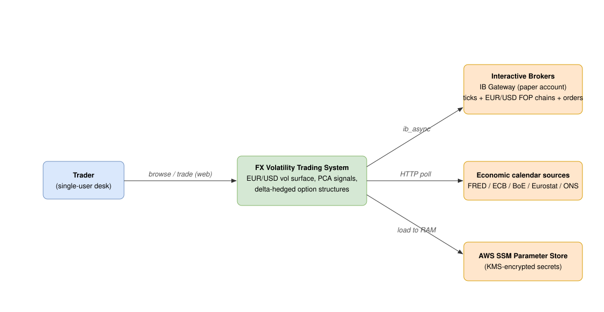

# Documentation

The **FX Volatility Trading System** is an end-to-end platform for trading EUR/USD
FX options. A live Interactive Brokers feed flows through six async Python engines
that fit the volatility surface (SVI / SSVI / GARCH / HAR-RV), detect the market
regime (GMM), and reduce the 30-dimensional surface to PCA signals; the desk then
submits delta-hedged option structures and books every fill into a versioned
Postgres audit trail. A React trading desk (voldesk) serves it all over REST + WebSockets.
The public deployment at
[valeriandarmente.dev/fx-volatility-trading-system](https://valeriandarmente.dev/fx-volatility-trading-system/)
is read-only; trading, config, and the `/dev` console sit behind an auth boundary.

These docs describe the system as it is built. Diagrams are **SVG** files under
[`diagrams/`](diagrams/), embedded inline in the relevant `.md`.

## How the diagrams are drawn

Prose walks one path and can silently skip an interaction; a diagram puts every
block and every edge on the page, so a missing arrow shows. Each mechanism is
drawn once, with the diagram type that answers its question, and the prose adds
order, causality and exceptions (#295):

| Question | Diagram | Example |
|---|---|---|
| what exists and what connects | C4 container / UML component | [`system-containers.svg`](diagrams/system-containers.svg) |
| in what order a request moves | UML sequence | [`hot-cold-pool-exhaustion.svg`](diagrams/hot-cold-pool-exhaustion.svg) |
| which states a thing can be in | UML state machine | [`oms-state-machine.svg`](diagrams/oms-state-machine.svg) |
| who holds a resource over time | Gantt / timeline | [`hot-cold-cpu-timeline.svg`](diagrams/hot-cold-cpu-timeline.svg) |
| who competes for one thing | queue / contention | [`hot-cold-pool.svg`](diagrams/hot-cold-pool.svg) |
| what a change alters | before / after pair | [`hot-cold-ui-bundle.svg`](diagrams/hot-cold-ui-bundle.svg) |
| how data is shaped | entity-relationship | [`database-er.svg`](diagrams/database-er.svg) |

Format: hand-authored SVG, 1100 px wide, Helvetica, white ground, one palette
(hot `#d9480f` / `#fbe3d6`, cold `#3b6ea8` / `#dbe6f4`, shared `#b7791f` /
`#fff3cd`, failure `#b02a37` / `#f8d7da`, ok `#146c43` / `#d1e7dd`). Each one is
embedded as ``: the alt text states the one claim the
picture makes. No Mermaid (PyCharm's preview does not render it), no HTML.
Every note outside `audits/` embeds at least one; the index at the end of this
page lists every diagram with the note that owns it.

## Architecture

| Doc | Covers |
|---|---|
| [architecture/overview.md](architecture/overview.md) | The platform in one page: what it trades, the 11-container core stack (6 ship our code) + optional obs stack, the live deployment. |
| [architecture/backend.md](architecture/backend.md) | The `src/` layout (`api` / `core` / `engines` / `persistence` / `bus` / `shared`) and the five import-linter contracts. |
| [architecture/data-flow.md](architecture/data-flow.md) | The live path: IB → engines → Redis pub/sub + cache → db-writer → Postgres; api reads DB + Redis; frontend via REST + WS. |
| [architecture/frontend.md](architecture/frontend.md) | The voldesk React app: 7 views, zustand stores, the typed OpenAPI client, WS hooks, the `/dev` console. |
| [architecture/database.md](architecture/database.md) | The Postgres schema: 31 ORM classes grouped by domain, Alembic flow, `VolConfig` versioning. |
| [architecture/websockets.md](architecture/websockets.md) | Every `/ws/*` stream: Redis channel, cadence, desk reader, one message example each (generated from the payload fixtures). |
| REST reference | `/api/openapi.json` (public; Swagger at `/api/docs` locally): every operation described, `traderCookie` on the gated ones, error codes per route. |
| [architecture/hot-cold-paths.md](architecture/hot-cold-paths.md) | Hot path (orders, fills, positions, account) vs cold path (surface, PCA, rollups): the six engines, the three collision points behind the November 2026 incidents, and the changes that separate them. |

## Planning

| Doc | Covers |
|---|---|
| [planning/iteration-plan.md](planning/iteration-plan.md) | The operational plan: 15 two-week iterations over the 71 open work tickets (audit campaign + hot / cold programme), ordering rules, dependency map, capacity model, review cadence. |

## Hot / cold path programme

| Doc | Covers |
|---|---|
| [hot-cold-path/README.md](hot-cold-path/README.md) | The programme: goal, principles, reading order. |
| [hot-cold-path/01-problems.md](hot-cold-path/01-problems.md) | Problem register P1 to P10: shared pool, all-or-nothing bundles, equal CPU priority, write side, polled hot state, per-request cold compute, freshness that never ages, no latency metric, chain load, duplicate analytics. |
| [hot-cold-path/02-tasks.md](hot-cold-path/02-tasks.md) | Task plan T1 to T10 with acceptance, dependencies and estimates; the dependency map. |

## Volatility modeling

| Doc | Covers |
|---|---|
| [vol-modeling/pca-signals.md](vol-modeling/pca-signals.md) | PCA on the surface snapshot → PC1/PC2/PC3 (level/slope/curvature) → z-scores → signals. |
| [vol-modeling/volatility-surface.md](vol-modeling/volatility-surface.md) | SVI / SSVI calibration, smile, term structure, delta/tenor pillars, PCHIP, surface-Z. |
| [vol-modeling/forecasting.md](vol-modeling/forecasting.md) | Realized-vol models: GARCH, HAR-RV, Yang-Zhang, VRP. |
| [vol-modeling/regime.md](vol-modeling/regime.md) | GMM regime detection and how the regime gates signals. |
| [vol-modeling/pricing.md](vol-modeling/pricing.md) | The one Black-Scholes kernel: inputs, boundary (intrinsic at expiry), the undiscounted-convention decision. |
| [vol-modeling/units.md](vol-modeling/units.md) | Units at every boundary: greeks (USD / per pip / per vol point), IV fraction vs percent, IB price points, P&L attribution terms. |
| [vol-modeling/notebooks/pca_signal_pipeline_explained.ipynb](vol-modeling/notebooks/pca_signal_pipeline_explained.ipynb) | Runnable walk-through of the PCA signal pipeline. |

## Strategy

| Doc | Covers |
|---|---|
| [strategy/structures.md](strategy/structures.md) | Straddle, strangle, risk reversal, butterfly, calendar — built by delta pillar + tenor. |
| [strategy/signals-to-trades.md](strategy/signals-to-trades.md) | Mapping PC signals to structures (level→straddle, slope→calendar, curvature→butterfly, skew→risk-reversal). |
| [strategy/risk.md](strategy/risk.md) | Greeks (Δ/Γ/V/Θ/vanna/volga), VaR, greek limits, P&L attribution, delta hedging. |

## Execution

| Doc | Covers |
|---|---|
| [execution/oms.md](execution/oms.md) | Order management: free-legs book, structure submit, reconciliation, reaper/projection/reservation. |
| [execution/order-lifecycle.md](execution/order-lifecycle.md) | Submit → IB → fills → booked position; states, idempotency, partial fills. |
| [execution/ib-integration.md](execution/ib-integration.md) | IB Gateway, ib_async, the four client IDs, single-session-per-userid, paper vs live. |
| [execution/position-figures.md](execution/position-figures.md) | Which table feeds Position breakdown vs P&L attribution by tenor / by trade; units per figure; the footing invariants. |

## Observability

| Doc | Covers |
|---|---|
| [observability/conventions.md](observability/conventions.md) | Metric naming + label-cardinality rules (Prometheus / OTel). |
| [observability/runbooks.md](observability/runbooks.md) | Loki / Prometheus / Tempo / Grafana operator playbooks. |

## Ops

| Doc | Covers |
|---|---|
| [ops/local-stack.md](ops/local-stack.md) | Run locally: docker compose, `scripts/local` launchers, profiles, Alembic. |
| [ops/deployment.md](ops/deployment.md) | Prod on AWS/EC2: push → GitHub Actions → OIDC → SSM → deploy, the deploy gate. |
| [ops/runbooks.md](ops/runbooks.md) | Incident procedures: orientation, reboot, rollback (schema-aware), restore, IB session recovery; each with its last walk. |
| [ops/secrets.md](ops/secrets.md) | The SSM inventory (every `/fxvol/prod/*` name, what reads it, what happens when absent), load-to-RAM, never-echo. |
| [ops/data-terms.md](ops/data-terms.md) | Each data source: how it is fetched, what is stored, the attribution shown, and the decisions on IB redistribution and FRED storage. |
| [ops/dependency-policy.md](ops/dependency-policy.md) | Lockfile, image pins, weekly scan, license gate, maintenance-risk register, triage log. |
| [ops/redis-durability.md](ops/redis-durability.md) | What Redis holds, its TTLs, the eviction policy, and what a restart costs. |
| [ops/alerting.md](ops/alerting.md) | Prometheus rules → Alertmanager → SNS, the host disk guard, the IB watchdog, one-time IAM / IMDS setup. |
| [ops/security.md](ops/security.md) | The auth boundary: public reads, the trader cookie, the api-only internal token, the public-route decisions. |

## Diagram index

Generated from the embeds in each note (one row per embed).

| Diagram | Note | Claim |
|---|---|---|
| [`alerting-paths.svg`](diagrams/alerting-paths.svg) | [ops/alerting.md](ops/alerting.md) | Prometheus rules reach the mailbox through Alertmanager, its inhibit rules and the instance role, while the host disk cron publishes to the same SNS topic without the obs profile |
| [`backend-modules.svg`](diagrams/backend-modules.svg) | [architecture/backend.md](architecture/backend.md) | Backend modules and the import-linter contract boundaries |
| [`cicd-pipeline.svg`](diagrams/cicd-pipeline.svg) | [ops/deployment.md](ops/deployment.md) | CI/CD pipeline — push to build to deploy to smoke |
| [`compose-topology.svg`](diagrams/compose-topology.svg) | [ops/local-stack.md](ops/local-stack.md) | Compose topology — services grouped by network |
| [`data-flow.svg`](diagrams/data-flow.svg) | [architecture/data-flow.md](architecture/data-flow.md) | One tick to signal to order round-trip across the stack |
| [`data-integrity-write-paths.svg`](diagrams/data-integrity-write-paths.svg) | [audits/05-data-integrity.md](audits/05-data-integrity.md) | A streamed row lands once on its natural key and a bad row is dead-lettered instead of sinking its batch, while open_position, account_history and open_position_history are written directly by their engines |
| [`data-sources-terms.svg`](diagrams/data-sources-terms.svg) | [ops/data-terms.md](ops/data-terms.md) | Every source is attributed; the two open decisions are the raw IB quotes on the public desk (D1) and FRED release dates stored in Postgres (D2) |
| [`database-er.svg`](diagrams/database-er.svg) | [architecture/database.md](architecture/database.md) | ER of the core trading tables |
| [`dependency-update-flow.svg`](diagrams/dependency-update-flow.svg) | [ops/dependency-policy.md](ops/dependency-policy.md) | Every version change enters as a pull request against a lockfile or a digest, and the weekly scan's findings feed the same loop or an ignore list with a revisit date |
| [`fair-vol-forecast-flow.svg`](diagrams/fair-vol-forecast-flow.svg) | [vol-modeling/forecasting.md](vol-modeling/forecasting.md) | Fair vol is Yang-Zhang RV plus the VRP; HAR and GARCH ride along as diagnostics |
| [`frontend-map.svg`](diagrams/frontend-map.svg) | [architecture/frontend.md](architecture/frontend.md) | Voldesk shell, the 7 views, stores, client, WS hooks, and the /dev console |
| [`hot-cold-cpu-timeline.svg`](diagrams/hot-cold-cpu-timeline.svg) | [architecture/hot-cold-paths.md](architecture/hot-cold-paths.md) | One minute on the 2-core host during a PCA cycle |
| [`hot-cold-cpu-timeline.svg`](diagrams/hot-cold-cpu-timeline.svg) | [hot-cold-path/01-problems.md](hot-cold-path/01-problems.md) | One minute on the 2-core host during a PCA cycle |
| [`hot-cold-pg-writes.svg`](diagrams/hot-cold-pg-writes.svg) | [architecture/hot-cold-paths.md](architecture/hot-cold-paths.md) | The write side of Postgres shared with the hot reads |
| [`hot-cold-pg-writes.svg`](diagrams/hot-cold-pg-writes.svg) | [hot-cold-path/01-problems.md](hot-cold-path/01-problems.md) | The write side: five writers and their maintenance against the hot reads |
| [`hot-cold-pool-exhaustion.svg`](diagrams/hot-cold-pool-exhaustion.svg) | [architecture/hot-cold-paths.md](architecture/hot-cold-paths.md) | 4 November 2026: polled cold scans fill the pool, the hot account read gets a 500 |
| [`hot-cold-pool-exhaustion.svg`](diagrams/hot-cold-pool-exhaustion.svg) | [hot-cold-path/01-problems.md](hot-cold-path/01-problems.md) | 4 November: the pool exhaustion as a sequence |
| [`hot-cold-pool.svg`](diagrams/hot-cold-pool.svg) | [architecture/hot-cold-paths.md](architecture/hot-cold-paths.md) | The api connection pool: 200 ms reads queue behind 20 s scans |
| [`hot-cold-pool.svg`](diagrams/hot-cold-pool.svg) | [hot-cold-path/01-problems.md](hot-cold-path/01-problems.md) | The api connection pool: hot and cold queries queue for the same 15 slots |
| [`hot-cold-target-lanes.svg`](diagrams/hot-cold-target-lanes.svg) | [architecture/hot-cold-paths.md](architecture/hot-cold-paths.md) | Target: the same engines in two lanes, with the new edges marked |
| [`hot-cold-target-lanes.svg`](diagrams/hot-cold-target-lanes.svg) | [hot-cold-path/01-problems.md](hot-cold-path/01-problems.md) | Target: hot lane pushed end to end, with the two missing edges marked |
| [`hot-cold-task-map.svg`](diagrams/hot-cold-task-map.svg) | [hot-cold-path/02-tasks.md](hot-cold-path/02-tasks.md) | Task dependency map: T1, T2, T4, T5 start now; T3 and T6 follow T2; T7 follows T1 and the config hot-reload fix; T8 follows T7; T9 follows T4; T10 waits for T6's numbers |
| [`hot-cold-topology.svg`](diagrams/hot-cold-topology.svg) | [architecture/hot-cold-paths.md](architecture/hot-cold-paths.md) | Six engines, two paths: where each one writes and how the UI reads |
| [`hot-cold-topology.svg`](diagrams/hot-cold-topology.svg) | [hot-cold-path/README.md](hot-cold-path/README.md) | Six engines on two paths: the hot producers and the cold producers write to the same Redis and the same Postgres, and the UI reads both through one api |
| [`hot-cold-ui-bundle.svg`](diagrams/hot-cold-ui-bundle.svg) | [architecture/hot-cold-paths.md](architecture/hot-cold-paths.md) | The portfolio bundle before and after PR 289 |
| [`hot-cold-ui-bundle.svg`](diagrams/hot-cold-ui-bundle.svg) | [hot-cold-path/01-problems.md](hot-cold-path/01-problems.md) | The portfolio bundle before and after PR 289 |
| [`ib-session-reconnect.svg`](diagrams/ib-session-reconnect.svg) | [execution/ib-integration.md](execution/ib-integration.md) | The execution engine loses IB at the nightly restart, the watchdog reconnects, and a pass reopens the gate |
| [`iteration-timeline.svg`](diagrams/iteration-timeline.svg) | [planning/iteration-plan.md](planning/iteration-plan.md) | All 16 iterations shipped between 6 and 10 November 2026, against a plan of two weeks each |
| [`obs-cycle-correlation.svg`](diagrams/obs-cycle-correlation.svg) | [observability/runbooks.md](observability/runbooks.md) | A cycle's log lines and its trace are joined in Grafana by trace_id one way and cycle_id + engine the other |
| [`obs-hardware-tab-source.svg`](diagrams/obs-hardware-tab-source.svg) | [observability/runbooks.md](observability/runbooks.md) | The Hardware tab reads cAdvisor through Prometheus and falls back to the Docker socket only where the dev override mounts it |
| [`obs-profile-components.svg`](diagrams/obs-profile-components.svg) | [observability/conventions.md](observability/conventions.md) | Logs go through alloy to Loki, traces through otel-collector to Tempo, metrics are scraped by Prometheus, and only Prometheus alerts leave the host, through Alertmanager and SNS |
| [`oms-loops.svg`](diagrams/oms-loops.svg) | [execution/oms.md](execution/oms.md) | Five execution-engine loops repair the book from two truths: recorded fills and the IB mirror |
| [`oms-state-machine.svg`](diagrams/oms-state-machine.svg) | [execution/oms.md](execution/oms.md) | Every order leaves the working states for exactly one terminal state, and terminal rows never move |
| [`oms-state-machine.svg`](diagrams/oms-state-machine.svg) | [execution/order-lifecycle.md](execution/order-lifecycle.md) | Every order leaves the working states for exactly one terminal state, and terminal rows never move. |
| [`ops-ib-recovery.svg`](diagrams/ops-ib-recovery.svg) | [ops/runbooks.md](ops/runbooks.md) | The failure signature picks the fix; only a dead Gateway app or a lost upstream session is cured by the restart sequence |
| [`ops-rollback-flow.svg`](diagrams/ops-rollback-flow.svg) | [ops/runbooks.md](ops/runbooks.md) | A rollback past a migration stops unless the downgrade is explicitly allowed, and the downgrade only runs after the pre-deploy dump |
| [`order-fill-sequence.svg`](diagrams/order-fill-sequence.svg) | [execution/ib-integration.md](execution/ib-integration.md) | A live structure: each leg is committed as it is placed, its fills arrive later as IB events |
| [`position-figures-sources.svg`](diagrams/position-figures-sources.svg) | [execution/position-figures.md](execution/position-figures.md) | The three position panels read the same IB mirror, so their per-leg figures foot |
| [`position-limits-killswitch-states.svg`](diagrams/position-limits-killswitch-states.svg) | [strategy/risk.md](strategy/risk.md) | A booked position has no limit state: exit rules close it, and a kill switch set mid-close leaves it in closing |
| [`pricing-pipeline.svg`](diagrams/pricing-pipeline.svg) | [vol-modeling/pricing.md](vol-modeling/pricing.md) | One kernel, two scalings: a leg is priced and its greeks scaled from the same surface cell |
| [`redis-restart-loss.svg`](diagrams/redis-restart-loss.svg) | [ops/redis-durability.md](ops/redis-durability.md) | A Redis restart costs cache freshness and the pub/sub frames published while db-writer is down; the trading record in Postgres loses nothing |
| [`regime-state-machine.svg`](diagrams/regime-state-machine.svg) | [vol-modeling/regime.md](vol-modeling/regime.md) | The regime label is recomputed from scratch every cycle; only the gate remembers three cycles |
| [`secrets-flow.svg`](diagrams/secrets-flow.svg) | [ops/secrets.md](ops/secrets.md) | Secrets reach a container's RAM from Parameter Store over the host's instance role or the laptop's MFA profile; the GitHub deploy role only carries non-secret config |
| [`security-order-path-gates.svg`](diagrams/security-order-path-gates.svg) | [audits/01-security.md](audits/01-security.md) | Three gates stand between the internet and an IB order: nginx, the trader cookie on every write, the internal token on the execution engine |
| [`security-trust-boundaries.svg`](diagrams/security-trust-boundaries.svg) | [ops/security.md](ops/security.md) | Only nginx faces the internet; the api gates writes on the trader cookie, the execution engine on a shared token, the Docker socket sits behind a read-only proxy, and Grafana and the IB Gateway are loopback-only |
| [`signal-pipeline.svg`](diagrams/signal-pipeline.svg) | [vol-modeling/pca-signals.md](vol-modeling/pca-signals.md) | PCA signal pipeline: surface to PCA to z-score to regime gate to signals |
| [`signal-to-submit-sequence.svg`](diagrams/signal-to-submit-sequence.svg) | [strategy/signals-to-trades.md](strategy/signals-to-trades.md) | The preview arms on five pre-submit checks; the submit takes a lock, revalidates, and passes the pre-trade gate before any order exists |
| [`structures-payoffs.svg`](diagrams/structures-payoffs.svg) | [strategy/structures.md](strategy/structures.md) | Vol structures and the net greek each expresses |
| [`system-containers.svg`](diagrams/system-containers.svg) | [architecture/overview.md](architecture/overview.md) | System containers: api, 6 engines, redis, postgres, nginx, frontend, ib-gateway, obs |
| [`system-containers.svg`](diagrams/system-containers.svg) | [pictures/README.md](pictures/README.md) | The current container topology: nginx in front of the frontend and the api, six engines on Redis and Postgres, one IB Gateway, the obs profile alongside |
| [`system-context.svg`](diagrams/system-context.svg) | [architecture/overview.md](architecture/overview.md) | System context: trader, the desk, IB, event sources, SSM |
| [`test-coverage-map.svg`](diagrams/test-coverage-map.svg) | [audits/07-test-coverage.md](audits/07-test-coverage.md) | Pure code carries a 95 % coverage floor while the four engines that talk to IB sit between 22 and 59 %, and only seven layers are reached by a live Postgres, Redis, IB or browser test |
| [`units-map.svg`](diagrams/units-map.svg) | [vol-modeling/units.md](vol-modeling/units.md) | Which unit at which layer: points at IB, fractions on the surface, dollars in the desk |
| [`vol-surface.svg`](diagrams/vol-surface.svg) | [vol-modeling/volatility-surface.md](vol-modeling/volatility-surface.md) | Vol surface build: chain to SVI/PCHIP to SSVI to display pillars to surface-Z and fair smile |
| [`ws-redis-bridge.svg`](diagrams/ws-redis-bridge.svg) | [architecture/websockets.md](architecture/websockets.md) | One bridge task in the api subscribes to every forwarded Redis channel, and the connection manager sends each message only to the sockets of its channel |
