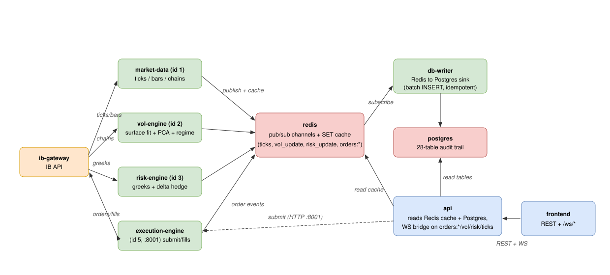

# Data flow

Data moves in one direction at runtime: **Interactive Brokers → engines → Redis →
db-writer → Postgres**, with the API reading from both Redis (live cache) and
Postgres (history) and pushing to the frontend over REST + WebSockets. No engine
calls the API; the API forwards order actions to the execution-engine over HTTP.

## The four IB client IDs

Each engine that touches IB Gateway opens its own `ib_insync` session with a distinct
client ID (a single userid allows one session per client ID):

| Engine | clientID | Consumes from IB | Produces |
|---|---|---|---|
| `market-data` | 1 | ticks, bars | spot/bid/ask + bars → Redis |
| `vol-engine` | 2 | EUR/USD FOP option chains | fitted surface, PCA signals, regime → Redis + Postgres |
| `risk-engine` | 3 | positions, greeks | portfolio greeks + P&L → Redis + Postgres |
| `execution-engine` | 5 | order acks, fills | order/fill/position rows → Postgres, events → Redis |

(clientID 4 is reserved for a legacy path.)

## Redis: pub/sub + last-value cache

`bus/channels.py` and `bus/keys.py` define the contract. Engines both **publish** an
event on a channel and **`SET`** the latest value under a TTL'd key, so a subscriber
that missed a message can still read current state.

| Channel (`channels.py`) | Publisher | Cadence |
|---|---|---|
| `ticks` | market-data | ~200 ms throttle |
| `account` | execution-engine (`account_snapshot`: the `latest` of `/portfolio/account`) | each account snap (~1 s loop) |
| `vol_update` | vol-engine | end of each scan (~3 min) |
| `risk_update` | risk-engine | end of each cycle (~60 s) |
| `orders:<structure_id>` | execution-engine | per order event |
| `positions` | execution-engine (`positions_changed`: rows upserted / closed by a sync, shape of `/positions/open`); position monitor (MTM snapshot, `position_id`) | on change; per cycle |
| `spot_orders` | execution-engine (`spot_order_changed`: shape of `/trade/spot-orders`) | per spot order change |
| `exit_alerts` | position monitor | per cycle |
| `config:changed` | admin endpoint | on config PUT/revert; engines apply by version through `bus.config_watch.ConfigWatcher` (DB latest at start, re-read on resubscribe and every 5 min, older versions ignored; #329) |

Execution-engine messages carry `event` and `source`; a subscriber keys on
`event`. The serialisers live in `persistence/rows.py` and are the same
functions the REST readers use, so a WebSocket patch and the poll it
reconciles against never disagree on keys (`tests/fixtures/channels/`).
WebSocket routes: `/ws/positions`, `/ws/account`, `/ws/spot_orders`,
`/ws/orders/{structure_id}` (#366, #367).

### Field-level contract (#327)

Every name comes from `bus/keys.py` / `bus/channels.py`; a unit test
(`tests/unit/bus/test_no_literal_names.py`) fails the build on a literal key
or channel string anywhere else in `src/`. Payload fixtures:
`tests/fixtures/payloads/<channel>.json` (#338) and
`tests/fixtures/channels/*.json` for the execution-engine events (#366).

| Key / channel | Writer | Value | TTL |
|---|---|---|---|
| `latest_spot:{symbol}`, `latest_bid:…`, `latest_ask:…` | market-data, every tick | `{"value": float, "ts": iso}` (readers also accept the older bare float; `bus.spot_cache.parse_spot`) | 30 s |
| `latest_vol_surface:{symbol}` | vol-engine, per cycle | `{"symbol", "timestamp", "spot", "surface": {tenor: {label: {iv, strike}}, "_fair_q", "_har", …}}` | 600 s |
| `latest_signals:{symbol}` | vol-engine | `{"symbol", "timestamp", "signals": […]}` | 600 s |
| `latest_greeks:portfolio` | risk-engine, per cycle | aggregate greeks (`units` field says the scale, `docs/vol-modeling/units.md`) | 30 s |
| `account_snapshot` | execution, per account snap | the `account` channel message (`latest` = `/portfolio/account.latest`) | 60 s |
| `contract_marks:{symbol}`, `option_marks:…`, `unrealized_pnl:…` (hashes) | execution, per position sync | field = open position id, value = mark / premium / P&L; fields pruned to the open set each sync | 600 s |
| `market_status:{symbol}` | market-data, with each heartbeat | `{"open": bool, "ts": iso}` from `shared.market_hours` | 300 s |
| `heartbeat:{engine}` | every engine | bare ISO stamp; the compose healthchecks compute `now - ts` | 300 s |
| `cycle_progress:vol_engine` (hash) | vol-engine | `stage`, `task`, `completed`, `cycle_started_at` | 600 s |
| `analytics:regime_model:{symbol}`, `analytics:pc3_history:…` | analytics-engine | serialised GMM / PC3 arrays | 2 h |
| `bars:{symbol}:{tf}` | market-data | JSON list of `{t, o, h, l, c}` | 6 h |
| `trading:halted` | api (kill switch) | mirror of the DB flag | none |
| `db_events` (channel) | vol / analytics engines | `{"table", "payload"}`, natural keys per `persistence.writer.IDEMPOTENT_TABLES` | pub/sub |

## db-writer: the Redis → Postgres sink

`db-writer` subscribes to the streamed payloads and batches them into Postgres via
`persistence.writer.AsyncDatabaseWriter` (batch INSERT + retry + idempotency). The
vol, risk, and execution engines additionally write their own domain tables directly.

## API: reads cache + DB, bridges WS

The FastAPI app reads live state from the Redis cache and history from Postgres. Its
`ws/redis_bridge` subscribes to Redis (including the `orders:*` pattern) and forwards
to the `ConnectionManager`, exposing `/ws/ticks`, `/ws/vol`, and `/ws/risk`. Order
submission is *not* done in-process: the API forwards to `EXECUTION_URL`
(`http://execution-engine:8001`).

## Frontend

The React desk consumes REST (typed against the OpenAPI schema) plus the three
WebSocket streams. In voldesk the vol/risk WS beats are used only as
REST-invalidation triggers — each open tab re-fetches its snapshot family at a
bounded cadence rather than rendering raw WS payloads (see
[frontend.md](frontend.md)). There is no mock fallback; empty backend state renders
zeros plus a freshness badge.

## Related

- [backend.md](backend.md) — the packages behind each box.
- [database.md](database.md) — where the sinked payloads land.
- [frontend.md](frontend.md) — the consuming views and hooks.
- [hot-cold-paths.md](hot-cold-paths.md) — which of these edges must stay fast, where the slow ones collide with them, and the fixes.
