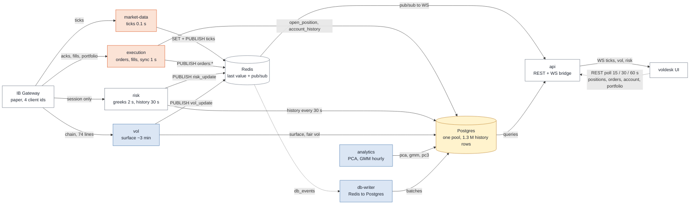
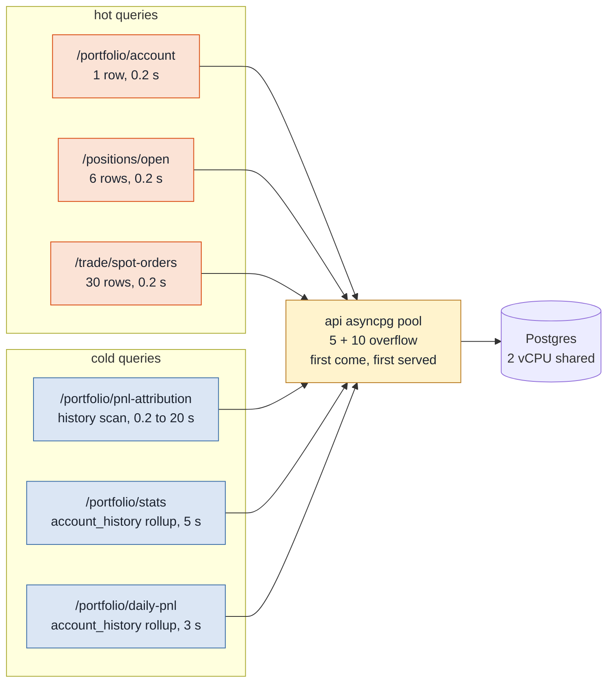
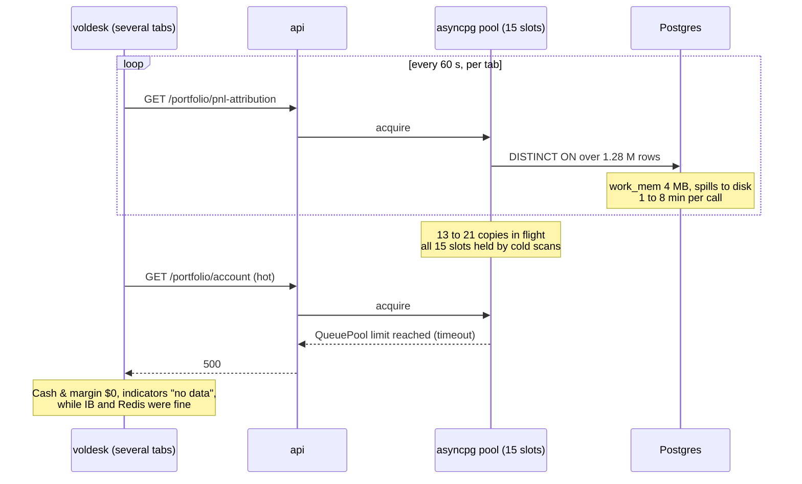
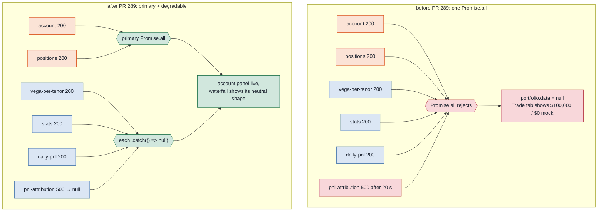
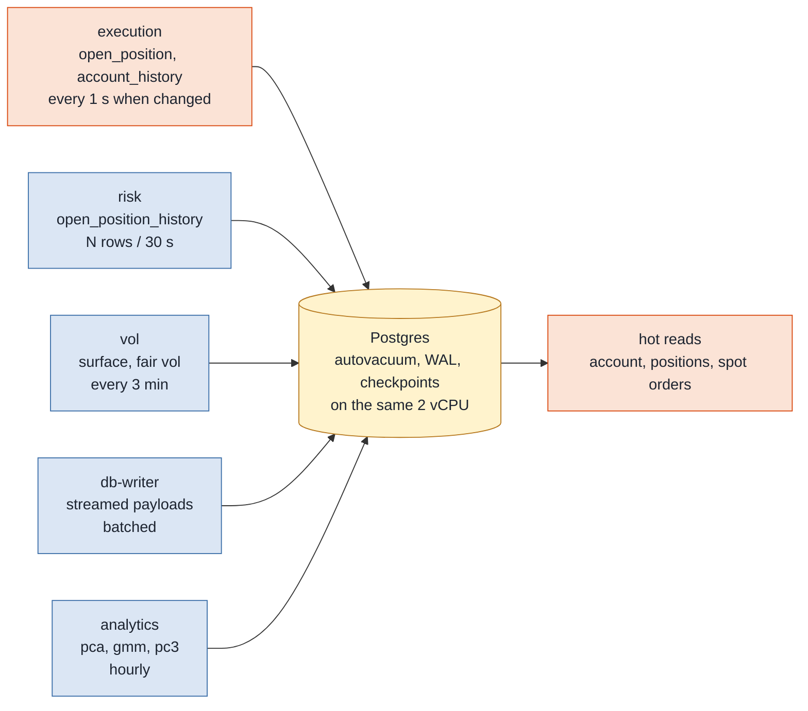
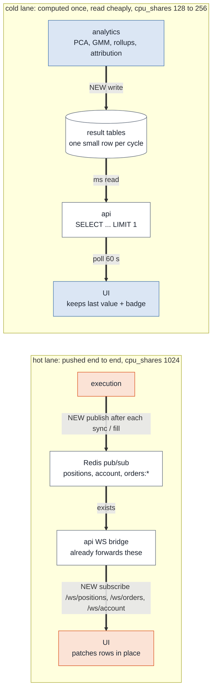

# Hot path, cold path

The desk must feel instant where money moves (orders, fills, positions,
account) and may be slow where it thinks (vol surface, PCA, regime, rollups).
The six engines are already separate processes. What is missing is the rule
that keeps the slow work from standing in the fast work's way.

This note names the two paths, shows the three places where they collide
today (each one produced an incident in the first week of November 2026), and
lists the changes that separate them, in shipping order.

Companion notes: [data-flow.md](data-flow.md) (the live path end to end),
[backend.md](backend.md) (packages and import contracts),
[database.md](database.md) (schema).

## 1. The six engines and the path each one serves

| Engine | IB client | Cadence | Produces | Path |
|---|---|---|---|---|
| `market-data` | 1 | 0.1 s poll | EUR/USD bid/ask to Redis (`latest_spot`, channel `ticks`) | hot |
| `execution` | 5 | event-driven + 1 s position sync | orders to IB, fills, `open_position` rows, account snapshots, `orders:*` events | hot |
| `risk` | 3 | 2 s / 30 s | book greeks + P&L curve to Redis every 2 s; `open_position_history` rows every 30 s | hot read, cold write |
| `vol` | 2 | ~3 min | option chain (74 live lines), SVI/SSVI surface, fair vol, to Redis + Postgres | cold |
| `analytics` | none | 60 min | PCA snapshot, GMM regime refit, PC3 history, to Postgres | cold |
| `db-writer` | none | batched | streamed Redis payloads (`db_events`) into Postgres | cold |

**Hot** means an operator is waiting on the output within seconds. **Cold**
means the output is valuable but a minute late is fine.

Orange producers and blue producers write to the same Redis and the same
Postgres. The UI receives ticks, vol and risk by push and polls everything
else over REST. Positions, orders and account, the things an operator waits
on, sit on the dashed polling edge.

## 2. Where the two paths collide today

Separation by process is not separation by priority. The two paths still
share three resources with no rule about who yields. Each of the three
produced an incident between 2 and 5 November 2026, which is how we know these
are the three that matter.

### 2.1 The Postgres connection pool

The api holds one asyncpg pool: 5 connections plus 10 overflow. Every REST
endpoint takes a connection from it, whether it reads six `open_position`
rows or scans 1.3 million `open_position_history` rows.

The pool is first come, first served. A cold query that holds a connection for
20 seconds holds it against an account read that needs it for 200 milliseconds.

**4 November, pool exhaustion.** The attribution endpoint ran a `DISTINCT ON`
over the whole history table with no position filter. One call took one to
eight minutes. The Portfolio tab polls it every 60 seconds, so copies piled
up.

Fixed in PR #285: per-position `LATERAL` probe, index on
`account_history.timestamp`, and a 20 s `statement_timeout` on the api pool so
a slow query fails alone instead of holding a slot for minutes.

**5 November, the same endpoint, a second shape.** The forward-price lookup
for the attribution walked the history index backwards looking for a 6E
future that was not in the book. With no match, `LIMIT 1` never stopped the
walk; the query hit the new 20 s timeout and returned 500. That is the
timeout doing its job. The damage came from the next collision point.

### 2.2 The UI refresh loop

The frontend fetches each domain as one bundle. Until PR #289 the portfolio
bundle was a single `Promise.all` over six endpoints: one rejection rejected
the bundle, and the Trade tab fell back to the trade slice's account, which
is the trade-book bootstrap mock.

The lesson generalises: a hot panel must never depend on a cold request
succeeding, and a panel must never substitute a mock for a value it cannot
fetch. Keep the last good value and show the freshness badge.

### 2.3 Host CPU

Two cores, thirteen containers (twenty with observability), and the Linux
scheduler gives every container the same weight. The only hard cap is
`cpus: 0.5` on the analytics engine.

```mermaid
gantt
    title One minute on the host during a PCA cycle (illustrative)
    dateFormat ss
    axisFormat %S s
    section cold
    analytics PCA + GMM fit, 2 threads      :crit, a1, 00, 25s
    vol chain scan, 74 lines                :a2, 30, 20s
    section hot
    execution order submit + ack            :active, h1, 05, 2s
    execution position sync (every 1 s)     :h2, 00, 60s
    market-data ticks (every 0.1 s)         :h3, 00, 60s
    api GET /portfolio/account              :h4, 06, 1s
```

While the fit holds both cores, the order submit at second 5 and the account
read at second 6 wait their turn in the run queue. Nothing is broken, but the
operator feels a stutter exactly when they are watching. The same applies to
the IB Gateway's Java process, which is busiest during the vol engine's
three-minute chain scan.

Measured on 5 November with averaged `docker stats`: at rest the whole stack
uses about a quarter of one core. The problem is not the average, it is the
burst, and the burst lands on whoever is running at that moment.

### 2.4 One more shared thing: the write side of Postgres

Not an incident yet, but the same shape. The risk engine writes one
`open_position_history` row per open position every 30 seconds, the vol engine
writes a surface every 3 minutes, db-writer streams payloads in batches, and
the execution engine writes positions and account snapshots. All of it lands
in one database on the same two cores that serve the hot reads.

The 90-day retention delete in the risk engine and the autovacuum that follows
it are the kind of background work that can make Postgres busy for minutes
with no query of ours visible in `pg_stat_activity`.

## 3. The target: same engines, four rules

None of this adds a service or rewrites an algorithm. Each change installs a
priority rule at one of the collision points, plus one measurement so we know
the rules hold.

Why the push is cheap to finish: the api already serves `/ws/positions` and
`/ws/orders/{structure_id}`, the Redis bridge already forwards the
`positions`, `account` and `orders:*` channels, and the bus has
`publish_position_update` and `publish_account`. Nobody calls them: the
execution engine writes positions to Postgres and the UI reads them back on a
15 s timer. Two edges close the loop.

## 4. The changes, in shipping order

| # | Change | Where | Effort | Collision point |
|---|---|---|---|---|
| 1 | `cpu_shares` per container: execution, api, market-data 1024; risk 512; vol, db-writer 256; analytics, obs 128 | `docker-compose.yml` | 1 h, deploy-time | 2.3 |
| 2 | Push the hot path: execution publishes position and account deltas; UI subscribes to `/ws/positions`, `/ws/orders/{id}`, new `/ws/account`; REST poll becomes a 60 s reconciliation | execution, api/ws, frontend provider | 2 PRs | 2.2, 2.1 |
| 3 | Materialise cold results: analytics computes attribution and daily rollups once per cycle into result tables; api endpoints become single-row reads (closes #286) | analytics, migration, api | 2 PRs | 2.1, 2.4 |
| 4 | Never blank a panel: last good value + freshness badge, no mock fallback, on the trade and risk bundles too | frontend provider | 1 PR | 2.2 |
| 5 | Measure: `order_submit_latency_seconds` and `fill_to_screen_seconds` histograms, one Grafana panel with a 2 s target | execution, frontend beacon, grafana | 1 PR | all |
| 6 | Only then, hardware: split hosts (trading core / analytics + obs) rather than grow one | infra | later | decided by 5 |

Shares only bite under contention: an idle box still gives analytics both
cores. Step 1 is the manual brake, applied by the kernel.

## 5. Where a runtime capacity dial fits

A Settings dial for the analytics engine (cadence, training window, thread
count, hot-reloaded over `config:changed` like `VolConfig`) is a good operator
tool once steps 1 to 3 are in: it then changes how long a chart takes to
refresh and nothing else. Without the structural rules, the dial would be the
only thing between a PCA fit and a slow order ticket, which is too much to ask
of a slider.

## Related

- [data-flow.md](data-flow.md): the live path end to end.
- [../observability/](../observability/): the obs profile (re-enabled with memory caps on 5 November 2026).
- Issues: #284 / #285 (pool exhaustion), #288 / #289 (attribution timeout, portfolio bundle), #286 (daily rollups), #290 / #291 / #292 (spot orders), #293 / #294 (obs caps).
