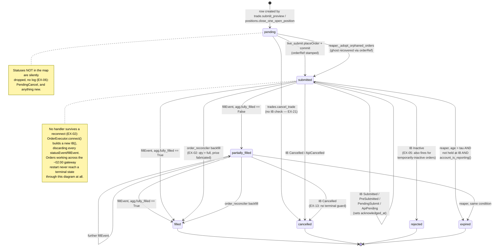
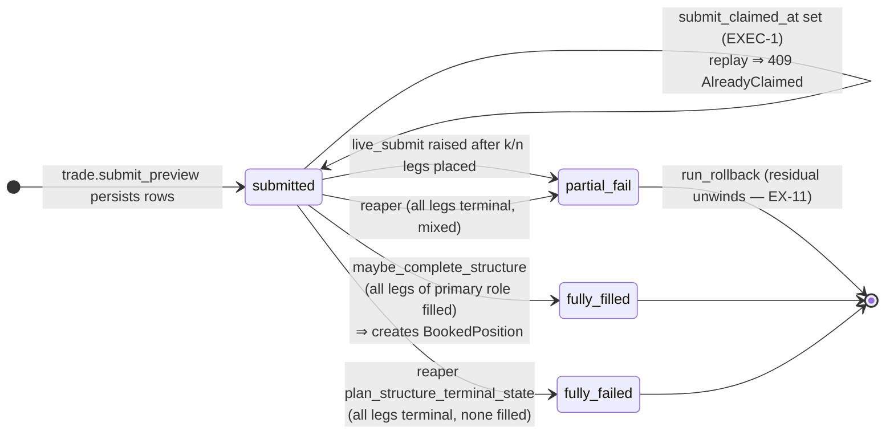

# Audit 4 — Execution Safety — Findings

**Date:** 2026-08-01
**Scope:** `src/engines/execution/*`, `src/shared/ib_connection.py`, the
`/orders` · `/trade` · `/trades` · `/cockpit` · `/positions` API seam, and the
order/fill persistence paths.
**Method:** static state-machine reconstruction from source, cross-read against
the installed `ib_insync==0.9.86` wrapper to establish real IB event semantics.
**No source, config or git state was modified. No live/paper action was taken.**
Everything requiring the running stack is in the checklist at the end.

---

## Executive summary

The OMS core is in better shape than its age suggests. The pure invariant layer
(`core/execution/`) is well factored and tested, `live_submit` has a genuine
durable idempotency claim (EXEC-1) plus an `orderRef` adoption sweep (EXEC-2),
the reaper/reconciler pair closes the liveness edge, and every destructive
reconciliation action is gated behind `account_is_reporting()` so a dead IB feed
can never be mistaken for a flat account. That guard is the single best piece of
defensive engineering in this subsystem.

The problems are concentrated in three places.

**1. The idempotency work stopped at `structure/submit`.** `live_submit` is
protected; the *close* path, the manual `/orders` path, the rollback unwinds and
the hedge submit are not. The worst instance is a Blocker: `close_one_open_position`
gives the execution-engine a **10 s HTTP budget** for a handler that qualifies the
contract, snapshots quotes (up to 3 s), places the order and *then* runs a full
`sync_positions_from_ib` before replying. On timeout the API stamps the closing
order `rejected` — a state the close-stacking guard does not count — so the
operator's retry places a second live close of the same lots. That is the classic
"lost ACK but the order was placed" failure, wired end-to-end.

**2. Nothing survives an IB reconnect.** `OrderExecutor.connect()` constructs a
**new `IB()` instance** on every reconnect, so every `Trade` object and every
`statusEvent`/`fillEvent` handler attached to it is discarded. Nothing re-attaches
handlers to the orders IB replays, and ib_insync deliberately does *not* emit
`fillEvent` for executions returned by the connect-time `reqExecutions()` replay
(`isLive = reqId not in self._futures`). So any order working across the ~02:00
Paris gateway restart, or across an engine redeploy, loses its terminal
transition. The only catch-up is the coarse reconciler, which books the *whole*
order qty at `market_price` or `preview_price` — a fabricated fill price.

**3. The safety rails the audit asks about mostly do not exist.** There is no
kill switch (zero grep hits, anywhere, in any language). There is no price collar
and no notional cap on the structure path — the limit is IB's raw touch, taken
under `reqMarketDataType(4)` (delayed-frozen, i.e. possibly last-close), snapped
to the tick and sent, with no sanity band against the theoretical premium. The
paper-vs-live guard is incidental (a socat port number), never asserted. And the
risk gate fails **open**: of the five `run_pre_submit_checks` gates, two are
hardcoded to pass, two were deleted, and the one real gate reads a
`book_state_snapshot` row with no freshness check — an absent or stale row
becomes an all-zeros book and the vega limit passes trivially. None of it is
re-checked at submit.

Wave 1's cross-audit theme repeats here exactly. `engines/execution/structures.py`
— the module `cockpit.py` executes at request time (A6-01) — is the third BS copy
(A6-02), and inside execution it disagrees with `core/pricing/bs.py` on the
QM-01 boundary in the *opposite* direction: `structures.bs_price` correctly returns
intrinsic at `T<=0` while `core.pricing.bs` returns 0.0. Same expiring leg, ~$25 000
in cockpit, $0 in the position monitor. Its greeks additionally carry no contract
multiplier, putting them 125 000× off the rest of the system's USD scale.

**Totals: 1 Blocker · 11 High · 13 Medium · 4 Low.**

Exit criteria for this audit are **not met** (`zero Blocker/High`).

---

## Findings table

| ID | Sev | Location | One-liner |
|---|---|---|---|
| EX-01 | **Blocker** | `api/routers/positions.py:1246-1258` + `engines/execution/main.py:439-476` | 10 s client timeout on a close handler that also runs a full position sync; timeout ⇒ order stamped `rejected` (uncounted by the stacking guard) ⇒ retry places a second live close |
| EX-02 | High | `engines/execution/order_executor.py:104` + `fills_handler.py:74-84` | Reconnect builds a new `IB()`; all fill/status handlers are lost and never re-attached, and connect-time `reqExecutions` replay does not emit `fillEvent` |
| EX-03 | High | `engines/execution/fills_handler.py:168` | Commission is read at `fillEvent` time, where ib_insync always supplies an **empty** `CommissionReport`; `commissionReportEvent` is unsubscribed ⇒ commission is permanently 0.0 and currency is dropped |
| EX-04 | High | `engines/execution/main.py` (absent) | No `ib.errorEvent` handler anywhere ⇒ IB 1100/1101/1102 invisible; `rejection_text` stores the status string, never IB's reject reason from `trade.log` |
| EX-05 | High | `engines/execution/fills_handler.py:61` | `Inactive` mapped to terminal `rejected`, but IB also uses it for orders that are temporarily not working and can re-activate and fill |
| EX-06 | High | `engines/execution/fills_handler.py:53-67,94-96` | Unknown IB statuses silently dropped, not logged; `PendingCancel` absent from the map entirely |
| EX-07 | High | `engines/execution/main.py:114-190` | No startup-reconciliation gate — `/internal/*` serves as soon as `connect()` returns; reconcile/reaper/sync are fire-and-forget tasks |
| EX-08 | High | `core/trade_preview.py:885-905` + `api/routers/trade.py:130-146` + `core/execution/revalidation.py:85-89` | Risk gating fails open: 2 checks hardcoded to pass, 2 deleted, the one real gate reads an unvalidated/absent book snapshot, and none are re-checked at submit |
| EX-09 | High | repo-wide (absent) | No kill switch: nothing halts submission or cancels working orders; zero references in code, compose, frontend or docs |
| EX-10 | High | `engines/execution/live_submit.py:114-178` | No price collar and no notional cap — the limit is IB's raw touch under delayed/frozen market data, with no sanity band vs the theoretical premium |
| EX-11 | High | `engines/execution/rollback_runner.py:161-241` | Rollback unwinds are placed in a loop that commits only at the end and stamps no `orderRef` — a mid-loop failure loses every unwind row while the orders are live at IB |
| EX-12 | High | `api/routers/trade.py:181-197,788-789` + `persistence/models.py:602` | `/trade/submit` cross-request dedup is a fail-open Redis lock plus a non-atomic read-modify-write; no idempotency key, no unique constraint on `trade_structure.preview_id` |
| EX-13 | Medium | `engines/execution/fills_handler.py:119-130` | Per-leg status handler overwrites `state` with no terminal guard, unlike the combo handler which does guard |
| EX-14 | Medium | `api/routers/positions.py:1106-1133` | Close-stacking guard is a check-then-act with no row lock, and self-heals after 3 min so a resting close stops blocking a full-size retry |
| EX-15 | Medium | `engines/execution/hedge_executor.py:62-126` | Hedge submit has no atomic claim, no `orderRef`, leaks its `reqMktData` line, and only finalises on `Filled` |
| EX-16 | Medium | `engines/execution/fills_handler.py:328-371` | Combo path writes synthetic `StructureFill` rows priced at `preview_price` into the fill journal that P&L folds from |
| EX-17 | Medium | `engines/execution/ib_heartbeat.py:70-79` + `docker-compose.yml:398,489` | Paper-vs-live guard is incidental (socat port number); `account_type` is derived and stored but never asserted before placing |
| EX-18 | Medium | `engines/execution/structures.py:83-110` | Cockpit's request-time greeks: zeros outside 1M–6M, zeros at `T<=0`, and no contract multiplier (125 000× off the system's USD scale) |
| EX-19 | Medium | `engines/execution/structures.py:73-74` vs `core/pricing/bs.py:13-57` | Inside execution, the third BS copy disagrees with `core` on the QM-01 boundary — intrinsic here, 0.0 there |
| EX-20 | Medium | `docker-compose.yml:405` + ib_insync `ib.py:1762-1764` | `IB_READ_ONLY=yes` makes ib_insync skip `reqOpenOrders`, so `ib.trades()` is empty and the reaper expires orders that are still working at IB |
| EX-21 | Medium | `api/routers/trades.py:219-232` | `cancel_trade` treats a 404 as "already gone" and stamps `cancelled` — 404 also means "just filled"; `cancelled` is not a reconcilable state |
| EX-22 | Medium | `engines/execution/main.py:227-234` + `docker-compose.yml:434-439` | `/health` returns OK with `ib_connected: false`, so a permanently disconnected engine stays "healthy" |
| EX-23 | Medium | `api/routers/orders.py:27,51-53` | Manual order proxy: 10 s timeout, no idempotency key, no `orderRef` stamped by `OrderExecutor.place_order` |
| EX-24 | Medium | `engines/execution/order_executor.py:352-367` | `POST /internal/positions/{con_id}/close` closes the **entire** netted position with no qty parameter |
| EX-25 | Low | `engines/execution/order_executor.py:1-9`, `position_sync.py:12` | Doc drift in a safety-critical module: docstrings say clientId 4 and a 30 s sync loop; reality is 5 and 5 s |
| EX-26 | Low | `shared/ib_connection.py:72-85` | The execution watchdog polls at a flat 10 s and ignores `shared.backoff`, which the other engines use |
| EX-27 | Low | `docs/execution/order-lifecycle.md:14` | References `_STATUS_MAP` (symbol is `_STATUS_TO_STATE`) and omits the dropped-status behaviour |
| EX-28 | Low | `engines/execution/main.py:248-263` | `_log_event` swallows its own failures, so the SUBMIT/CANCEL audit trail can have silent holes |

---

## EX-01 — Blocker — timed-out close is stamped `rejected`, and the retry double-closes

**Evidence.** The API side gives the engine ten seconds:

`src/api/routers/positions.py:1246-1258`
```python
    async with httpx.AsyncClient(timeout=10.0) as client:
        r = await client.post(url, json=payload, headers=trace_headers())
except httpx.HTTPError as e:
    # Mark the closing structure as failed so the operator sees it.
    closing_struct.state = "partial_fail"
    closing_order.state = "rejected"
    closing_order.rejection_text = f"execution-engine unreachable: {e}"[:300]
    await db.commit()
    raise HTTPException(503, f"execution-engine unreachable: {e}") from e
```

The engine handler, on the other side of that budget, does five IB round-trips
and a full DB sync **before replying** (`engines/execution/main.py:439-476`):

1. `close_position_by_symbol` → `ib.positions()`, optional `qualifyContractsAsync`,
   and for FOPs `_marketable_close_price` which awaits `reqTickersAsync` with its
   own `timeout=3.0` (`order_executor.py:32-56`);
2. `ib.placeOrder(...)` — **the order is now live at IB**;
3. `attach_fill_handlers`;
4. `sync_positions_from_ib(db, ex)` — a complete IB→Postgres position upsert,
   delete pass and commit;
5. only then, `return`.

`httpx.ReadTimeout` is a subclass of `httpx.HTTPError`, so a slow-but-successful
close lands in the `except` branch above. The order is live at IB; the DB says
`rejected`.

The stacking guard that should catch the retry does not count that state
(`positions.py:1110`):

```python
    StructureOrder.state.in_(("pending", "submitted", "partially_filled")),
```

So the operator (or the frontend) retries, `already_closing` evaluates to 0, and a
**second full-size reverse order** is placed on the same contract. Two closes of a
long become a short position of the same size. The engine's own `db_order_id`
callback wiring makes this worse: the first order's handlers were attached, so its
fills do arrive — the position closes, then the second order opens the opposite
side.

The team already knows this failure mode — `api/routers/trade.py:227-232` carries a
comment explaining that a tight client timeout "also risks a double-submit on
retry" and sets `EXECUTION_SUBMIT_TIMEOUT_S` to 45 s. That reasoning was never
applied to the close path, the `/orders` proxy or the hedge dispatch, all of which
are still at 10 s.

**Recommended fix (not applied).** Three independent layers, in priority order:

1. Move `sync_positions_from_ib` out of the request path — schedule it as a
   background task after the response is written. The close endpoint should return
   as soon as `placeOrder` returns.
2. Give the close path the same durable idempotency key the structure path has:
   stamp `orderRef = f"fxvol:close:{closing_order.id}"` in
   `close_position_by_symbol`, and have `_adopt_orphaned_orders` parse the
   `close:` variant so a lost ACK is adopted rather than re-placed.
3. Never map a *transport* failure to a *business* terminal state. On
   `httpx.TimeoutException` specifically, leave the closing order in a new
   `dispatch_unknown` state that the stacking guard **does** count, and let the
   reaper/adoption sweep resolve it. Raise the client timeout to match the
   structure path in the meantime.

---

## EX-02 — High — no fill or status handler survives a reconnect

**Evidence.** `OrderExecutor.connect` builds a fresh `IB()` every time
(`order_executor.py:101-119`):

```python
async with self._lock:
    if self._ib is not None and self._ib.isConnected():
        return
    ib = IB()
```

Handlers are attached per-`Trade` at placement time only
(`fills_handler.py:74-84`, called from `live_submit.py:461`, `main.py:448`,
`rollback_runner.py:219`). Nothing in the lifespan, in `maintain_ib_connection`,
or in `_adopt_orphaned_orders` re-attaches them. `reaper._adopt_orphaned_orders`
re-links the DB row's `ib_order_id` but leaves the ghost with **no callbacks**.

The connect-time replay does not compensate. ib_insync's `connectAsync` issues
`reqOpenOrders` and `reqExecutions` (`ib.py:1762-1782`), but `execDetails` classifies
a replay as non-live and skips the event (`wrapper.py:471-487`):

```python
isLive = reqId not in self._futures
...
if isLive:
    self.ib.execDetailsEvent.emit(trade, fill)
    trade.fillEvent(trade, fill)
```

**Consequences.** Any order working across the nightly ~02:00 Paris gateway
restart (`AUTO_RESTART_TIME: "11:59 PM"` UTC, `docker-compose.yml:494`) or across an
engine redeploy will fill at IB with the DB never hearing about it. The catch-up is
`order_reconciler.reconcile_stuck_orders`, which flips the whole order to `filled`
with `qty_filled = o.qty` and `avg_fill_price = match.market_price or preview_price`
(`order_reconciler.py:119-128`) — full qty regardless of a partial, and a
**fabricated fill price** feeding P&L. Positions opened during the restart window are
booked at theoretical marks.

**Recommended fix.** On every successful `connect()`, run a rehydration pass:
enumerate `ib.openTrades()`, parse each `orderRef` via `parse_order_ref`, and
re-attach `attach_fill_handlers(trade=..., order_id=...)` for every match, before
any loop is allowed to reap. Then reconcile recorded fills against
`ib.reqExecutionsAsync()` results (which *are* populated on `trade.fills`, just not
evented) using the existing `apply_fill_idempotent` on `ib_execution_id`, so a
missed fill is replayed at its **real** price instead of being invented.

---

## EX-03 — High — commission is structurally never captured

**Evidence.** `fills_handler._persist_fill:168`

```python
commission = float(getattr(fill.commissionReport, "commission", 0.0) or 0.0)
```

ib_insync constructs the `Fill` with an **empty** report and emits `fillEvent`
immediately (`wrapper.py:475-487`):

```python
fill = Fill(contract, execution, CommissionReport(), time)
...
trade.fillEvent(trade, fill)
```

The real numbers arrive later, on a separate callback that emits
`commissionReportEvent` (`wrapper.py:496-508`). A repo-wide grep finds **no**
subscriber to `commissionReportEvent` or `ib.execDetailsEvent`.

So `structure_fill.commission_usd` is 0.0 for every live fill. That propagates to
`StructureOrder.total_commission_usd`, then to
`TradeStructure.total_commission_usd` and `total_entry_cost_usd`
(`fills_handler.py:431,449-450`), and therefore into realized P&L and the
portfolio stats. The audit's "commissions/currency captured" item fails on both
halves: `CommissionReport.currency` is never read, and the column name
`commission_usd` silently asserts a currency IB did not promise.

`hedge_executor._finalise_hedge:150-153` reads commissions later (at `Filled`
status), so it *may* catch them — a race, not a guarantee.

**Recommended fix.** Subscribe `ib.commissionReportEvent` once at connect and
route by `execId` to `UPDATE structure_fill SET commission_usd = :c,
commission_ccy = :ccy WHERE ib_execution_id = :execid`, then recompute the order
and structure aggregates. Add a `commission_ccy` column rather than assuming USD.
Until then, treat every commission figure in the UI as a placeholder.

---

## EX-04 — High — no `ib.errorEvent` handler; 1100/1102 invisible and reject reasons lost

**Evidence.** Grep for `errorEvent` across `src/` returns nothing. IB's
connectivity notifications (1100 lost, 1101 restored — data lost, 1102 restored —
data maintained) and per-order errors (201 rejected, 202 cancelled, 399 warning)
are delivered exclusively on that event. The engine's only awareness of a drop is
`maintain_ib_connection` polling `isConnected()` every 10 s
(`shared/ib_connection.py:72-85`) — which catches a torn socket but **not** a 1100,
where the API socket stays up while the upstream IBKR session is down. The
`dev.py:207,284` comments show the team already understands this distinction; the
execution engine does not act on it.

The reject reason is lost in the same way (`fills_handler.py:119-125`):

```python
elif new_state == "rejected":
    order.state = "rejected"
    order.rejected_at = now
    order.rejection_text = (status or "")[:300]
```

`status` here is the literal IB status string — `"Inactive"`. The actual reason
("price does not conform to minimum price variation", "insufficient margin",
"contract not available for trading") lives in `trade.log[-1].message`, which
`OrderExecutor.list_all_trades` already knows how to read (`order_executor.py:198`)
but the persistence path does not.

**Recommended fix.** Register a single `ib.errorEvent += handler` at connect that:
(a) on 1100, flips `ib_connection_state.is_connected` false and sets a
`submissions_blocked_until` marker that `_executor_dep` honours; (b) on 1101,
forces a full reconciliation pass before unblocking (data was lost); (c) on 1102,
unblocks without a replay; (d) for any `reqId` matching a live order, appends the
error text to `rejection_text` / a `TradeEvent`. Also change `rejection_text` to
prefer `trade.log[-1].message`.

---

## EX-05 — High — `Inactive` is terminalised as `rejected`

**Evidence.** `fills_handler.py:53-62`

```python
_STATUS_TO_STATE = {
    ...
    "Inactive": "rejected",
}
```

IB's `Inactive` is overloaded. It covers hard rejects, but also orders that are
*temporarily* not working — submitted outside the instrument's trading session,
awaiting exchange re-activation, or held by a price-cap check. The comment at
`api/routers/trade.py:64-69` shows this system hits exactly that case ("A market
order on an option hits IB's price-cap protection, which leaves BUY legs
`Inactive` on wide spreads").

Terminalising the row has three knock-on effects: the reaper skips it
(`rejected` is not in `REAPABLE_STATES`), `recompute_reservation` releases the
reservation it held, and the close-stacking guard stops counting it — so a leg
that IB later activates and fills is a completely unattributed position, and the
guard will admit a second order over the top of it.

**Recommended fix.** Introduce a distinct non-terminal `inactive` state. Only
promote it to `rejected` when the accompanying `errorEvent` (EX-04) carries a
terminal code, or after the reaper has confirmed IB no longer holds the order.
Keep the reservation held while `inactive`.

---

## EX-06 — High — unknown IB statuses are silently dropped

**Evidence.** `fills_handler.py:65-67` and `94-96`

```python
def _map_status(ib_status: str) -> str | None:
    return _STATUS_TO_STATE.get(ib_status)
...
new_state = _map_status(status)
if new_state is None:
    return
```

No log line, no `TradeEvent`, no metric. `PendingCancel` — an ordinary status in
every cancel flow — is not in the map at all, so a cancel that IB accepts but
does not complete leaves the DB reading `submitted` with no trace. Any status
string a future IB/TWS version introduces will be discarded in the same silence.

This is the audit checklist item "every IB status handled, unknown statuses
logged not dropped" failing directly.

**Recommended fix.** Log at `warning` with the raw status and order id, emit a
`TradeEvent(event_type="order_status_unmapped")`, and increment a Prometheus
counter so an unmapped status shows up on the dashboard rather than in a silent
`return`. Add `PendingCancel` explicitly (as a non-terminal `cancelling` state).

---

## EX-07 — High — no startup-reconciliation gate before the first submission

**Evidence.** `engines/execution/main.py:114-190`. The lifespan connects
(swallowing failure at :119), seeds the leg projection best-effort, then
`asyncio.create_task`s six loops and immediately `yield`s at :187. FastAPI starts
accepting requests at that point. `position_sync_loop` does run one sync before
its first sleep (`position_sync.py:529-538`), but nothing *awaits* it, and the
reaper/order-reconciler/position-reconciler first passes are unordered relative
to the first inbound `/internal/structure/submit`.

The audit's requirement — "on engine restart, open orders and positions at IB are
fetched and reconciled *before* any new order can be submitted" — is therefore
not met. Combined with EX-02 (handlers lost on restart), the window where the
engine will accept a new order while its book is knowingly behind IB is real.

**Recommended fix.** Set an `app.state.reconciled = asyncio.Event()`. In the
lifespan, `await` one full pass of `sync_positions_from_ib` +
`reconcile_stuck_orders` + the EX-02 handler rehydration, then set it. Have
`_executor_dep` (or a new dependency on the three mutating routes) return 503
`reconciliation_in_progress` until it is set. A hard timeout on the pass should
leave the engine in read-only rather than open it up.

---

## EX-08 — High — the risk gate fails open, and is only evaluated at preview time

**Evidence.** Three separate erosions compound.

*The checks themselves* (`core/trade_preview.py:885-905`) — two of the five are
hardcoded to pass at the call site (`api/routers/trade.py:518-520`):

```python
has_arb_violation=False,            # MVP : no arb check on synth surface
min_quoted_size=99,                 # MVP : assume liquid
```

and two were deleted outright:

```python
# max_loss_under_capital_limit + iv_data_fresh removed by request ...
```

leaving `regime_not_pre_event` and `vega_under_book_limit`. In manual mode
(`manual_mode = True` unconditionally, `trade.py:350`) the z-gate is also
neutralised by `armed_z_for_check = 2.0; current_z = 2.0`.

*The one real gate reads an unvalidated book* (`trade.py:130-146`):

```python
row = (await db.execute(select(BookStateSnapshot)... .where(is_current))).scalar_one_or_none()
if row:
    return row
return BookStateSnapshot(symbol=symbol, total_vega_usd=0.0, ...)
```

No `timestamp` freshness check. If the writer (`api/orchestration/book_state_refresh.py`)
has not run, or the risk engine is down and the snapshot is hours old, the
comparison `abs(book_vega + structure_vega) <= max_book_vega_usd` is made against
a stale or zero book. The system happily arms a trade that breaches the vega limit.

*Nothing is re-checked at submit* (`core/execution/revalidation.py:85-89`):

```python
# surface_stale check dropped on request ...
_ = (surface_age_seconds, max_iv_age_seconds)  # silence unused
```

`revalidate_preview` re-checks user_action / state / expiry / z-sign / regime —
not vega, not max loss, not data freshness. Preview validity is 120 s
(`preview_validity_seconds`), so another trade can fill inside the window and push
the book past the limit with no gate between.

**Answer to the audit's question** — "if the risk engine is unreachable/stale,
does execution refuse new orders?" — **No.** It silently substitutes a zero book
and proceeds.

**Recommended fix.** (a) Stamp `book_state_snapshot.timestamp` and refuse to
submit (503, `risk_state_stale`) when it exceeds a configured ceiling, instead of
falling back to zeros. (b) Move `vega_under_book_limit` and a max-notional check
into `revalidate_preview` so they are evaluated against the book *at submit time*.
(c) Restore `iv_data_fresh` as a submit-time gate — the operator-visibility
argument does not cover the automated close/hedge paths, which have no operator.
(d) Replace the two hardcoded constants with real inputs or delete the checks so
the check list stops reading as protection it does not provide.

---

## EX-09 — High — no kill switch

**Evidence.** A repo-wide search for `kill_switch|killswitch|trading_enabled|
halt_trading|TRADING_HALT|panic` across `src/`, `frontend/src`, and all compose
files returns **zero** hits. There is no flag, no endpoint, no config row and no
documented procedure that (a) stops accepting new submissions and (b) cancels
working orders.

What exists instead: `docker stop fxvol-execution` (leaves every working order
resting at IB, and per EX-02 destroys the handlers so subsequent fills are lost),
and `IB_READ_ONLY` (a restart-scoped env var, which per EX-20 has its own
side-effects on reconciliation). Neither is a kill switch, and neither is in the
docs.

**Recommended fix.** A `config_scalar` row `execution.trading_enabled` (hot-reloaded
over the existing Redis pub/sub used by `VolConfig`), checked in one place —
a dependency on every mutating `/internal/*` route — plus a
`POST /internal/kill` that flips it, iterates `ib.openTrades()` and cancels every
order carrying an `fxvol:` `orderRef`, writes a `TradeEvent`, and returns the
cancel report. Expose it on the Settings view behind `require_write`, and add a
drill to the runbook so "tested" is satisfiable.

---

## EX-10 — High — no price collar and no notional cap on the structure path

**Evidence.** `live_submit._marketable_limit:167-178` prices the order off IB's
raw touch and sends it:

```python
bid, ask, mkt = await _live_quote(ib, contract)
...
return marketable_from_quote(side, bid, ask, mkt, fallback)
```

`marketable_from_quote:114-134` does a tick snap and nothing else — no comparison
against the theoretical premium it was handed as `fallback`, no maximum
deviation, no absolute ceiling. `_num:105-111` filters only NaN and non-positive
values, so any positive number IB returns is accepted as the limit price. A stale,
crossed or fat-fingered ask becomes the limit on a BUY.

The quote source makes this materially worse: `OrderExecutor.connect:129-132` sets

```python
ib.reqMarketDataType(4)
```

— delayed-frozen. Outside market hours (or without a live CME subscription, which
the comment says is the paper reality) `bid`/`ask` are **frozen at the last
close**. Pricing a marketable limit off a frozen quote and firing it into a
re-opening market is exactly the scenario a collar exists to stop.

The only quantity bounds in the system are the Pydantic validators on
`/internal/orders` (`main.py:300-310`: ≤1000 contracts, ≤5 000 000 spot notional),
which the structure path never traverses. `PlaceOrderBody` also has no
`limit_price` upper bound. There is no symbol/tenor allowlist anywhere in the
submit path — the contract is whatever `build_contract_kwargs` produces from the
preview.

**Recommended fix.** A pure `core/execution/collar.py`:
`clamp_limit(theoretical, quote_side, max_deviation_pct, tick) -> float | None`,
returning `None` (⇒ refuse, do not place) when the touch deviates from the
theoretical premium by more than the configured band. Call it in
`_marketable_limit`, in `order_executor._marketable_close_price`, and in
`_marketable_close_from_mark`. Add a per-order max-notional assertion
(`qty × price × multiplier`) and a symbol allowlist check before `placeOrder`.
Separately: refuse to price a marketable limit at all when the ticker is frozen
(`ticker.marketDataType == 2/4` with a stale timestamp) — rest at the theoretical
instead, which is already the documented no-quote behaviour.

---

## EX-11 — High — rollback unwinds are not per-leg committed and carry no `orderRef`

**Evidence.** `rollback_runner.run_rollback:161-241` places each unwind inside the
loop:

```python
trade = ib.placeOrder(qualified[0], ib_order)
unwind_order.ib_order_id = str(trade.order.orderId)
unwind_order.state = "submitted"
...
await db.commit()          # ← line 241, AFTER the loop
```

`ib_order` is a plain `LimitOrder(action, qty, unwind_limit)` — no
`orderRef` is set, unlike `live_submit.py:448`.

This is precisely the defect EXEC-2 fixed in `live_submit` (per-leg commit +
durable key) left unfixed in the sibling module. If the session raises anywhere
after the first `placeOrder` — an IB disconnect, a qualify timeout on leg 3, a DB
error — the `async with sm()` block unwinds and **every** uncommitted unwind row
is discarded while the orders are live at IB. Because they carry no `orderRef`,
`reaper._adopt_orphaned_orders` cannot see them either (`parse_order_ref` returns
`None` for anything not prefixed `fxvol:`). The result is live opposite-side
orders with no record anywhere in the system.

`decide_rollback`'s residual math is idempotent, so a *retry* is safe — but the
retry will re-place the unwinds that are already live, because the DB shows none.

**Recommended fix.** Mirror `live_submit` phase 1/phase 2: qualify all unwind
contracts first (no side effects), then place-and-commit per leg, stamping
`ib_order.orderRef = order_ref(structure_id, unwind_order.id)`. The reaper's
adoption sweep then covers unwinds for free.

---

## EX-12 — High — `/trade/submit` has no idempotency key, only a fail-open lock

**Evidence.** Three layers, none of which is authoritative.

`api/routers/trade.py:181-197` — the Redis lock returns `True` (proceed) when
Redis is absent *or* when any exception is raised:

```python
client = get_redis_client_or_none()
if client is None:
    return True
...
except Exception:
    return True
```

TTL is 10 s while `EXECUTION_SUBMIT_TIMEOUT_S` defaults to 45 s.

`core/execution/revalidation.py:53-56` — the DB guard is `preview.user_action is
not None`, a read (`trade.py:791-793`) followed much later by a write
(`trade.py:1009-1012`). Not a conditional `UPDATE ... WHERE user_action IS NULL`,
not `SELECT ... FOR UPDATE`.

`persistence/models.py:602` — the backstop that would make this safe does not
exist:

```python
preview_id: Mapped[str | None] = mapped_column(String(40), ForeignKey("trade_preview.preview_id"))
```

No `unique=True` (contrast line 478 on `trade_preview.preview_id` itself).

So: two POSTs of the same `preview_id` that interleave before either commits — a
double-click, or any retry while Redis is unavailable — both pass revalidation,
both create a `TradeStructure`, and both dispatch. EXEC-1's `submit_claimed_at`
claim is keyed on `structure_id` and each request has its own, so it never fires.
The trade goes out twice.

**Recommended fix.** Add `unique=True` to `trade_structure.preview_id` (a
migration) so the database refuses the second structure outright — that single
change makes the whole path safe regardless of Redis. Additionally replace the
read-modify-write with an atomic
`UPDATE trade_preview SET user_action='submitted' WHERE preview_id=:id AND
user_action IS NULL RETURNING preview_id`, exactly the pattern `live_submit`
already uses for `submit_claimed_at`, and treat a `None` result as 409. Accept an
optional client-supplied `Idempotency-Key` header for the manual paths.

---

## EX-13 — Medium — per-leg status handler lacks the terminal guard the combo handler has

`fills_handler._on_order_status:119-130` writes `order.state = "rejected"` /
`"cancelled"` with no check on the current state. The combo equivalent does guard
(`_on_combo_status:316`):

```python
if o is None or o.state in ("filled", "cancelled", "rejected"):
    continue
```

An out-of-order or late `Cancelled` after a fill therefore overwrites `filled`
on the per-leg path. The fills journal and `leg_position` projection stay correct
(they fold from `structure_fill`), so this is an order-state/reporting defect
rather than a position defect — hence Medium.

**Fix.** Lift the combo guard into a shared helper and apply it to both paths.

---

## EX-14 — Medium — close-stacking guard: check-then-act, and self-heals after 3 minutes

`api/routers/positions.py:1117-1133` does a plain `SELECT` then decides, with no
`FOR UPDATE` and no unique constraint behind it: two concurrent closes both read
`already_closing = 0` and both pass.

Separately, `close_inflight_remaining:991-995` returns 0 once the order is older
than `_INFLIGHT_CLOSE_WINDOW` (default 3 min):

```python
if age_ts is not None and age_ts < cutoff:
    return 0  # stuck / cancelled at IB, or never dispatched — don't block
```

The self-heal is deliberate and defensible (a permanently-stuck close must not
lock the position forever), but the consequence is that a resting close on a thin
wing stops blocking after 3 minutes, and a retry places a second full-size order
while the first is still live and fillable.

**Fix.** Take a `SELECT ... FOR UPDATE` on the target `open_position` row (or an
advisory lock on the `localSymbol`) for the duration of the guard. For the
self-heal, verify against IB before releasing: an order still in
`live_ib_order_keys()` must keep counting no matter its age — the age heuristic
should only apply to orders IB no longer holds.

---

## EX-15 — Medium — hedge submit: no claim, no `orderRef`, leaked data line, `Filled`-only finalisation

`hedge_executor.submit_hedge_order:58-126`:

- `if hedge.state != "pending": return {...skipped}` is a read followed by a
  place, in a session with no lock — two concurrent `/internal/hedge` calls for
  the same id both see `pending` and both place. (Low likelihood today: the sole
  caller `position_monitor._dispatch_pending_hedges` is single-threaded and the
  `check_delta_hedge_needed` cooldown covers the loop-level case. The API endpoint
  is nonetheless directly callable.)
- `ticker = ib.reqMktData(contract, "", False, False)` at :92 with no matching
  `ib.cancelMktData` — every hedge attempt permanently consumes one of the ~100
  concurrent market-data lines the paper account allows. The vol engine's
  `chain_fetcher` documents that cap explicitly.
- `await asyncio.sleep(0.5)` as the quote-arrival strategy, versus the 3-attempt
  warm-up `live_submit._live_quote` uses. A cold line usually yields nothing in
  500 ms ⇒ `state = "failed"`.
- No `orderRef` ⇒ not adoptable by the reaper.
- `_finalise_hedge:141` returns unless `status == "Filled"`, so a cancelled or
  rejected hedge stays `submitted` forever, and no reaper covers the `hedge_orders`
  table at all. Partial fills are booked as complete (`avgFillPrice` with the full
  requested qty).

**Fix.** Atomic claim (`UPDATE ... WHERE state='pending' RETURNING id`), reuse
`_live_quote`, `cancelMktData` in a `finally`, stamp
`orderRef=f"fxvol:hedge:{hedge_order_id}"`, and handle
`Cancelled`/`ApiCancelled`/`Inactive` in `_finalise_hedge`.

---

## EX-16 — Medium — the combo path invents fill prices

`_book_combo_filled:328-371` books every leg of a filled BAG at its
**`preview_price`** with a synthetic execution id:

```python
exec_id = f"combo-{perm}-{oid}"
price = float(o.preview_price) if o.preview_price is not None else 0.0
...
db.add(StructureFill(order_id=oid, ib_execution_id=exec_id, ..., fill_price=price,
                     commission_usd=0.0, ...))
```

`structure_fill` is the journal that `persistence.projection.fold_fills` computes
the book's VWAP from and that P&L is derived against (`docs/execution/oms.md`
calls it the truth model). Writing theoretical prices into it means the "pure fold
of executions" invariant is silently violated whenever a combo fills — the fold is
arithmetically correct over inputs that are not executions. The docstring is honest
about it; the data model is not.

Mitigated by `EXECUTION_USE_COMBO: ${EXECUTION_USE_COMBO:-0}`
(`docker-compose.yml:415`), which is why this is Medium rather than High.

**Fix.** Do not synthesise `StructureFill` rows. Book the legs' *states* from the
BAG status, but resolve prices by calling `ib.reqExecutionsAsync()` filtered on the
combo `permId` and allocating the per-leg executions IB does report. If no
per-leg execution can be resolved, mark the leg `filled` with
`avg_fill_price = NULL` and raise a reconciliation break rather than fabricating a
price. Keep the flag off until that lands.

---

## EX-17 — Medium — the paper-vs-live guard is incidental, never asserted

`ib_heartbeat.update_heartbeat_row:70-79` derives the account type and stores it:

```python
first = str(acct_id)[:1].upper()
if first == "D":
    row.account_type = "paper"
elif first in ("U", "F"):
    row.account_type = "live"
```

Nothing reads `account_type` back as a precondition. `_executor_dep` checks only
`is_connected()`; `live_submit` checks only `is_connected()`.

The actual structural protection is a port number: gnzsnz's socat relay listens on
4004 in front of paper TWS and 4003 in front of live, and the engines hardcode
`IB_PORT: 4004` (`docker-compose.yml:398`) against
`TRADING_MODE: ${TRADING_MODE:-paper}` (:489). Flipping `TRADING_MODE=live` would
therefore break the connection rather than trade live — which is a real guard, but
an emergent one that no code documents, no test covers, and that a single
`IB_PORT` change defeats silently.

**Fix.** Assert at connect: read `ib.managedAccounts()` (or the first
`accountValues().account`), and if `EXPECT_ACCOUNT_TYPE=paper` (default) and the id
does not start with `D`, log `ALERT` and refuse to mark the executor connected —
so every mutating route 503s. Optionally pin the exact expected account id in
config and assert equality.

---

## EX-18 — Medium — cockpit's request-time greeks are zeroed or 125 000× off scale

This is the A6-01 allow-listed import audited from the execution side.
`api/routers/cockpit.py:158-175` calls `s.legs(...)` and `s.net_greeks(...)` from
`engines/execution/structures.py` on every `POST /api/v1/vol/trade-preview`.

Three defects in that module:

1. `TENOR_YEARS` covers only 1M–6M (`structures.py:107-110`). Any other tenor makes
   every `legs()` implementation return `[]` (`:140-142`, `:173`, `:203`, `:237`),
   so the endpoint returns all-zero greeks and `bootstrap: True` — indistinguishable
   from "not enough data" rather than "unsupported tenor".
2. `bs_greeks:85-86` returns `{vega: 0, gamma: 0, theta: 0, delta: 0}` for
   `T <= 0` — the QM-01 pattern, reproduced in execution's own module.
3. No contract multiplier is applied anywhere. `_sum_greeks:254-273` sums
   `sign * leg.qty * g["vega"]` where `g["vega"] = F·φ(d1)·√T/100` — a price-point
   quantity. The docstring claims `$/vol_pt`. The rest of the system multiplies by
   `EUR_FOP_MULTIPLIER` (125 000) to get USD at notional
   (`core/units.py`, used in `fills_handler.py:412-432`). The same trade therefore
   reads five orders of magnitude smaller in cockpit than in the risk panel.

**Fix.** As Wave 1 recommends: promote a single pricer into `core/pricing`, make
`structures.py` a data-class-only module, apply `EUR_FOP_MULTIPLIER` at the
boundary, and raise a 400 for tenors outside the supported set instead of
returning zeros.

---

## EX-19 — Medium — inside execution, the third BS copy disagrees with `core` on the QM-01 boundary

`engines/execution/structures.py:73-74`:

```python
if T <= 0 or sigma <= 0 or F <= 0 or K <= 0:
    return max(0.0, (F - K) if right == "CALL" else (K - F))
```

`core/pricing/bs.py:13-57` (per QM-01) returns `0.0` in the same condition. So on
expiry day a deep-ITM call is worth its intrinsic in cockpit's preview and $0 in
the position monitor. The right encodings also differ (`"CALL"` here, `"C"` /
`"call"` elsewhere — A6-02), and vega is `/100` here versus the `core` convention.

Answering the brief's question directly: **yes — a structure priced in cockpit and
the same structure priced through the `/trade` path can disagree**, both on the
expiry-day boundary (intrinsic vs zero) and on scale (multiplier vs none). They do
not share an order-construction path, so this does not by itself mis-price a live
order; it mis-informs the operator who decides to place one.

**Fix.** Same as A6-02 — one pricer, one right-encoding, one vega unit.

---

## EX-20 — Medium — `IB_READ_ONLY=yes` disables open-order replay, and the reaper then expires live orders

`docker-compose.yml:400-405` passes `IB_READ_ONLY: ${READ_ONLY_API:-no}` through
to `OrderExecutor(readonly=...)`, and the comment states *"Prod runs read-only, so
this is the normal path there."*

ib_insync skips the open-order requests entirely in that mode (`ib.py:1762-1764`):

```python
if not readonly:
    reqs['open orders'] = self.reqOpenOrdersAsync()
if not readonly and self.client.serverVersion() >= 150:
    reqs['completed orders'] = self.reqCompletedOrdersAsync(False)
```

So `ib.trades()` is empty after a read-only connect. `reaper.live_ib_order_keys`
(`reaper.py:77-87`) then returns an empty set, while `account_is_reporting()`
stays `True` (account values still stream). Every stale order that is not matched
to an `open_position` mirror row is driven to `expired` (`reaper.py:171-190`) —
including orders that are, in fact, still working at IB. The reservation is
released and the structure is terminalised on top of it.

**Fix.** Make the reaper require positive evidence: if `list_all_trades()` returns
an empty list while DB rows claim live `ib_order_id`s, treat the snapshot as
untrustworthy and skip the cycle (the same shape as the `trustworthy` guard in
`position_sync.py:208`). Independently, resolve the compose comment — either prod
is read-only (in which case it cannot trade at all and the mutating routes should
say so) or it is not.

---

## EX-21 — Medium — `cancel_trade` conflates "filled" with "already cancelled"

`api/routers/trades.py:219-232`:

```python
r = await client.delete(f"{_EXECUTION_URL}/internal/orders/{int(o.ib_order_id)}")
# 404 = the order isn't live at IB anymore (already gone) → OK.
if r.status_code >= 400 and r.status_code != 404:
    raise HTTPException(...)
o.state = "cancelled"
```

The engine returns 404 when the id is not in `ib.openTrades()`
(`order_executor.cancel_order:344-350`) — which is equally true for an order that
filled a second ago. The row is then stamped `cancelled`, and `cancelled` is not in
`order_reconciler._STUCK_STATES`, so no loop will ever repair it. Orders with
`ib_order_id IS NULL` skip the DELETE entirely and are stamped `cancelled` too,
even though (per EXEC-2's own rationale) such a row may be a live ghost.

The position itself remains visible via the IB mirror and would surface as a
`reconciliation_break`, which is why this is Medium rather than High.

**Fix.** On 404, do not assume — query `list_all_trades()` for that id and branch
on the real status (`Filled` ⇒ leave for the fills/reconciler path;
`Cancelled`/absent ⇒ `cancelled`). For `ib_order_id IS NULL`, run the `orderRef`
adoption sweep first and only then cancel.

---

## EX-22 — Medium — `/health` is green while IB is down

`engines/execution/main.py:227-234` returns `{"status": "OK", "ib_connected":
False, ...}` — HTTP 200 — when the gateway is unreachable, and
`docker-compose.yml:434-439` healthchecks exactly that endpoint. A container that
can never place an order is reported healthy indefinitely.

**Fix.** Keep `/health` as a liveness probe but add `/ready` returning 503 when
`ib_connected` is false *or* startup reconciliation (EX-07) has not completed, and
point the compose healthcheck at it. Note this interacts with EX-09: an engine
that is intentionally halted should be "not ready", not "unhealthy and restarting".

---

## EX-23 — Medium — the manual `/orders` proxy has the EX-01 shape without the consequences being tracked

`api/routers/orders.py:27,30-43` — `TIMEOUT_S = 10.0`, no idempotency key, and
`OrderExecutor.place_order:308-342` stamps no `orderRef`. A timed-out
`POST /api/v1/orders` leaves an order live at IB that the reaper's adoption sweep
cannot see (`parse_order_ref` requires the `fxvol:` prefix) and that has no DB row
at all. Lower severity than EX-01 only because this path is operator-driven,
one-shot, and creates no `structure_order` row whose state can mislead a
subsequent guard.

**Fix.** Stamp `orderRef=f"fxvol:manual:{uuid4()}"`, echo it in the response, and
raise the proxy timeout to match the structure path.

---

## EX-24 — Medium — `close_position(con_id)` closes the entire netted position

`order_executor.close_position:352-367` takes no quantity:

```python
qty = abs(float(target.position))
...
order = LimitOrder(side, qty, limit_price)
```

Exposed as `POST /api/v1/exec/positions/{con_id}/close`
(`api/routers/orders.py:66-68`). IB nets by contract, so when two structures share
a strike/expiry this closes *both* structures' lots from a single request — the
exact D2 netting defect that `trades.py:107-112` documents at length and guards
against on the trade-level path. The `con_id` path has no such cap.

**Fix.** Add an optional `qty` to `ClosePositionBody` and cap it the way
`close_position_by_symbol:404-414` already does; or route this endpoint through
the same `plan_trade_close` capping logic.

---

## Low findings

**EX-25** — `order_executor.py:1-9` documents `clientId=4`; the code and compose
use 5. `position_sync.py:12` documents a 30 s loop; compose sets 5 s
(`EXECUTION_SYNC_INTERVAL_S`), and the module default is 5 s. In a module whose
correctness argument depends on cadence and client-id discipline, stale docstrings
are a real hazard for the next reader.

**EX-26** — `shared/ib_connection.maintain_ib_connection:72-85` polls at a flat
`interval_s` (10 s) forever and never uses `shared.backoff.next_backoff_seconds`,
which exists in the same file's imports and which the cycle engines do use via
`connect_ib_with_backoff`. During a multi-hour outage that is ~8 640 connection
attempts/day against a gateway that rate-limits. Not a storm, but not the
capped-backoff behaviour the audit asks about either.

**EX-27** — `docs/execution/order-lifecycle.md:14` refers to `_STATUS_MAP`; the
symbol is `_STATUS_TO_STATE`. The status table there also presents the mapping as
exhaustive without noting that unmapped statuses are dropped (EX-06).

**EX-28** — `main._log_event:248-263` wraps the whole audit write in
`try/except Exception: logger.exception(...)`. A DB hiccup during a SUBMIT means
the `trade_event` audit row is silently missing while the order is live. For an
audit log, best-effort is the wrong contract — at minimum it should raise a metric.

---

## Verified clean (worth recording)

- **The `account_is_reporting()` guard is applied consistently.** `reap_stale_orders`
  (`reaper.py:100`), `reconcile_positions` (`reconciler.py:74`),
  `reconcile_trade_positions` (`position_sync.py:453`) and the delete branch of
  `sync_positions_from_ib` (`position_sync.py:208`) all refuse to act on a
  potentially-dead feed. `position_sync` additionally refuses when IB reports empty
  while the DB holds rows. This is the correct discipline and it is not skipped
  anywhere.
- **EXEC-1 is a real durable claim**, not an in-process lock: an atomic
  `UPDATE ... WHERE submit_claimed_at IS NULL ... RETURNING`, **committed before**
  anything touches IB (`live_submit.py:217-228`), with a narrow, correct release
  path that only fires when zero orders were placed (`_release_submit_claim`).
- **EXEC-2's two-phase placement is correct**: qualify-all-then-place, per-leg
  commit, `partial_fail` on mid-loop failure, and the `orderRef` adoption sweep
  closes the crash-between-place-and-commit window (`reaper._adopt_orphaned_orders`).
- **Fill persistence is genuinely idempotent** on `ib_execution_id`
  (`fills_handler.py:176-181` via `core/execution/fills.apply_fill_idempotent`), and
  partial fills accumulate by re-folding **all** recorded fills rather than
  incrementing — so out-of-order and duplicate fill events converge to the same
  answer.
- **The trade-level close correctly refuses to close by the netted mirror**
  (`trades.py:107-135` + `plan_trade_close`), capping each leg at both its own
  filled qty and the live mirror qty. This is the right model.
- **`trade_to_dict` handles IB's `UNSET_DOUBLE` sentinel** (`order_executor.py:454-456`)
  instead of serialising 1.7e308 as a limit price.
- **The execution engine is not exposed**: no `ports:` in its compose service, no
  nginx location references it. Network isolation is intact — it is simply the
  *only* control (F-03).
- **Rollback is residual-based and re-entrant** (`decide_rollback` recomputed from
  DB truth, a passed plan deliberately ignored), which is the right shape even
  though its persistence is not (EX-11).

---

## Appendix A — Order lifecycle state machine (as implemented)

Reconstructed from `fills_handler._STATUS_TO_STATE`, `_on_order_status`,
`_persist_fill`, `core/execution/reaper_policy`, `order_reconciler`, and the
manual `cancel_trade` path. Dashed edges are the defective ones this audit found.



### Structure-level FSM



### Where each idempotency mechanism applies

| Path | Durable key | Atomic claim | Verdict |
|---|---|---|---|
| `/internal/structure/submit` (entry) | `orderRef fxvol:{s}:{o}` | `submit_claimed_at` | Protected |
| `/internal/structure/submit` (auto-close) | same | same | Protected |
| `/internal/positions/close-by-symbol` | **none** | **none** | **EX-01 Blocker** |
| `/internal/positions/{con_id}/close` | none | none | EX-24 |
| `/internal/orders` (manual) | none | none | EX-23 |
| `/internal/hedge` | none | none (state read) | EX-15 |
| `/internal/structure/rollback` | none on unwinds | `rollback_started_at` + residual math | EX-11 |
| `/api/v1/trade/submit` | none | fail-open Redis lock | EX-12 |

---

## Appendix B — Needs live verification by Valérian (paper only)

None of these were run. Each is a failure-injection drill against the paper stack;
several will place real paper orders, so run them with the book flat and one
structure at a time.

**Duplicate submission**
1. **EX-01 reproduction.** Temporarily set the close-path client timeout to 1 s (or
   add latency to the engine), close one option leg, and confirm: (a) the API
   returns 503 and stamps the closing order `rejected`; (b) `/internal/orders` shows
   the order **live at IB**; (c) an immediate retry passes the stacking guard and
   places a second order. Cancel both before they fill.
2. **EX-12.** With Redis stopped, fire two `POST /api/v1/trade/submit` for one
   `preview_id` concurrently (mock mode first, then live with qty=1). Confirm
   whether two `trade_structure` rows are created.
3. **EX-14.** Place a close on a wing that will not fill, wait >3 min, retry.
   Confirm a second full-size close goes out while the first is still working.

**Reconnect / restart**
4. **EX-02, the important one.** Place a resting limit that will not fill.
   `docker restart fxvol-execution`. Then force the order to fill (move the limit
   marketable via IB Gateway's own UI, or wait). Confirm whether `structure_fill`
   ever receives the execution, and at what price the reconciler books it.
5. Same drill across the ~02:00 Paris gateway auto-restart with an order resting
   overnight. Capture `trade_order.state` and `structure_fill` rows the next morning.
6. **EX-04.** Pull the ib-gateway container's external network (simulating an
   upstream 1100) while the API socket stays up. Confirm the engine keeps reporting
   `ib_connected: true` and keeps accepting `/internal/structure/submit`.
7. **EX-20.** Start the engine with `IB_READ_ONLY=yes` while a stale `submitted`
   order exists. Confirm the reaper drives it to `expired` even though IB still
   holds it. (Do this with a cancelled order first to confirm the mechanism, then
   with a live one.)

**Fills and money**
8. **EX-03.** Fill one option leg and dump
   `SELECT ib_execution_id, commission_usd FROM trade_fill ORDER BY id DESC LIMIT 5`.
   Confirm every `commission_usd` is 0.0 while IB's own trade report shows a
   non-zero commission.
9. **EX-05.** Submit an option order outside the instrument's session so IB marks it
   `Inactive`, then let the session open. Confirm the DB terminalised it `rejected`
   and never recovers when IB activates and fills it.
10. **EX-16.** Only if `EXECUTION_USE_COMBO=1` is ever considered: fill a 2-leg BAG
    and compare `trade_fill.fill_price` against IB's real per-leg executions.

**Rails**
11. **EX-10.** With markets closed (frozen data), run a live submit with qty=1 and
    record the limit price the engine computes versus the preview premium. Then
    check the same at open. Quantifies the collar gap.
12. **EX-17.** Confirm the current gateway's account id prefix
    (`SELECT account_id, account_type FROM ib_connection_state`) and confirm that
    setting `TRADING_MODE=live` in a throwaway compose override makes the engine
    fail to connect on port 4004 rather than connect to a live account. **Do not
    log in with live credentials** — the point is only to confirm the port shifts.
13. **EX-09.** Time a full "stop everything now" drill: how long from decision to
    (a) no new submissions possible and (b) zero working orders at IB, using only
    what exists today. Whatever that number is, it is the current kill-switch SLA.

**Reconciliation**
14. **EX-07.** Restart the engine while an order is `pending` with no `ib_order_id`
    and confirm whether a new submit can be accepted before the adoption sweep runs.
15. **EX-11.** Trigger a rollback and kill the engine (`docker kill`) between the
    first and second unwind `placeOrder`. Confirm the unwind rows are absent from
    the DB while the orders are live at IB, and that the reaper cannot adopt them.

---

## Cross-references to Wave 1

- **A6-01 / A6-02** → EX-18, EX-19. Confirmed from the execution side: the
  cockpit-executed `structures.py` disagrees with `core/pricing/bs.py` on the
  expiry boundary in the opposite direction to QM-01, and its greeks carry no
  contract multiplier.
- **QM-01** → EX-18(2), EX-19. The zero-at-`T<=0` pattern is reproduced in
  `structures.bs_greeks`. Execution's own hedging path is not directly exposed
  (delta comes from the position monitor), but the operator-facing preview is.
- **F-03** (`/internal/*` has no auth beyond network isolation) → confirmed and
  compounded: with no kill switch (EX-09), no collar (EX-10) and no account
  assertion (EX-17), anything that reaches `fxvol-internal` can place an
  unbounded-price order. The network isolation is not defence in depth; it is the
  entire defence.
- **DEP-03** (`ib-insync` archived) → EX-02/EX-03 both hinge on precise ib_insync
  event semantics (`wrapper.py:475`, `ib.py:1762`). Any migration to `ib_async`
  must re-verify them; they are not documented behaviour, they are read from source.
- **Silent-fallback / producer-consumer-drift pattern** → EX-06 (dropped statuses),
  EX-08 (absent book snapshot → zeros), EX-16 (theoretical prices in the fill
  journal), EX-18(1) (unsupported tenor → zeros). Same class as QM-02.
