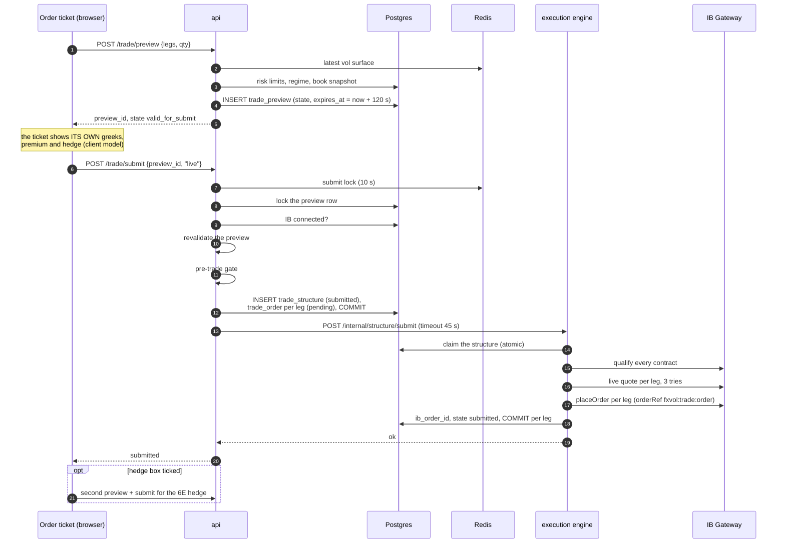
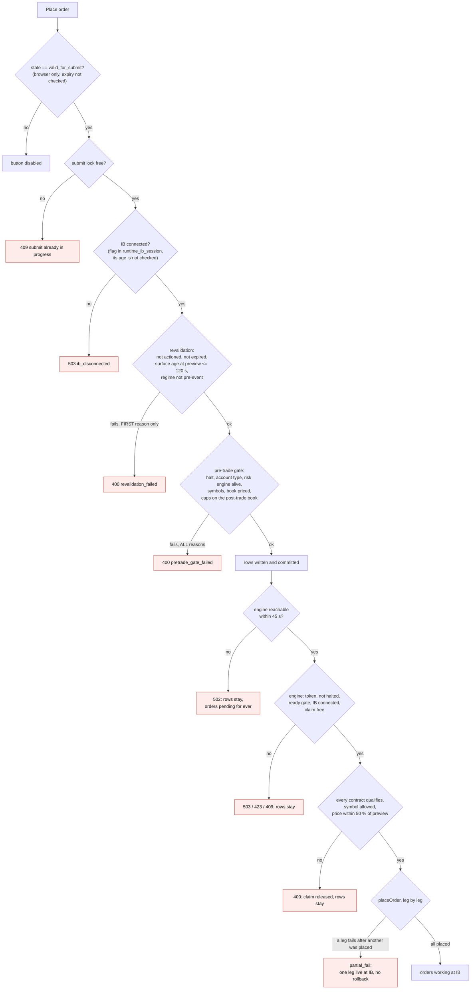
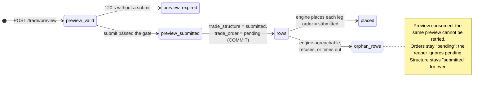

# How an entry order is sent

From the "Place order" button to Interactive Brokers: the stages, the checks
in the order they run, what is written, and where an order can be refused or
left half-way.

Part of [the order-lifecycle audit](README.md). Code at commit `384b5a70`.

## The path

| Stage | Where |
|---|---|
| Ticket: preview, submit, error text | `frontend/src/voldesk/components/OrderBuilder.tsx:363-420`, `:102-119` |
| Preview endpoint | `src/api/routers/trade.py:357-705` |
| Pricing and greeks of the preview | `src/core/trade_preview.py:454-542`, `:575-655` |
| Submit endpoint | `src/api/routers/trade.py:744-1135` |
| Revalidation | `src/core/execution/revalidation.py:47-124` |
| Pre-trade gate | `src/api/orchestration/pretrade_gate.py:110-192`, `src/core/risk/pretrade.py:73-150` |
| Caps | `src/api/orchestration/greek_caps.py:33-69`, `src/core/risk/greek_limits.py:75-109` |
| Engine: live submit | `src/engines/execution/live_submit.py:204-546` |
| Engine guards | `src/engines/execution/main.py:356-436`, `halt_guard.py:24-37`, `ib_session.py:351-421` |

## The checks, in the order they run

### Revalidation

One reason at a time, first failure wins (`revalidation.py:71-122`):
`preview_already_actioned`, `preview_state_not_valid`, `preview_expired`,
`signal_flipped`, `signal_no_longer_actionable`, `surface_age_unknown`,
`surface_stale`, `regime_pre_event`.

Two facts matter:

- The surface age compared with the limit is the age **recorded when the
  preview was built**, not the age now. A preview built on a 119-second-old
  surface passes; one built on a 121-second-old surface fails for its whole
  life, whatever happens next.
- There is no check on how far spot moved since the preview.

### Pre-trade gate

Every reason at once (`pretrade.py:78-148`): `halt_flag_unreadable`,
`trading_halted`, `symbol_not_allowed`, `account_type_mismatch`,
`risk_engine_stale`, `surface_stale`, `surface_arbitrage`, `caps_unavailable`,
`book_unavailable`, `trade_greeks_unavailable`, `book_partially_priced`,
`caps_not_established`, `cap_delta`, `cap_vega`, `cap_gamma`, `cap_notional`.

`surface_arbitrage` can never fire: the preview payload does not carry the
flag the gate reads (`surface_meta.butterfly_ok`), so it is always unknown,
and unknown is accepted for that one check.

## What is written, and when

The rows are committed **before** the engine is called
(`trade.py:1099-1117`). Everything that goes wrong after that point leaves
them behind:

| What fails after the commit | Result |
|---|---|
| engine unreachable, or no answer within 45 s | 502 to the browser; structure `submitted`, orders `pending`, preview consumed |
| engine answers 503 (ready gate closed, IB down), 423 (halted), 409 (claimed) | same rows left |
| a contract does not qualify, symbol not allowed, price outside the collar | 400; the engine releases its claim, rows left |
| timeout while the engine is still placing | the browser sees a failure, the orders may be live at IB a moment later |

Prod has the trace of it: three orders with the rejection text "execution-engine
unreachable" (4 November), and eleven `trade_structure` rows still `submitted`
whose only order is `cancelled` or `rejected` (the oldest from 21 July).

## Limit prices

| Path | Price sent to IB |
|---|---|
| stored on the row by the api | model premium ± 25 %, 4 decimals (`trade.py:1076-1079`) |
| engine, leg by leg (the default) | the live touch (ask for a buy, bid for a sell), kept only if within 50 % of the preview price (`live_submit.py:459-476`, `settings.py:34`) |
| engine, combo order (off by default) | the api's ± 25 % price, unchanged, with no live quote and no symbol check (`live_submit.py:307-379`) |
| futures | market order |

The 0.5 % `slippage_tolerance_pct` of the config applies to mock mode only.

## Multi-leg placement is not atomic

Legs are placed one after the other, with a commit after each
(`live_submit.py:478-539`). If leg 2 fails after leg 1 was placed, the trade is
`partial_fail` with one leg working or filled at the broker.

The code that would undo it exists (`run_rollback`,
`src/engines/execution/rollback_runner.py:65-257`) and is exposed as
`POST /internal/structure/rollback` (`main.py:866`). **Nothing calls it**: no
route of the api, no loop of the engine, no button of the frontend.

## What this stage can do to the desk

1. **An order refused with no visible reason.** See
   [02-ticket-vs-gate.md](02-ticket-vs-gate.md).
2. **Rows without an order.** Any failure between the commit and the
   placement leaves a trade the blotter shows as waiting and that nothing
   will ever place or clean.
3. **An order without a confirmed row.** A 45-second timeout does not stop
   the engine; the browser is told it failed while the legs go out.
4. **A naked leg.** A partial placement has no automatic undo.
5. **A stale preview that looks valid.** The button only looks at the state;
   the expiry is discovered at submit.
