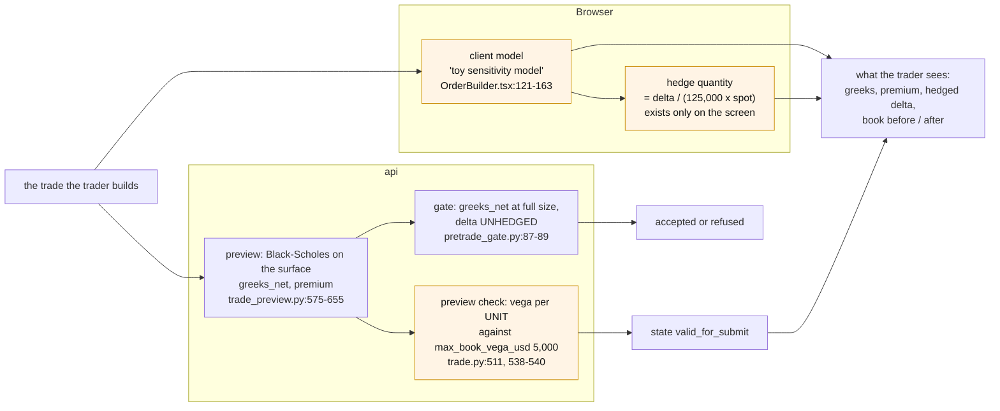
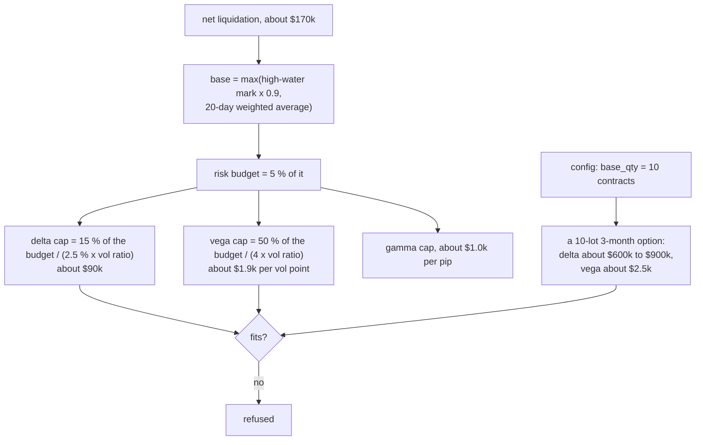
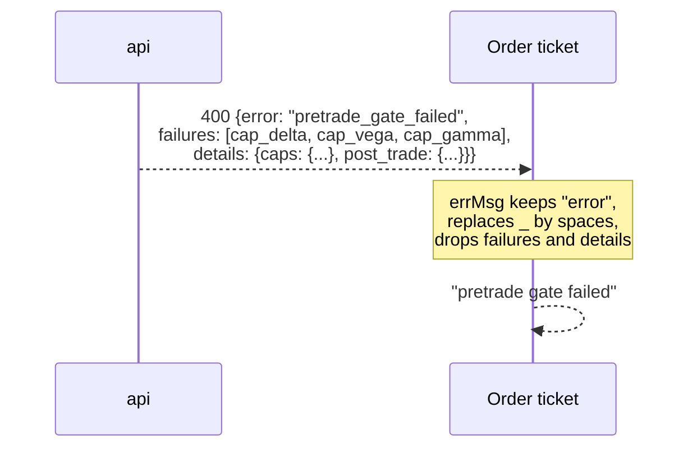

# The ticket and the gate do not look at the same trade

Why the order of 2026-11-13 09:27 UTC was refused, why the screen could not
say so, and why no entry order has passed since the gate went live.

Part of [the order-lifecycle audit](README.md).

## What happened

BUY 40 EUR puts, 3 months, strike 1.1050, with the delta-hedge box ticked.

| | What the ticket showed | What the gate computed |
|---|---|---|
| Delta | -$5.8k (after its hedge) | **-$2,575,629** (no hedge) |
| Vega per vol point | +$312 | **$10,927** |
| Gamma per pip | +$64.3k | **$5,876** |
| Premium | -$650 | not used by the gate |

| Limit | Cap | After the trade | |
|---|---|---|---|
| Delta | $90,645 | $2,575,629 | 28 times over |
| Vega per vol point | $1,888 | $10,927 | 5.8 times over |
| Gamma per pip | $1,018 | $5,876 | 5.8 times over |
| Notional | EUR 5,000,000 | EUR 5,000,000 | at the limit |

The gate answered `cap_delta, cap_vega, cap_gamma` with those numbers
(`trade_event` of 09:27:57). The screen printed "pretrade gate failed".

Two attempts just before were refused for another reason: `surface_stale`,
the surface being 124 and 132 seconds old against a limit of 120.

## Three sets of numbers for one trade

1. **The ticket's numbers are not the server's.** Every greek, the premium,
   the commission and the hedge size on the ticket come from a model inside
   the browser. The server's own pricing is computed, stored in
   `trade_preview`, and never displayed. The two disagree by a factor of 35
   on vega and 11 on gamma for this trade.
2. **The hedge is not part of the trade the gate judges.** The "6E hedge" leg
   is a second order, sent only after the structure has been accepted
   (`OrderBuilder.tsx:382-411`). The gate therefore always sees an option
   structure with its full delta. A trade that would be delta-neutral once
   hedged fails `cap_delta`, and can never reach the step that would hedge
   it.
3. **"valid_for_submit" does not mean the gate will accept.** The preview
   runs a different vega check (per unit, against a fixed 5,000) and none of
   the caps. Its other two checks, no-arbitrage and liquidity, are hardcoded
   to pass (`trade_preview.py:845-888`).

## Why nothing passes

The caps follow the account, not the ticket's default size.

One contract is EUR 125,000. A single at-the-money 3-month option carries
about $70k of delta and $270 of vega. The delta cap therefore allows **one
unhedged contract**, and the vega cap about seven. The configured default
size is 10, the ticket above asked for 40.

Prod confirms it. The last entry that filled is from 5 November 11:57 UTC.
Three submits reached the gate since and were all refused:

| When (UTC) | Reasons |
|---|---|
| 12 Nov 11:35 | `book_partially_priced, cap_delta, cap_vega, ...` |
| 13 Nov 09:27 | `cap_delta, cap_vega, cap_gamma` |
| 13 Nov (same order, earlier try) | `cap_delta, cap_vega, cap_gamma` |

So, as calibrated, the gate works as a switch that is off: either the caps
are right and the desk's sizes are wrong, or the reverse. That is a decision
about risk appetite, not a bug, and it is the owner's to make. What is a
defect is that the screen gives no way to see it.

## The refusal the screen cannot show

The same function drops the reason of every other refusal
(`OrderBuilder.tsx:102-119`):

| Refusal | What the api sends | What the screen prints |
|---|---|---|
| gate | codes + caps + post-trade values | "pretrade gate failed" |
| revalidation | `reason: surface_stale`, the ages | "revalidation failed" |
| IB down | `reason` | "ib disconnected" |
| unexpected error | `trace_id` | the error name, no id to look up |

## The surface is refused for being 4 seconds old too many

`max_iv_data_age_seconds` is 120. The preview stores the age of the surface
it was built on, and the submit compares that stored age with 120
(`revalidation.py`, live mode only). If the vol engine publishes a surface
roughly every two minutes, a preview built just before a new surface arrives
is born stale and stays stale: resubmitting the same preview cannot help, and
the screen says only "revalidation failed". Half of the six refusals on
record are this one.

The preview itself never refuses on age: that check was removed from it
(`trade_preview.py:868-871`), so it answers `valid_for_submit` on a surface
the submit will reject, including the synthetic surface it falls back to when
there is none (age 999).

## Other inconsistencies on this stage

| Item | Ticket | Server |
|---|---|---|
| Spot | tick mid, or a built-in constant when there are no ticks | the at-the-money strike of the surface, used as the forward for every tenor |
| Implied vol of a typed strike | - | the at-the-money vol, not the vol at that strike (`trade_preview.py:499-520`) |
| Commission | $2.10 per contract | $2.00, or 2.40 / 0.60 for futures |
| Gamma label | "USD/pip" | stored per pip squared, converted by the gate |
| Notional of a mixed option + micro-future ticket | - | options counted at the micro multiplier (`pretrade_gate.py:92`) |

The forward shown on the pasted ticket (1.0868 for 3 months with spot at
1.1060) and its premium ($650 for 40 contracts) are outputs of the browser
model; they are not what the server priced.

## What this stage can do to the desk

1. **A trader sizes a trade on numbers nothing else uses.** The risk shown
   before the click is not the risk the system books or limits.
2. **A refusal cannot be understood or fixed from the screen**, so the
   natural reaction is to retry, which cannot work.
3. **Hedged trades are structurally refused** as long as the hedge is a
   second order.
4. **If the caps are loosened to let trades through**, the mismatch above
   stops being visible, and the desk trades on browser numbers with a gate
   it has learnt to ignore.
