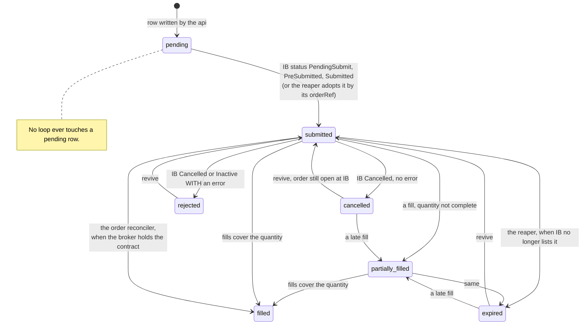
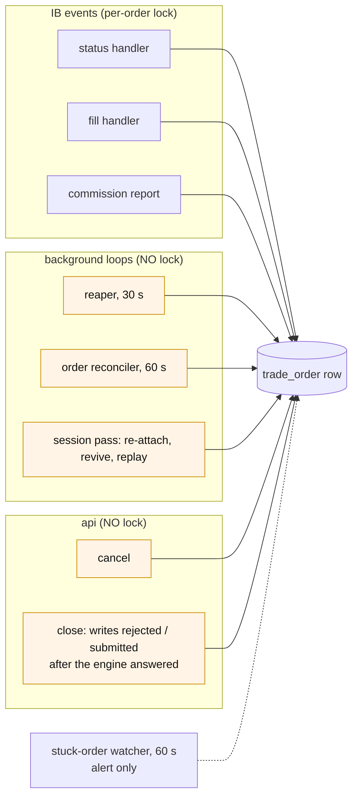
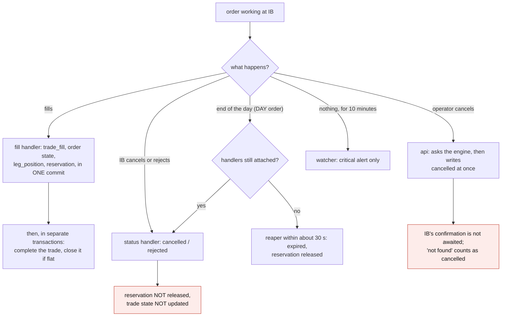
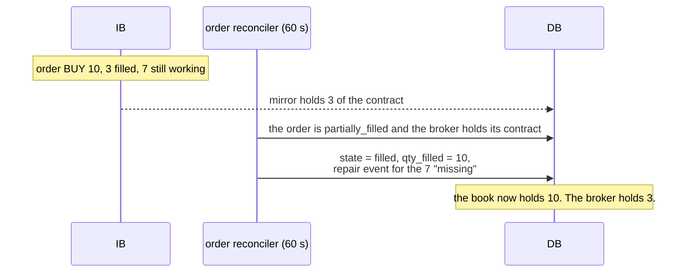

# How an order waits, and who can change it

Once an order is at Interactive Brokers, its row in `trade_order` is moved by
IB's own events and by six background loops. This note lists every writer,
what each one trusts, and where two of them can disagree.

Part of [the order-lifecycle audit](README.md).

## The state of an order

`acknowledged` is in the list of states of the table, and several queries
filter on it, but **no code ever writes it**: the handler only stamps
`acknowledged_at`. `partial_fill` at the trade level is the same: read in
three places, written nowhere.

| Rule | Where |
|---|---|
| IB status to state | `src/core/execution/order_states.py:26-82` |
| a terminal row ignores later **status** events | `order_states.py:59-64` |
| a terminal row does **not** ignore later **fills** | `src/engines/execution/fills_handler.py:268-276` |
| IB Inactive with no error = held, state unchanged | `order_states.py:69-72` |
| unknown IB status = logged, state unchanged | `order_states.py:57-58` |

## Every writer of an order row

The lock is an in-process lock per order id, taken by the three IB handlers
only (`fills_handler.py:73-81`). The reaper, the reconciler, the session pass
and both api writers read the row, decide, and write it back without the
lock, without a `WHERE state = ...` and without a version column. A fill or a
cancel committed between their read and their write is overwritten.

## The loops

| Loop | Every | Acts when | What it writes | Guard |
|---|---|---|---|---|
| position sync | 1 s | always | the broker mirror only | deletes only on a trusted snapshot |
| heartbeat | 10 s | always | the connection row | - |
| stuck-order watcher | 60 s | an order `submitted` for 10 min | a critical event, nothing else | - |
| order reconciler | 60 s | an order `submitted` or `partially_filled` | `filled`, from its own fills, or because the broker holds the contract | **none** |
| reaper | 30 s | an order `submitted` for 5 min that IB no longer lists | `expired`; adopts orders by orderRef | IB reporting |
| position reconciler | 60 s | always | reconciliation breaks only | IB reporting |
| lifecycle | 1 h | always | expiry and write-off events, closes flat trades | IB reporting |
| IB watchdog | 10 s | connection lost | reconnects, runs the session pass | - |

Settings in `src/engines/execution/settings.py`; registration in
`src/engines/execution/main.py:198-240`.

The engine's "ready gate" closes on a disconnect and during a session pass
(`ib_session.py:351-421`). It stops **requests** (submit, close, cancel is
not even gated). It does not stop the loops above: they keep running while
the gate is closed.

## How an order leaves the waiting state

Every order is DAY (`order_executor.py:63`, `live_submit.py:481-493`). No
code handles the end of the trading day as such: the row is closed by
whichever of the status handler or the reaper sees it first, and the two
write different states (`cancelled` or `expired`) for the same event.

Three paths still send orders with no time in force, and so can still
receive the notice that was read as a rejection on 12 November: the close by
contract id (`order_executor.py:447`), the rollback unwind
(`rollback_runner.py:217`) and the hedge (`hedge_executor.py:109`).

## Where the book and the broker can disagree

Each of these is read off the code; none was reproduced.

### 1. The reconciler marks a working order filled

The second pass of the reconciler takes any order still `submitted` or
`partially_filled`, and marks it filled at its full quantity when the mirror
holds a matching contract for its trade (`order_reconciler.py:111-140`). It
checks neither the age of the order nor whether IB still lists it as working,
and it has no connection guard. Since 12 November it also writes a `repair`
event for the difference, which turns the wrong state into a wrong quantity.

The mirror gives a contract to the newest trade naming it, so a new, unfilled
order on a contract an older trade already holds qualifies too.

### 2. A held order is expired while it is still at IB

The reaper's list of "still working" statuses is Submitted, PreSubmitted,
PendingSubmit and ApiPending (`reaper.py:55-57`). An order IB holds as
**Inactive** (outside trading hours, price cap) is not in it. After 5 minutes
the reaper writes `expired` and releases the reservation; the order is still
at the broker and can fill later.

### 3. A fill arrives before anyone listens

On every path the order is placed, then a database write is awaited, then the
handlers are attached (`live_submit.py:499-510`, `main.py:664-679`,
`placement.py:124-132`). An order that fills in that window has no listener.
For an entry, the reconciler repairs it from the mirror. For a **close**,
nothing does: the reaper later writes `expired` with zero filled, and the
book keeps a leg the broker no longer has. Fills are replayed only on a
reconnect, and only for the current day.

### 4. A cancel is recorded before it is true

The api writes `cancelled` as soon as the engine answers, including when the
engine answers "not found" (`trades.py:221-230`). The engine looks for the
order in its own session's open trades; an order live at IB but absent from
that list is reported not found. The row then says cancelled, the reservation
is not released, and a fill can still come.

### 5. A reservation outlives its order

`reserved_qty` on a leg is recomputed on a close creation, on a fill, and
when the reaper expires an order. It is **not** recomputed when IB cancels or
rejects a close, when the operator cancels one, or when an order is revived
(`persistence/reservation.py:33-48` and its callers). A close that dies by
any of those routes leaves the leg looking partly reserved until another
event touches it.

### 6. A trade never reaches a final state

Three independent routes:

- an order is rejected or cancelled by IB: the status handler updates the
  order and nothing updates the trade. Prod has eleven such trades, the
  oldest from 21 July;
- the engine stops between the commit of the last fill and the step that
  completes the trade: on restart the fill is already there, so the
  completion is never retried, and no booked position is created;
- an order stays `pending`: no loop reads pending rows, and a pending close
  keeps its reservation for ever.

### 7. States that flip

A fill on a `cancelled` or `expired` row writes `partially_filled` again, the
reaper expires it again five minutes later, and so on. After error 1101 the
session pass attaches the handlers a second time to the same orders: every
event is then handled twice (fills are de-duplicated, audit events are not).

### 8. The notice filter can hide a real cancel

The filter added on 12 November treats a Cancelled status as "only a notice"
when **every** error in the order's log is a notice
(`ib_trade_log.py:45-53`). An order that received the notice once and is
genuinely cancelled later (operator, or end of day) has only that notice in
its log, so the real cancel is ignored and the row waits for the reaper. The
combo path has no filter at all and would cancel every leg on a notice. Now
that every order states its time in force the notice should no longer be
sent, so the exposure is small, but the rule is wrong as written.

## What this stage can do to the desk

1. **A position the book holds and the broker does not**, or the reverse,
   created by the loops themselves (points 1, 2, 3). The 24-hour write-off
   added on 12 November would then correct the book at cost, a day late.
2. **A second close accepted** because the first one reads as dead (points
   2, 4) or because its reservation logic is wrong (point 5).
3. **Trades that never finish**, each one a row the blotter keeps showing as
   waiting (point 6).
4. **Two writers undoing each other** on one row, with no trace of which won
   (the locking section above).
