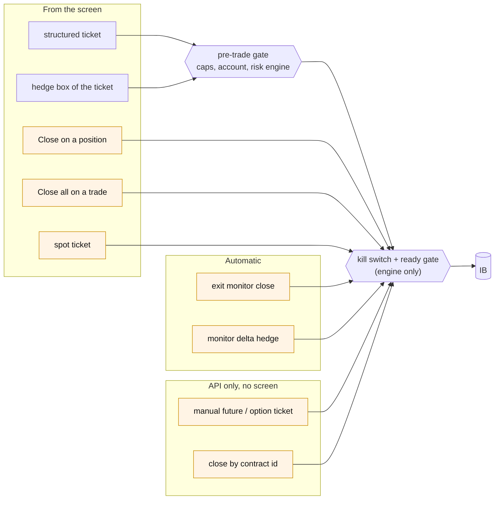
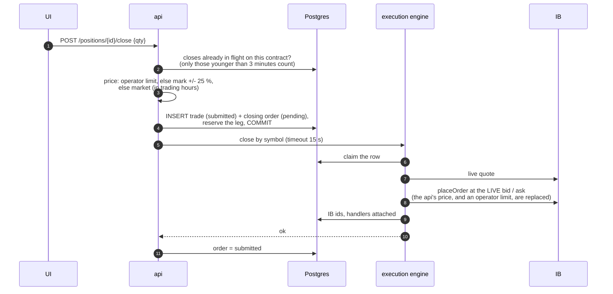
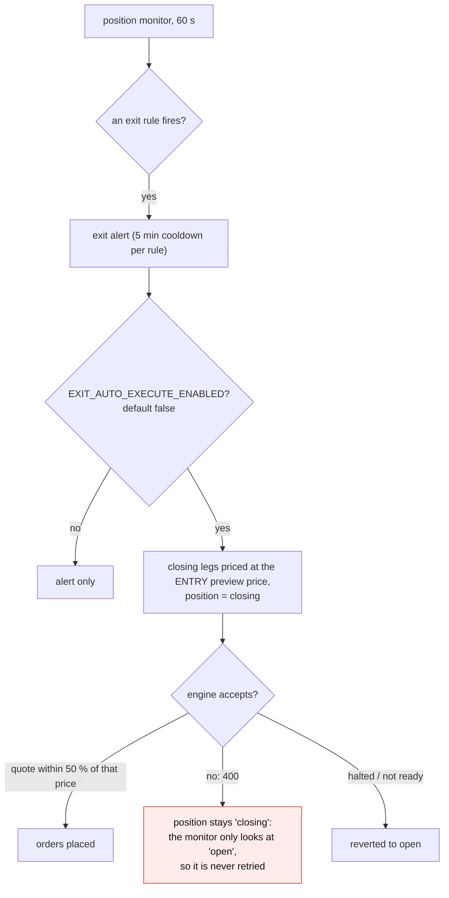

# The other ways an order is created

The structured ticket is one of nine paths that can send an order. This note
lists them, which controls each one goes through, and what each can leave
behind.

Part of [the order-lifecycle audit](README.md).

## Nine paths, one gate

| Path | Pre-trade gate | Kill switch | Ready gate | Write auth | Row before the order |
|---|---|---|---|---|---|
| Structured ticket | yes | yes | yes | yes | trade + orders |
| Hedge box of the ticket | yes (a second structured order) | yes | yes | yes | trade + order |
| Close one position | **no** | yes | yes | yes | trade + closing order |
| Close a whole trade | **no** | yes | yes | yes | one trade per leg |
| Exit-monitor close | **no** | yes | yes | background | trade + closing orders |
| Monitor delta hedge | **no** | yes | yes | background | hedge order |
| Spot ticket | **no** | yes | yes | yes | spot order |
| Manual future / option ticket | **no** | yes | yes | yes | trade + order |
| Close by contract id | **no** | yes | yes | yes | **none** |

The kill switch and the ready gate are checked by the execution engine only.
The api never reads them: it writes its rows first and learns of the refusal
from the engine's answer.

Closes reduce risk, so not capping them is defensible. Two rows are not
closes: the **spot ticket** (up to 5,000,000 of base currency, a market order
when no limit is given) and the **manual future or option ticket**, which can
open any size on any listed contract with none of the caps, the symbol list
or the price collar of the structured path. The comment on the api route says
the engine's pre-trade gate applies (`src/api/routers/orders.py:64`); it does
not, the gate is called in one place only (`src/api/routers/trade.py:950`).
The screen never calls the manual ticket, but the route is live.

## Closing one position

| Step | Where |
|---|---|
| guard against stacking | `src/api/routers/positions.py:1108-1140`, window `CLOSE_INFLIGHT_WINDOW_MIN = 3` (`src/api/config.py:62`) |
| price | `positions.py:998-1012`, `:1149-1165` |
| rows | `positions.py:1171-1238` |
| engine | `src/engines/execution/main.py:617-690` |
| re-pricing at the engine | `src/engines/execution/order_executor.py:33-57`, `:515-525` |

What it can leave behind:

- **A second full-size close.** The guard counts a close only for 3 minutes.
  A limit order resting longer than that (an option nobody bids for, a close
  sent outside trading hours) no longer counts, and the screen's own lock
  lasted 90 seconds. The second close of 12 November on EUUZ6 C1210 came
  through this window. Since 13 November the Open positions row shows the
  close in flight and replaces Close by Cancel close, which removes the
  screen's part of the problem; the api guard is unchanged.
- **The price on the row is not the price sent.** The engine replaces the
  api's limit, including a limit typed by the operator, with the live quote,
  and nothing writes the sent price back.
- **A timeout that looks like a working order.** If the engine does not
  answer in 15 seconds the row is set to `submitted` with no IB id. Cancelling
  that row never reaches IB (there is no id to cancel) and still writes
  `cancelled`: the order, if it was placed, stays live.
- **A live order on a row marked rejected.** If the engine places the order
  and then fails while recording it, it answers 500 and the api writes
  `rejected`.
- **An off-tick price outside trading hours.** The outside-hours limit is the
  mark plus or minus 5 basis points, rounded to 6 decimals and not snapped to
  the contract's tick (`positions.py:1162-1164`).
- **The guard matches too loosely.** It keys on side, expiry and strike, not
  on call or put nor on the contract family, so a call and a put with the
  same strike and expiry share one budget and block each other.

## Closing a whole trade

One closing trade per leg, sent one after the other, each committed on its
own (`src/api/routers/trades.py:82-185`). A leg that fails is recorded and
the loop goes on; legs already sent are not undone. The answer is 200 with
the lists of closed and failed legs, and the screen prints "Close submitted"
without reading those lists (`frontend/src/voldesk/views/TradeView.tsx:418-422`).
A trade half closed is announced as closed.

## Automatic exit

`src/api/orchestration/position_close.py:48-258`,
`position_monitor.py:117-119`, `:358-379`. Auto-execution is off by default,
so today this path only writes alerts. Turned on as it is, an option whose
price has moved by more than half since entry, which is the usual case for an
exit, cannot be closed automatically and blocks its own retry.

`POST /positions/{id}/close-manual` sends no order at all: it sets the
position to `closing` and records an alert (`positions.py:1360-1389`).

## Delta hedges

There are two unrelated hedges.

- **The hedge box of the ticket** is a second structured order, sent by the
  browser after the first one succeeds
  (`frontend/src/voldesk/components/OrderBuilder.tsx:382-411`). If the first
  is refused there is no hedge; if the hedge is refused the structure is
  already live, unhedged, and the ticket says "structure placed, hedge
  failed".
- **The monitor's hedge** writes `hedge_order` rows that are never sent:
  the flag that sends them is never set
  (`position_monitor.py:71`, `:649-660`). If it were, the order has no
  expiry (the contract cannot be resolved without one), no time in force, a
  status handler that only knows "Filled", no re-attachment after a restart,
  and no line in the Orders blotter
  (`src/engines/execution/hedge_executor.py:38-153`). A hedge cancelled by IB
  would stay `submitted` and keep netting against every later hedge decision.

## Spot and manual tickets

Both follow "write the row, place, attach handlers", and both catch two
exception types only (`main.py:497-543`). Any other failure after the order
is placed (a timeout while qualifying, a database error) leaves a `pending`
row with its claim set and no handlers: an order at the broker that nothing
follows.

Neither has an idempotency key on the server. The spot ticket protects itself
in the browser with a synchronous flag, added after prod created duplicate
spot orders; the Close panel still relies on React state for the same job
(`TradeView.tsx:405`, compare `:558-561`).

## What the screen shows of all this

| Situation | What the screen says |
|---|---|
| gate or revalidation refuses an entry | the error name only |
| a close times out (504, "in flight, do not retry") | "broker/API error 504" |
| the engine's ready gate is closed (503) | "broker/API error 503" |
| an order rejected by IB | "rejected", without IB's reason, which is stored in `rejection_text` |
| a refusal recorded this session | lost on refresh (kept in memory, ten at most) |
| Cancel on one leg of a multi-leg order | cancels **every** working leg of that trade |
| a monitor hedge | not in the blotter |

Sources: `OrderBuilder.tsx:102-119`, `TradeView.tsx:35-42`, `:892-904`,
`:933-976`, `:1127-1146`.

## What this stage can do to the desk

1. **Size without a limit** through the two tickets that skip the gate.
2. **A close doubled** by the 3-minute window, and a close that cannot be
   cancelled after a timeout.
3. **A half-closed trade reported as closed.**
4. **Switching on a feature that is not ready**: auto-exit and monitor hedges
   are one environment variable away and would each strand positions or
   orders as they stand.
5. **An operator who cannot tell why** something was refused, and retries.
