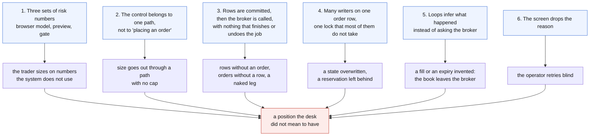
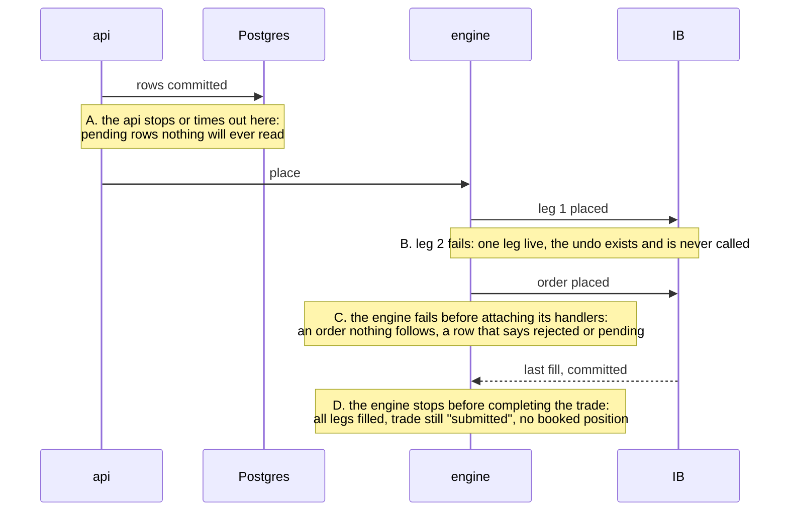
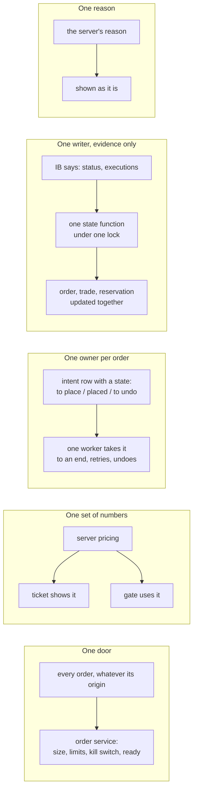

# How the order structure can collapse

Notes 01 to 04 list defects. This one groups them by the design weakness that
produces them, because fixing the defects one by one leaves the weakness, and
the weakness produces the next defect.

Part of [the order-lifecycle audit](README.md).

## Six weaknesses

### 1. Three sets of risk numbers

The ticket prices the trade in the browser, the preview prices it on the
server, the gate judges a third view of it (unhedged, full size). They
disagreed by a factor of 28 on delta on 13 November. As long as the gate
refuses everything this is only confusing. It becomes dangerous the day the
caps are raised to let trades through: the trader then confirms a risk shown
by the browser while the system books another. Note 02.

### 2. The control belongs to one path

The caps, the symbol list and the price collar are called from the
structured ticket. Eight other paths reach the broker without them, two of
which open positions. Every new way to send an order will be born without
the gate unless someone remembers to add it. Note 04.

### 3. Commit, then call, with no one to finish

Every path writes its rows, commits, and then calls the engine or the
broker. There are four points of no return and no component whose job is to
take a half-done order to one of its two ends:

Notes 01, 03 and 04.

### 4. Many writers, one lock most of them skip

Eight components write an order row. Three take the lock. The others read,
decide and write back, sometimes seconds later, with nothing that detects
that the row changed in between. The same holds one level up: the trade row
and the reservation on a leg are each updated by some of the events that
should update them and not by others. Note 03.

### 5. Inference instead of evidence

Three loops conclude from an absence or from a coincidence:

| Loop | Concludes | From |
|---|---|---|
| order reconciler | "this order filled completely" | the broker holds some of that contract |
| reaper | "this order is dead" | IB's list of working orders does not show it, though a held order is not in that list |
| lifecycle write-off | "this position does not exist" | the broker has not held it for a day |

Each was added to repair a real loss of information, and each can be wrong in
a way the next one then "repairs" in turn: an invented fill becomes a book
position, which a day later becomes a write-off. The broker can be asked
directly for the two facts these loops guess (the executions of an order, the
status of an order), and is asked only on a reconnect. Note 03.

### 6. The screen drops the reason

Whatever the server explains, the operator reads an error name. The only
available move is to try again, and several of the weaknesses above get worse
on a retry (a second close, a second preview on the same stale surface).
Notes 02 and 04.

## Scenarios

Likelihood is a judgement from how ordinary the trigger is; none of these was
reproduced. "Seen" means prod shows the result already.

| # | Trigger | Chain | End state | Likelihood | Seen |
|---|---|---|---|---|---|
| S1 | caps are raised so trades pass | the trader sizes on browser greeks; the hedge is a second order that can fail | a book 10 to 30 times the size the screen showed, possibly unhedged | high once trading resumes | the mismatch, yes |
| S2 | a multi-leg order, second leg refused (contract not listed, price collar) | first leg already placed; no undo runs | a naked option leg, trade `partial_fail` | medium | 3 trades in `partial_fail` |
| S3 | a partial fill on an entry | the reconciler marks the order filled at full size within a minute and books the rest as a repair | book larger than the broker; pre-trade checks and hedges computed on it; write-off a day later | medium | not looked for |
| S4 | the engine is slow or restarting during a submit or a close | the api times out after its commit | rows that wait for ever; or an order live with a row the operator then "cancels" without reaching IB | medium | 3 "engine unreachable", 11 trades stuck `submitted` |
| S5 | a close rests more than 3 minutes | the api's guard forgets it; a second close is accepted | twice the position sold: a short where there was a long | medium, happened | 12 Nov, EUUZ6 C1210 |
| S6 | an order held by IB outside trading hours | the reaper expires it after 5 minutes and frees the reservation | the order fills at the open on a row that says expired; a second close may have been sent meanwhile | medium | not looked for |
| S7 | IB cancels or rejects a close | reservation not released, trade not finalised | the leg reads "partly reserved", a later manual ticket is booked as a new trade instead of a close | medium | 6 rejected closes |
| S8 | the engine restarts right after a last fill | completion never retried | a filled trade with no booked position: outside the exit monitor and the P&L | low | not looked for |
| S9 | `EXIT_AUTO_EXECUTE_ENABLED` is switched on | closes priced at the entry price are refused by the collar | positions stuck in `closing`, never retried, no alert | certain if switched on | - |
| S10 | someone uses the manual ticket route | no cap, no symbol list, no collar | any size on any listed contract | low (no screen calls it) | - |
| S11 | the vol engine publishes every two minutes | previews born on a surface older than 120 s | submits refused at random, "revalidation failed", retries that cannot work | high | 3 of the 6 refusals on record |

## What would hold instead

Five rules. Each removes one weakness, and each is checkable by a test.

1. **One door.** Placing an order is one function in one module. The
   pre-trade checks live in it, with a declared exemption for orders that
   only reduce a position. A path cannot reach the broker without it; a test
   lists the engine's routes and fails on a new one that bypasses it.
2. **One set of numbers.** The ticket displays what the server priced, and
   the gate judges the trade as it will be sent: when a hedge is part of the
   order, structure and hedge are one order with one decision.
3. **One owner per order.** The intent to place (or to undo) is a row with a
   state, written in the same commit as the order rows. One worker picks it
   up, places, records, and on failure retries or undoes. Nothing is left
   for a human to notice; the four gaps of weakness 3 become states of that
   row.
4. **One writer, on evidence.** A single function changes an order's state,
   under one lock, from what the broker reports: its status and its
   executions. The trade state and the reservation are derived in the same
   transaction. A loop that finds a disagreement asks the broker for the
   executions and the status of that order; if the broker cannot say, the
   row is flagged for the operator, not guessed.
5. **One reason.** A refusal carries a code and its numbers from the server
   to the screen, and stays readable after a refresh.

## Order of work

Proposed, not started. The first three are small and change nothing in how
orders flow.

| # | Change | Removes | Size |
|---|---|---|---|
| 1 | The ticket shows the refusal reasons and numbers; the blotter shows IB's reason | weakness 6, S11's blind retries | S |
| 2 | The ticket shows the server's greeks, premium and caps headroom from the preview, and drops the browser model for anything that is submitted | weakness 1 | M |
| 3 | The owner decides the caps and the default size, so that a standard trade either passes or is known not to | the gate being off in practice | decision |
| 4 | The order reconciler stops marking orders filled from the mirror; it asks IB for the executions of the order | S3 | M |
| 5 | The reaper treats an order held by IB as working, and asks IB for an order's status before expiring it | S6 | S |
| 6 | One state function for an order, under the lock, used by every writer; trade state and reservation derived with it | weakness 4, S7, S8 | L |
| 7 | An intent row and a worker for placement and undo; the undo that exists is called | weakness 3, S2, S4 | L |
| 8 | The pre-trade checks move into the engine's single placement function; closes exempt from caps, never from the kill switch | weakness 2, S10 | M |
| 9 | Structure and hedge are one order for the gate and for placement | S1 | M |
| 10 | The api's stacking guard follows the order's real state, with no time window | S5 | S |
| 11 | Auto-exit and monitor hedges: finish or remove; until then a test that fails if the flags are on | S9 | M |
| 12 | The surface age is checked against the clock at submit, with a limit above the publishing interval | S11 | S |
