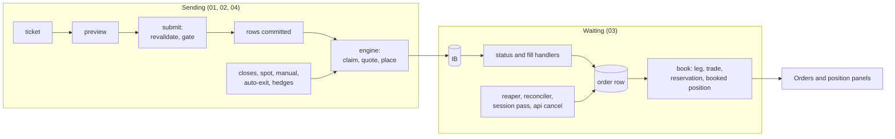

# Order lifecycle: how orders are sent, how they wait, how it can break

Audit of 2026-11-13, code at commit `384b5a70`. It started from one refused
order and looks at the whole path, to answer a wider question: by which
routes can this structure fail, today or after the next change.

No code was changed for this audit. Diagrams are Mermaid, at the owner's
request (the rest of `docs/` uses SVG, see `docs/README.md`).

| Note | Subject |
|---|---|
| [01-entry-send-path.md](01-entry-send-path.md) | from "Place order" to IB: stages, checks in order, what is written, where an order is refused or left half-way |
| [02-ticket-vs-gate.md](02-ticket-vs-gate.md) | why the order of 13 November was refused, and why the screen could not say so |
| [03-waiting-and-recovery.md](03-waiting-and-recovery.md) | the state of an order, every loop that can change it, where the book and the broker can disagree |
| [04-other-order-paths.md](04-other-order-paths.md) | closes, hedges, spot, manual tickets: which controls each one passes |
| [05-how-it-can-collapse.md](05-how-it-can-collapse.md) | the six design weaknesses behind the defects, the scenarios, what would hold instead, the order of work |

## The refused order

BUY 40 EUR puts, 3 months, with the hedge box ticked, 13 November 09:27 UTC.

It was refused by the pre-trade gate on size: delta $2.58M against a cap of
$90.6k, vega $10.9k against $1.9k, gamma $5.9k against $1.0k per pip. The api
returned those reasons and numbers; the ticket printed "pretrade gate
failed". Two tries just before were refused because the vol surface was 124
and 132 seconds old against a limit of 120.

Three facts behind it:

- **The numbers on the ticket are computed in the browser.** They are not
  the server's and not the gate's; on this trade they differ by 28 times on
  delta and 35 times on vega.
- **The hedge is not part of what the gate judges.** It is a second order,
  sent after the first is accepted, so a hedged trade is judged unhedged.
- **Nothing has passed the gate since it went live.** The last filled entry
  is from 5 November. The caps, derived from a net liquidation of about
  $170k, allow one unhedged at-the-money contract on delta; the configured
  default size is 10.

Whether the caps or the sizes are wrong is a decision about risk appetite and
belongs to the owner.

## The map

## Findings that matter most

Each is detailed, with file and line, in the note given.

| # | Finding | Note |
|---|---|---|
| 1 | The ticket shows browser-computed risk; the server's pricing is never displayed | 02 |
| 2 | A refusal reaches the screen as an error name; the reasons and numbers are dropped | 02, 04 |
| 3 | As calibrated, the gate refuses every standard trade | 02 |
| 4 | Eight of nine order paths skip the pre-trade gate; two of them open positions | 04 |
| 5 | Rows are committed before the broker is called and nothing completes or undoes a half-done order; the undo for a partial multi-leg placement exists and is never called | 01, 05 |
| 6 | The order reconciler marks a working, partly filled order as fully filled when the broker holds some of the contract | 03 |
| 7 | The reaper expires an order IB is holding (Inactive), and frees its reservation | 03 |
| 8 | Eight writers on an order row, three of them under the lock | 03 |
| 9 | A close resting more than 3 minutes no longer blocks a second close | 04 |
| 10 | A cancel is written before IB confirms it, and "not found" counts as cancelled | 03, 04 |
| 11 | Auto-exit and monitor hedges are one flag away and would strand positions and orders as written | 04 |

## What prod shows

Read through the read-only path of `docs/ops/runbooks.md` section 5.

| Fact | Value |
|---|---|
| Entry orders filled / cancelled / expired | 53 / 11 / 3 |
| Closing orders filled / cancelled / rejected / working | 36 / 8 / 6 / 1 |
| Trades stuck in `submitted` with only dead orders | 11, oldest 21 July |
| Trades in `partial_fail` | 3 |
| Orders with "execution-engine unreachable" | 3 (4 November) |
| Closes written `rejected` on IB's notice 10349 while live | 3 (12 November), fixed in `384b5a70` |
| Submits refused on record | 6: 3 on the surface's age, 3 at the gate |
| The close sent on 13 November | working at IB, row `submitted`, shown "closing, waiting at IB" |

That last line confirms on prod the fix shipped the same morning: a close now
waits instead of reading "rejected".

## How this was established

- The code was read end to end by three independent passes (entry path,
  waiting and recovery, other paths and screens), each reporting file and
  line; the claims this audit rests on were then re-read.
- Prod was read for the counts above and for the gate's own record of the
  refusal.
- **Nothing here was reproduced by running it.** Every scenario of note 05 is
  derived from the code. Where a claim depends on how the IB library behaves
  (an event fired before a handler is attached, a held order's status), it is
  marked as inferred in the note.
- Not covered: the combo order path beyond what note 03 says of it (it is
  off by default), mock mode, and the vol engine's publishing cadence, which
  note 02 assumes from the refusals observed.

## Decisions for the owner

1. **Caps or sizes.** Keep the caps and trade one to seven contracts, or
   set caps that fit the sizes the desk wants. Until then the gate is off in
   practice.
2. **Is the hedge part of the trade.** If yes, structure and hedge must be
   judged and sent as one order (note 05, change 9).
3. **Order of work.** Note 05 proposes twelve changes; the first two (show
   the reasons, show the server's numbers) are small and make every later
   problem visible.
