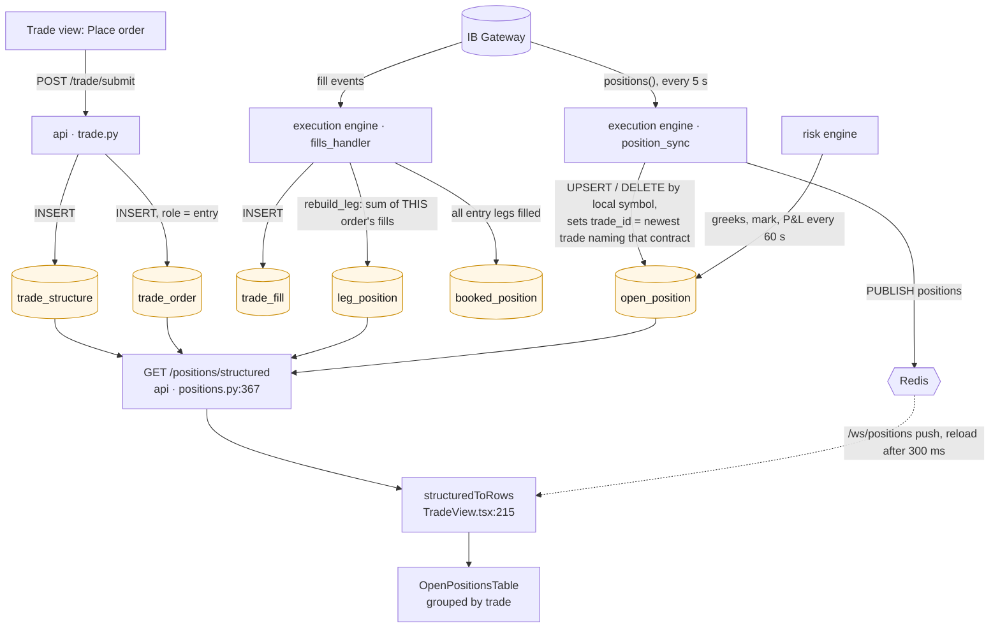
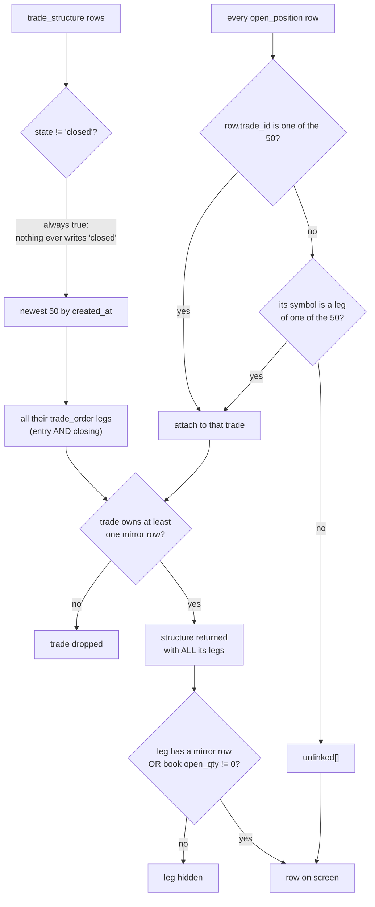
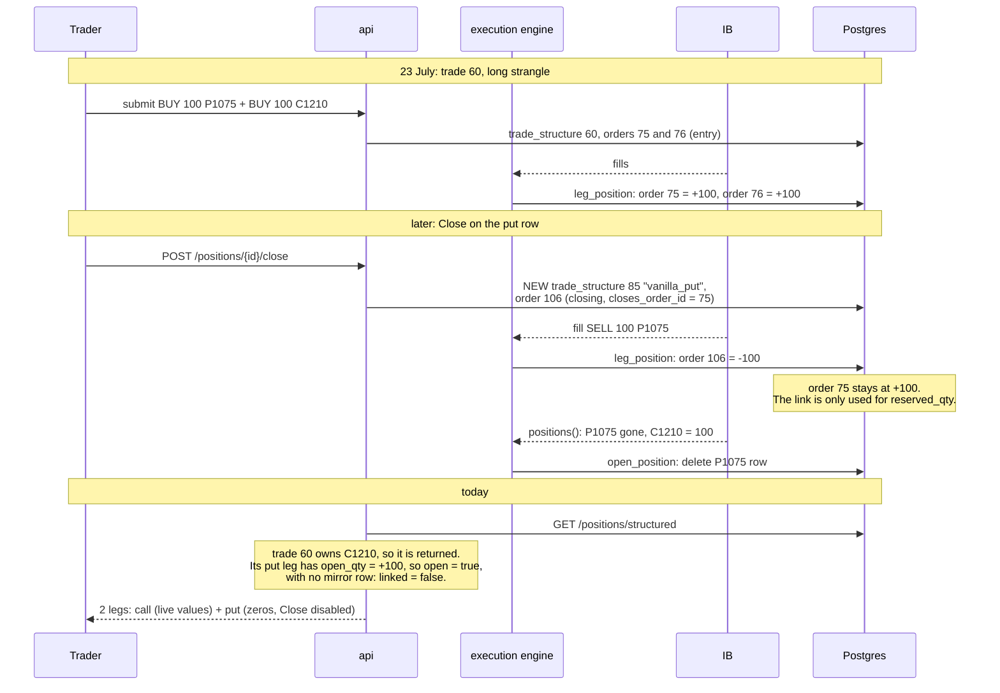

# Open positions (Trade view)

**Purpose of the panel:** show what the desk holds, grouped by the trade that
opened it, with a Close button per leg and per trade.

**What it does instead:** it shows the legs our *book* believes are open inside
the trades that still own something at the broker. Today that is 8 rows for 7
holdings: one row is a leg the broker no longer has.

Part of [the position-panels analysis](README.md).

## Pipeline

| Step | Where | Cadence |
|---|---|---|
| Trade and legs written | `src/api/routers/trade.py:985`, `:1086` | on submit |
| Fill recorded, leg quantity rebuilt | `src/engines/execution/fills_handler.py:224`, `src/persistence/projection.py:21` | per fill; full rebuild at engine start |
| Mirror of IB holdings | `src/engines/execution/position_sync.py:107` | every 5 s (`docker-compose.yml:443`) |
| Greeks, mark, P&L on the mirror | `src/engines/risk/engine.py:398` | every 60 s (30th cycle of a 2 s loop) |
| Endpoint | `src/api/routers/positions.py:367` | on request |
| Frontend poll | `TradeView.tsx:862` | 60 s, plus a reload on every positions push |

## How the endpoint picks its rows

Three rules matter:

1. **Trade selection** (`positions.py:389-390`, `:519`): the newest 50 trades,
   then only those owning a mirror row. A trade outside the window is never
   shown; its holdings fall into `unlinked` if their symbol is not in the
   window either.
2. **Leg selection** (`positions.py:424-429`, `TradeView.tsx:232`): a leg is a
   row when the broker holds it **or the book says its quantity is not zero**.
3. **Ownership** (`position_sync.py:409-447`): a held contract belongs to the
   newest trade that ever had an entry leg on it. Direction and whether that
   trade is still alive are not checked.

## Why trade 60 shows a leg nobody holds

Prod evidence (`trade_order` joined to `leg_position`):

| Trade | Order | Role | Closes | Contract | Side | Qty | Book open qty |
|---|---|---|---|---|---|---|---|
| 60 | 75 | entry | - | EUUZ6 P1075 | BUY | 100 | **+100** |
| 60 | 76 | entry | - | EUUZ6 C1210 | BUY | 100 | +100 |
| 85 | 106 | closing | 75 | EUUZ6 P1075 | SELL | 100 | **-100** |

The close is correctly linked (106 closes 75), yet order 75 still reads +100:
`rebuild_leg` sums only the fills of its own order
(`src/persistence/projection.py:23-29`).

## Other things this panel gets wrong

| Symptom | Cause | Where |
|---|---|---|
| Spot short shown as "Future - 6E", entry 0.00000887, no mark, no P&L | `EUR.USD` matches no contract pattern: multiplier defaults to 125,000 (`avgCost / 125000`), label falls to the future default, the risk engine skips it | `position_sync.py:156-163`, `src/core/products.py:66-75`, `risk/engine.py:272-274` |
| Expiry and days-to-expiry differ from the contract's | the leg carries the preview's calendar date (`today + tenor`); IB resolves to the listed expiry and nothing writes it back | `src/core/trade_preview.py:488`, `contract_builder.py:48-63` |
| Tenor is the contract's, expiry is the booked one, on the same row | `tenor` comes from the mirror, `expiry` from the leg | `positions.py:459`, `:481`; `TradeView.tsx:260-265` |
| A trade older than the 50 newest disappears from the panel while still held | `limit` defaults to 50 and the frontend sends none | `positions.py:367`, `frontend/src/api/endpoints.ts:334` |
| The "closed" filter does nothing | no code sets `trade_structure.state = 'closed'` | `positions.py:389` |

Booked versus real expiry, prod:

| Trade | Booked expiry (`trade_order`) | Contract expiry (`open_position`) |
|---|---|---|
| 60 call | 2026-12-20 | 2026-12-04 |
| 79 legs | 2027-02-02 | 2027-02-05 |
| 87 put | 2027-02-03 | 2027-02-05 |
| 88 future | 2027-02-03 | 2027-03-15 |

## What "same lines as the other panels" needs here

- The row set comes from the shared position set (one line per contract held),
  not from book legs. A leg the book holds and the broker does not becomes a
  **flagged** line that the other two panels show too.
- The 50-trade window stops deciding what is visible: visibility follows
  holdings, not creation date.
- Expiry shown is the contract's; the booked date is an entry detail.
