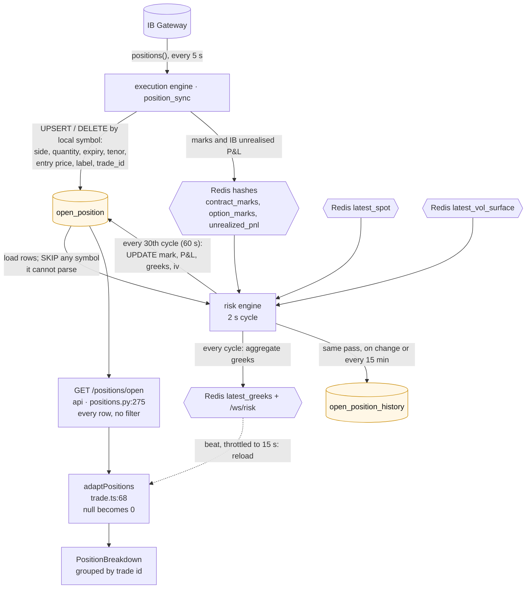
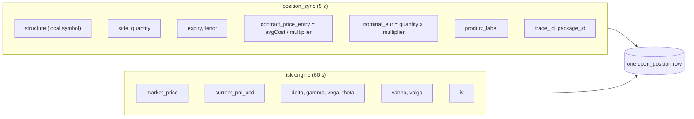
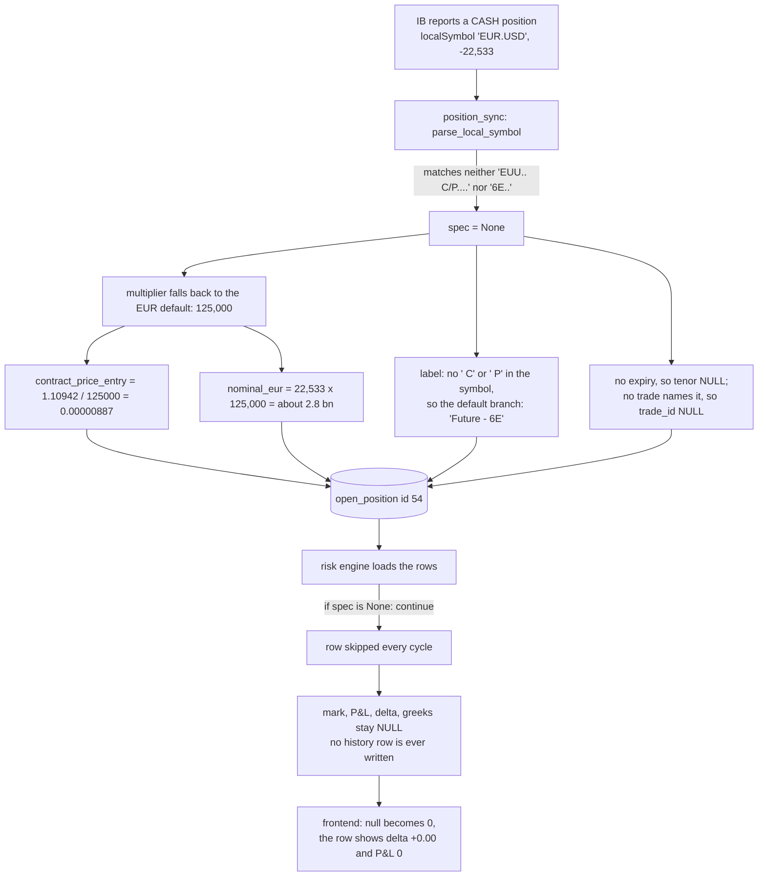
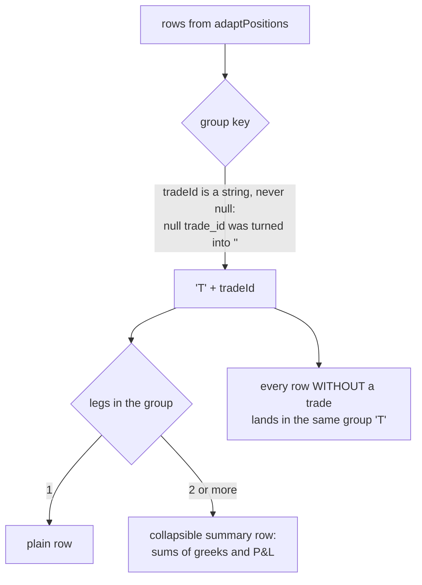

# Position breakdown (Risk view)

**Purpose of the panel:** show the risk of everything held, one line per
position with its greeks and P&L, grouped by trade.

**What it does instead:** it lists exactly what the broker holds (7 rows), but
one of them, the spot position, carries no delta and no P&L, and a trade whose
other leg is gone appears as an unrelated single option.

Part of [the position-panels analysis](README.md).

## Pipeline

| Step | Where | Cadence |
|---|---|---|
| Mirror of IB holdings | `src/engines/execution/position_sync.py:107` | 5 s |
| Greeks computed | `src/engines/risk/engine.py:165` (`run_cycle`) | 2 s, published to Redis only |
| Greeks written to the table | `engine.py:213-217`, `:398-409` | **60 s** (`HISTORY_PERSIST_CYCLES = 30`) |
| History snapshot | `engine.py:411-447`, `src/core/risk/history_policy.py:45` | when a value moves, or every 15 min |
| Endpoint | `src/api/routers/positions.py:275` | reads Postgres on each call, no cache |
| Frontend | `frontend/src/voldesk/data/provider.tsx:189`, `:320` | poll 60 s, reload on the risk beat at most every 15 s |

The handler's docstring says the greeks refresh "every 2 s". The table is
refreshed every 60 s; only the Redis aggregate moves every 2 s.

## Who writes which column

No other process writes the table. A row the risk engine never visits keeps
`NULL` in every column of the right-hand box.

## Why the spot row has no numbers

| Fact | Where |
|---|---|
| Only two symbol shapes parse | `src/core/contracts.py:42-43`, `:65-98` |
| The security type is read from IB but never used | `src/engines/execution/order_executor.py:355` |
| Default multiplier and entry price | `position_sync.py:156-163` |
| Default label | `src/core/products.py:66-75` |
| The skip | `src/engines/risk/engine.py:272-274` |
| Null shown as zero | `frontend/src/voldesk/data/live/trade.ts:58` |

Consequence on the totals. The position is real: spot order #6, sold 22,533 EUR
at 1.10942 on 2026-11-12 09:38 UTC. Its delta is about -22,533 EUR, roughly
**-$25,000**. It is missing from:

- the net delta of the Risk view (a frontend sum of these rows, null as 0);
- the Redis aggregate `latest_greeks:portfolio` and everything fed by it;
- `open_position_history`, so it can never be attributed.

The pre-trade check does **not** let it through. It counts held rows against
priced rows and refuses when they differ (`book_partially_priced`,
`src/core/risk/pretrade.py:122`). So while the spot row has no delta, every
new structured trade is refused: prod `trade_event` 618, 2026-11-12 11:35 UTC.
The refusal gave a count, not the name of the line. The published aggregate
had the opposite flaw: it dropped the row before counting, so it reported
`n_priced == n_positions`.

Prod row, as stored:

| id | structure | product_label | side | quantity | contract_price_entry | market_price | delta_usd | trade_id |
|---|---|---|---|---|---|---|---|---|
| 54 | EUR.USD | Future - 6E | SELL | 22533 | 0.00000887 | NULL | NULL | NULL |

## Grouping on screen

- `groupByTradeId` keys on `"T" + tradeId`, with a singleton branch for a null
  id (`frontend/src/voldesk/components/tradeGrouping.ts:21-35`). The adapter
  has already turned null into `""`, so that branch is never taken: two
  positions without a trade would be merged into one group labelled "—". Today
  there is only one such row.
- A leg prints "—" for gamma, vega, theta, vanna and volga when it has no IV
  (`PositionBreakdown.tsx:72`, `:43-47`). Delta and P&L always print, as 0 when
  the value is unknown.
- The panel has no totals row and filters nothing.

## Other things this panel gets wrong

| Symptom | Cause | Where |
|---|---|---|
| Trade 60 appears as a lone "Vanilla Call" | the panel only knows mirror rows; the put leg has none | this is the mirror rule itself |
| Stored tenor "2W", displayed "1M" for the same row | two ladders: the sync's (1W, 2W, 1M...) and the display's (1M to 6M only) | `position_sync.py:64-94`, `src/core/vol/tenors.py:146-167` |
| `tenor` documented as "never rolls" but it is rewritten every sync | the sync recomputes it from the expiry each cycle | `src/persistence/rows.py:31`, `position_sync.py:184` |
| Net vanna and volga exclude futures and spot by construction | the query keeps `structure LIKE 'EUU%'` | `src/api/routers/portfolio_panel.py:654-662` |
| A row can belong to a trade that is no longer alive | `trade_id` goes to the newest trade that ever named the contract | `position_sync.py:409-447` |

## What "same lines as the other panels" needs here

- This panel already has the right line set for what the broker holds. It is
  missing the book-only lines (shown on Trade) as flagged rows.
- Spot becomes a known instrument: its own label, entry price without a
  multiplier, a mark, a P&L and a delta of `quantity x spot`.
- A row without a trade stays its own line (fix the group key), and an unknown
  value prints "—", not 0.
