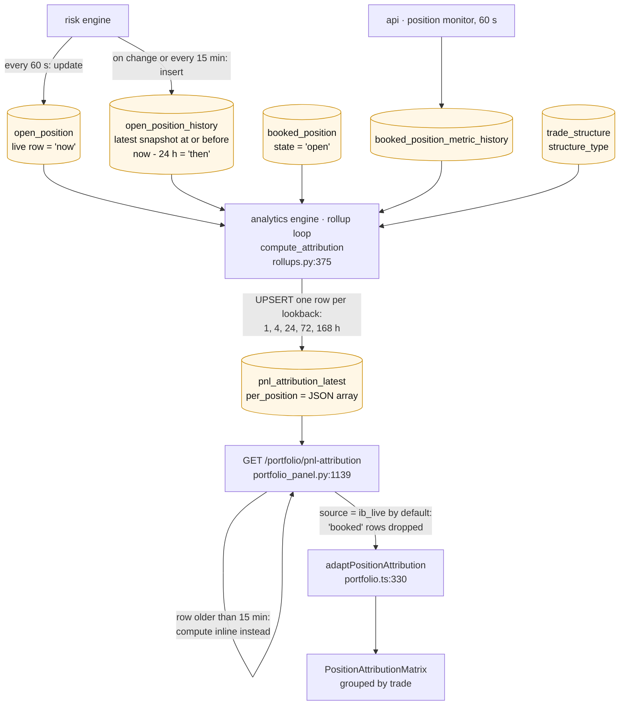
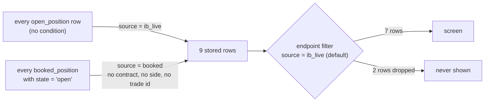
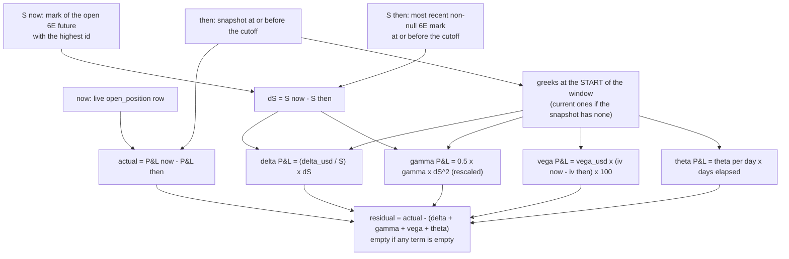
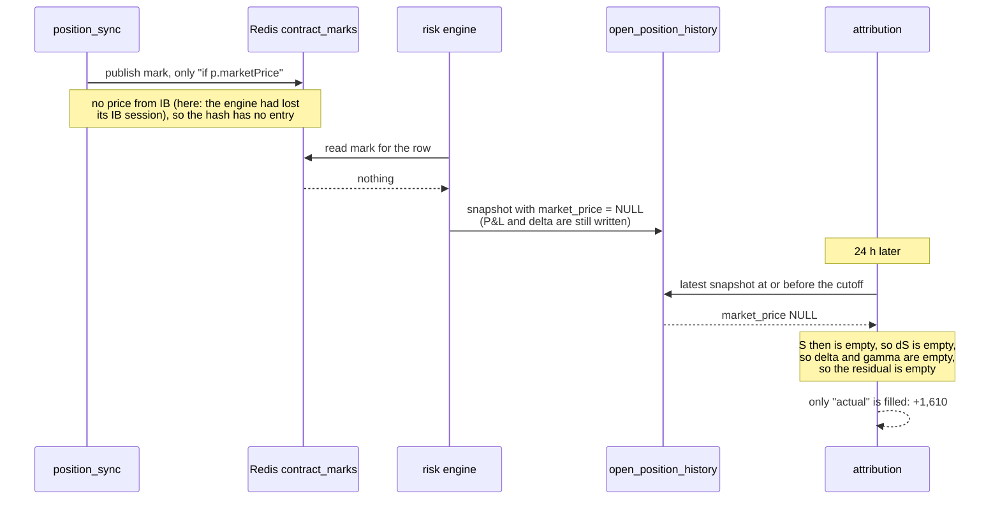
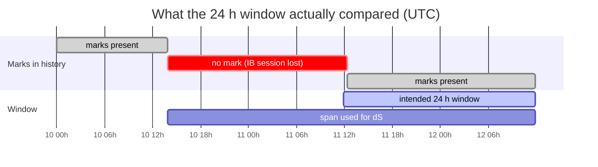
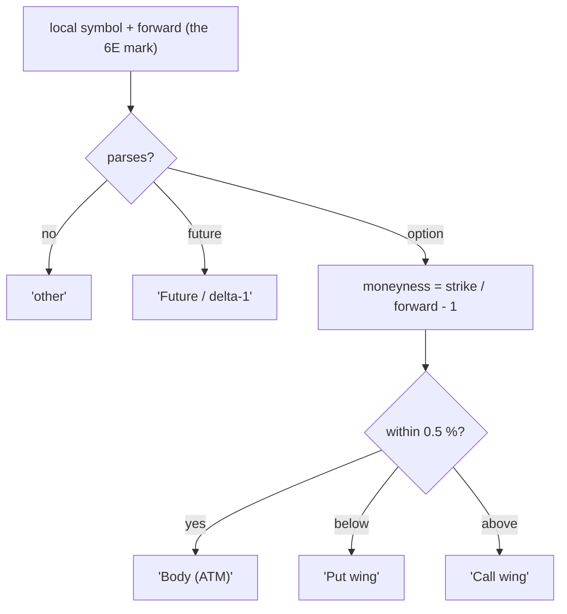

# P&L attribution by trade · 24h (Portfolio view)

**Purpose of the panel:** explain the last 24 hours of P&L, leg by leg: how
much came from the underlying moving (delta, gamma), from implied volatility
(vega), from time (theta), and what is left unexplained (residual).

**What it does instead:** it lists the 7 broker holdings, but the future has no
delta term, the spot line is empty, and on every option the unexplained part is
as large as the explained part. Two extra trade-level rows are computed and
stored, then filtered out.

Part of [the position-panels analysis](README.md).

## Pipeline

| Step | Where | Cadence |
|---|---|---|
| Snapshots | `src/engines/risk/engine.py:411-447` | on a move, or every 15 min; kept 90 days |
| Computation and store | `src/engines/analytics/engine.py:185-224`, `src/persistence/rollups.py:526-544` | every 300 s (120 to 600 by capacity preset) |
| Endpoint | `src/api/routers/portfolio_panel.py:1139-1172` | serves the stored row if younger than 15 min, else computes inline |
| Frontend poll | `frontend/src/voldesk/views/PortfolioView.tsx:1085-1090` | 60 s |

## The row set

- The 7 `ib_live` rows are the mirror rows, emitted unconditionally
  (`rollups.py:405`, `:434-446`). A row with no price and no greeks is emitted
  with every term empty.
- The 2 `booked` rows are trade-level duplicates of legs already present:
  booked_position 31 is the butterfly (trade 79), 33 is the long put (trade
  87). They are computed with their own inputs and scale (`rollups.py:268-313`,
  `:454-463`).
- Only 2 booked rows exist because only 2 booked trades are still `open`; the
  others were closed by the faulty check described in
  [04-book-vs-broker.md](04-book-vs-broker.md). Trades 60 and 88 are held at
  the broker and have no booked row.

## The computation, per leg

| Term | Formula in code | Where |
|---|---|---|
| actual | `current_pnl_usd` now minus at the snapshot | `src/core/risk/attribution.py:92` |
| S for an option | the book-level future mark, now and then | `rollups.py:316-344`, `:419` |
| S for a future | that row's own `market_price`, now and at **its** snapshot | `rollups.py:408` |
| delta | `(delta_usd / S) x dS` | `rollups.py:428-430`, `attribution.py:105` |
| gamma | `0.5 x gamma_usd x (1 / pip) x dS^2` | `attribution.py:106`, `rollups.py:424` |
| vega | `vega_usd x (iv_now - iv_then) x 100` | `attribution.py:107` |
| theta | `theta_usd x elapsed days` since the snapshot's own timestamp | `attribution.py:100`, `:108` |
| residual | actual minus the four; empty if one is empty | `attribution.py:110-114` |

## Why the future has no delta P&L

A future's P&L is entirely its delta term. The code does compute it, from the
row's own mark at both ends. The mark at the start of the window is missing.

Prod, position 51 (6EH7), the three snapshots just before the 24 h cutoff:

| Snapshot | market_price | current_pnl_usd | delta_usd |
|---|---|---|---|
| 11-11 11:49 | NULL | -12,965.97 | 974,601.25 |
| 11-11 11:48 | NULL | -13,044.72 | 974,522.50 |
| 11-11 11:47 | NULL | -13,189.09 | 974,378.12 |

Those snapshots fall in the hours when the execution engine had no IB session
(see the next section). Over the last 24 h, 47 of 493 snapshots of that row
have no mark. The
book-level probe skips NULL marks (`rollups.py:336`); the per-row probe does
not (`rollups.py:260-263`). So the options get a `dS` and the future, whose own
price it is, does not.

## Why the residual is as large as the delta term

Prod, 24 h window:

| Leg | delta | gamma | vega | theta | residual | actual |
|---|---|---|---|---|---|---|
| EUUG7 C1110 (BUY 10) | -6,322 | 652 | 363 | -92 | **+6,672** | 1,272 |
| EUUG7 C1130 (SELL 20) | 7,068 | -1,197 | -834 | 160 | **-7,028** | -1,832 |
| EUUG7 C1155 (BUY 10) | -1,246 | 307 | 248 | -44 | **+1,178** | 442 |
| EUUG7 P1120 (BUY 10) | 6,521 | 666 | 493 | -89 | **-8,674** | -1,082 |

Two causes are confirmed in the prod data. Both come from the same event: the
execution engine lost its IB session from 2026-11-10 13:49 UTC to 2026-11-11
about 12:45 UTC, and during that time no mark reached the snapshots.

**Cause A: the "then" price is 22 hours older than the window start.**
The probe for `S then` takes the latest snapshot at or before the cutoff *that
has a mark*, with no limit on how far back it goes (`rollups.py:328-342`).

| Probe | Row | Mark | Snapshot time |
|---|---|---|---|
| S now | 6EH7, live row | 1.11475 | 11-12 11:53 |
| S then, as computed | 6EH7, history | 1.12496 | **11-10 13:53** (cutoff was 11-11 11:53) |

So `dS = -0.0102`. The underlying really moved about `-0.0044` over the 24 h
(spot implied by the snapshots: 1.11365 to 1.10922). Every delta term is about
2.3 times too large: C1110 holds about 625,000 EUR of delta, `625,000 x
-0.0102 = -6,375`, the -6,322 shown.

**Cause B: the P&L at the two ends is not measured the same way.**
`current_pnl_usd` is IB's unrealised P&L when the Redis hash has it, and a
model recompute otherwise (`engines/risk/engine.py:372-377`). The model uses
spot as the price of the future (`engine.py:172`).

| End | Source | Future P&L (7 x 6EH7, cost 1.12865) |
|---|---|---|
| then (session lost) | model, spot 1.11365 | `(1.11365 - 1.12865) x 875,000 = -13,125` |
| now | IB, future mark 1.1156 | `(1.1156 - 1.12865) x 875,000 = -11,420` |

The difference, +1,610, is the "actual" P&L shown for the future. It is the
spot-to-future basis (about 0.006) times the position, not a market move: both
spot and the future fell over the window.

Other causes visible in the code, not measured here:

| # | Candidate | Where |
|---|---|---|
| 1 | "now" and "then" can come from two different 6E months when two are open | `rollups.py:321-343` |
| 2 | The greeks are model values (surface IV, spot as forward), while `actual` follows the option's own traded price | `engine.py:366`, `:375-377` |
| 3 | The leg's snapshot and the future's snapshot are taken at different times, each up to 15 min before the cutoff | `src/core/risk/history_policy.py:19-23` |
| 4 | Start-of-window greeks held for 24 h, with no cross terms (vanna, volga, charm) | `attribution.py:101-108` |
| 5 | `delta_usd` was scaled by spot and is unscaled by the future mark (a basis-sized error, under 1 %) | `rollups.py:428-430` |

## Wing labels

The option's right (call or put) is never read (`rollups.py:347-360`), and the
reference is the future's mark (about 1.116), not spot (about 1.109). So the
call C1110 sits below the forward and is labelled "Put wing", and the put P1120
sits within 0.5 % and is labelled "Body (ATM)". The label means "strike versus
forward", not "which option".

## Other things this panel gets wrong

| Symptom | Cause | Where |
|---|---|---|
| Spot line with every cell empty | the row has no P&L, no greeks and no history, but is emitted anyway | `rollups.py:405`; see [02](02-position-breakdown-risk.md) |
| A leg opened less than 24 h ago shows nothing | no snapshot before the cutoff, so `actual` is empty and so is everything else | `attribution.py:92-97` |
| The total residual is not total actual minus total terms | each total is a sum over the rows that have that term | `attribution.py:177-182`, `portfolio.ts:352-357` |
| `tenor` and `attrib_tenor` differ on the same row | two ladders, as in the Risk panel | `position_sync.py:64-86`, `src/core/vol/tenors.py:146-167` |
| Stale frontend comment says the endpoint totals include booked rows | the filter moved server-side | `portfolio.ts:352` |

## What "same lines as the other panels" needs here

- The row set is the shared position set. The trade-level `booked` rows are
  not lines of the portfolio; if kept, they are a roll-up, not a second source.
- A future's delta term is computed from a mark that exists: skip NULL marks
  in the per-row probe as the book-level probe already does, and stop writing
  snapshots without a mark.
- One underlying price series for `dS`, the same at both ends, tied to the
  month the option actually trades on, and a "then" price that is refused when
  it is older than the window start by more than a few minutes.
- P&L measured the same way at both ends: a snapshot taken without IB's number
  is marked as such and not differenced against one that has it.
- Spot: once priced (see 02), its P&L is all delta.
- A line with no data shows why (too young, no mark), not empty cells.
