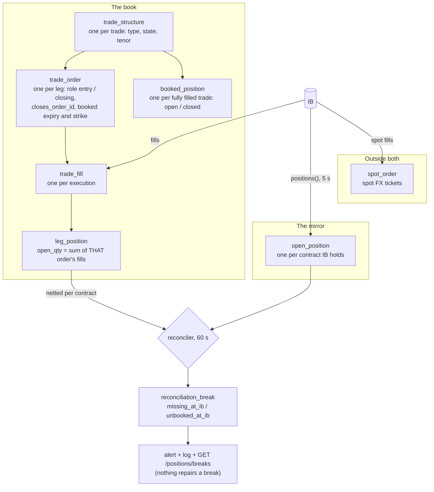
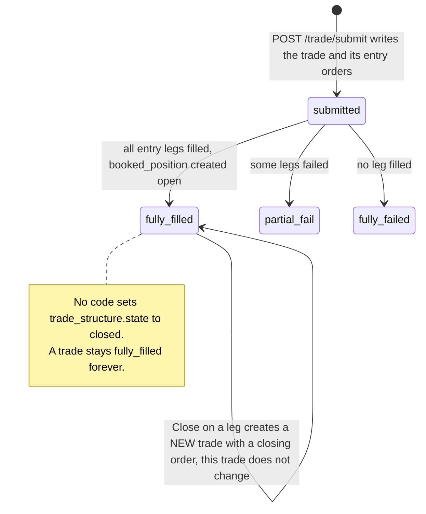
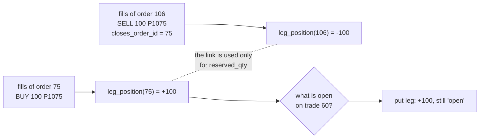
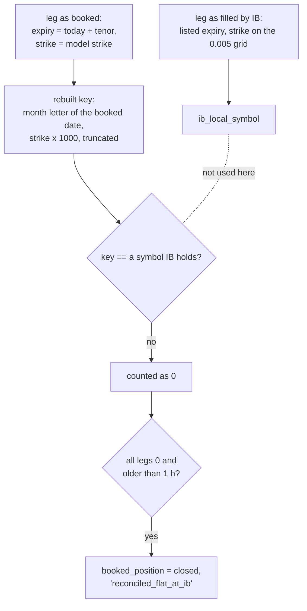
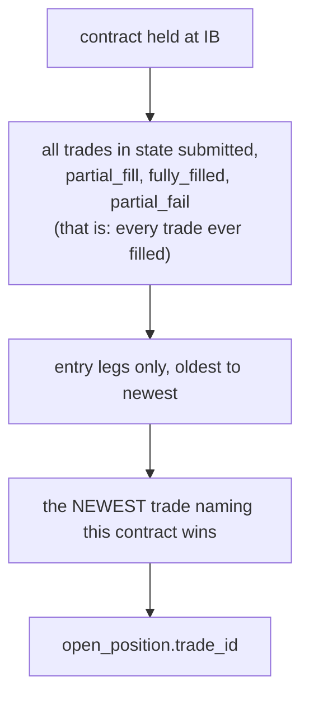

# Our book against the broker

The three panels disagree because they read two different pictures of the
portfolio: **the book** (what our tables say we hold) and **the mirror** (what
IB reports). This note explains how each picture is built and the five places
where the book drifts from the broker.

Part of [the position-panels analysis](README.md).

## The two pictures

Prod today: IB holds **7** positions. The book has **74** trades with a
non-zero leg. The reconciler has **26** unresolved breaks, the oldest from
2026-07-19.

| Break type | Meaning | Open today |
|---|---|---|
| `missing_at_ib` | the book holds it, the broker does not | 24 |
| `unbooked_at_ib` | the broker holds it, the book does not | 2 |

## How a trade is opened and closed

Entry paths and what each writes:

| Action | Writes to the book | Structure type written | Where |
|---|---|---|---|
| Structured trade (preview then submit) | trade + entry orders | the classifier's label: "butterfly", "long strangle 10d" | `src/api/routers/trade.py:985`, `:1086` |
| Close on one leg (Close position panel) | a **new** trade + one closing order | from the contract: `vanilla_call`, `vanilla_put`, `future_buy`, `future_sell` | `src/api/routers/positions.py:1046-1063`, `:1168-1208` |
| Close a whole trade | one **new** trade per leg | same | `src/api/routers/trades.py:115-152` |
| Exit-monitor close | a new trade reusing the parent's type | parent's | `src/api/orchestration/position_close.py:97-134` |
| Manual single-contract ticket (future or option) | **nothing** | - | `src/engines/execution/main.py:514-520` |
| Spot ticket | `spot_order` only | - | `main.py:489-513` |

That explains the two families of `structure_type` in the database: labels such
as "butterfly" are entries, names such as `vanilla_put` are closes.

## Drift 1: a close never reduces the leg it closes

`rebuild_leg` folds the fills of one order (`src/persistence/projection.py:23-29`).
A closing order gets its own row with the opposite sign. The two net to zero
only in the reconciler, which sums per contract (`src/engines/execution/reconciler.py:62-71`).
Every closed trade therefore keeps a non-zero leg, and its close keeps the
opposite one: that is most of the 74.

## Drift 2: nothing closes a leg when its contract expires

There is no expiry job. The reaper acts on stale *orders* (older than 300 s in
a working state), not on expired *contracts* (`src/engines/execution/reaper.py:121-126`).
When a contract expires, IB drops it without a fill, so the leg keeps its
quantity for ever.

Prod, legs still open in the book on contracts that expired:

| Contract month | Example legs | Expired |
|---|---|---|
| EUUQ6, 6EU6 | P1125 +100, C1155 +100, 6EU6 -13 | August, September |
| EUUU6 | C1140 +10, C1145 -10 | September |
| EUUV6 | C1145 -100, C1150 +20 | October |
| EUUX6 | C1115 +10, C1145 +10, C1170 +10 | November |

These are the 24 `missing_at_ib` breaks.

## Drift 3: spot and manual tickets never reach the book

A spot fill is stored in `spot_order` and nowhere else
(`src/engines/execution/spot_orders.py:95-112`). The mirror picks the position
up from IB with no check on its security type, so the reconciler finds it at
the broker and not in the book: `unbooked_at_ib`, by construction, every time.

| Spot order | When (UTC) | Side | Qty | Fill | Seen by the reconciler |
|---|---|---|---|---|---|
| #4 and #5 | 11-09 11:17 | SELL 44,658, BUY 10,000 | net -34,658 | 1.11965 / 1.11975 | break #29, gone at 23:59 the same day |
| #6 | 11-12 09:38 | SELL | 22,533 | 1.10942 | break #30, open |

The 11-09 position left the mirror at 23:59, which matches the gateway's
nightly restart: after it, IB no longer listed the cash position. The code has
no midnight rule; the row is deleted when IB stops reporting it
(`position_sync.py:218-226`). Whether the cash balance itself changed was not
checked.

## Drift 4: the "closed" check looks for a contract name IB never used

`booked_position` is the trade-level row. Every sync, for each `open` row, the
engine counts how much of its legs IB holds. If the count is 0 and the row is
older than one hour, it is closed with reason `reconciled_flat_at_ib`
(`src/engines/execution/position_sync.py:513-540`).

The count matches on a symbol **rebuilt from the preview's numbers**, not on
the symbol IB actually filled (`position_sync.py:516` uses
`_structure_order_to_ib_key`; the trade link at `:444` uses `ib_local_symbol`).

Prod, the four trades held today:

| Trade | Leg as booked | Rebuilt key | IB symbol | Match | Result |
|---|---|---|---|---|---|
| 60 | put, strike 1.07720, Dec | `EUUZ6 P1077` | `EUUZ6 P1075` | no | closed one hour after entry, `ib_qty_diff` 200 |
| 60 | call, strike 1.20786, Dec | `EUUZ6 C1207` | `EUUZ6 C1210` | no | (same row) |
| 79 | call, strike 1.10769 | `EUUG7 C1107` | `EUUG7 C1110` | no | open, `ib_qty_total` 10 of 40 |
| 79 | call, strike 1.13193 | `EUUG7 C1131` | `EUUG7 C1130` | no | (same row) |
| 79 | call, strike 1.15512 | `EUUG7 C1155` | `EUUG7 C1155` | **yes** | (same row) |
| 87 | put, strike 1.12000 | `EUUG7 P1120` | `EUUG7 P1120` | **yes** | open, diff 0 |
| 88 | future, booked 2027-02-03 | `6EG7` (February) | `6EH7` (March) | no | closed one hour after entry, `ib_qty_diff` 7 |

A booked trade survives only when one of its strikes happens to fall on the
grid. Of 33 booked trades, 31 are closed and 2 are open. Consequences:

- the exit monitor and the attribution's `booked` rows see 2 trades, not 4;
- a trade closed this way is not selected again, so the mistake is never revisited;
- closes from the Close panel never close the booked row either, because the
  finaliser needs an exit alert (`src/api/orchestration/position_close_finaliser.py:49-55`).

## Drift 5: a repaired leg has no fill, so no book quantity

When an order is stuck and the mirror shows the contract is held, the order
reconciler marks the leg `filled` with its full quantity
(`src/engines/execution/order_reconciler.py:119-128`). It writes no
`trade_fill` and does not rebuild the leg. `leg_position` is built from fills
only, so the leg has no book quantity.

Prod: trade 87, order 108, EUUG7 P1120, state `filled`, `qty_filled` 10,
**0 fills**, no `leg_position` row. The reconciler therefore reports the
contract as `unbooked_at_ib` (book 0, broker 10), although the trade is booked
and held. Why the original fill event was lost is not known.

## Who owns a held contract

`position_sync.py:409-447`. The choice ignores direction, the book quantity,
the booked state and expiry. A new entry on a contract takes over the mirror
row from the older trade; the older trade then shows the leg as unlinked, or
disappears from the Trade panel if it owns nothing else.

## What each endpoint treats as open

| Endpoint | Rule | Reads the book | Reads the mirror |
|---|---|---|---|
| `GET /positions/open` | every mirror row | no | yes |
| `GET /positions/structured` | newest 50 trades owning a mirror row; in them, every leg that is linked or has a book quantity | yes | yes |
| `GET /portfolio/pnl-attribution` | every mirror row, plus every `booked_position` still `open` | partly (`booked_position`) | yes |
| reconciler | book quantity per contract against mirror quantity | yes | yes |

## What a single line set needs from this layer

In dependency order:

1. **The book nets.** A closing fill reduces the leg named by
   `closes_order_id`; a contract past its expiry closes its legs. After that,
   "book quantity per contract" equals what the reconciler already computes.
2. **Everything traded is booked.** Spot tickets and manual tickets write a
   trade, or the mirror row is accepted as a line of its own with a clear
   "not booked" state.
3. **One matching key.** Every book-to-broker comparison uses the symbol IB
   filled (`ib_local_symbol`), which the fill handler already stores.
4. **A repair writes what a fill would have written**, so the leg has a
   quantity.
5. **Breaks are visible where the positions are.** A line that exists on one
   side only appears on all three panels with its break type, instead of being
   a row on one panel and an alert somewhere else.

Existing data needs a one-time cleanup before any of this shows correctly: 24
expired or never-netted legs, 31 booked rows closed by the faulty check (2 of
them, trades 60 and 88, still held), and one leg without fills.
