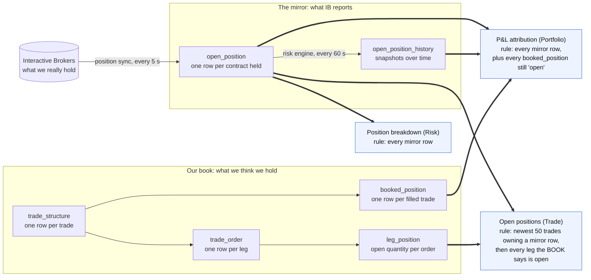
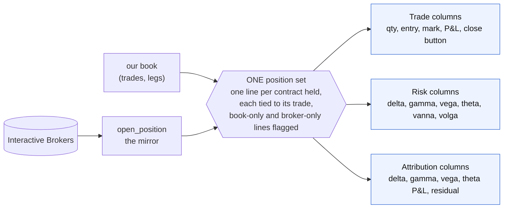

# Position panels: one portfolio, three row counts

Analysis of 2026-11-12. Three panels are meant to show three perspectives on
the **same** portfolio: same lines, different columns. They do not. This folder
traces each pipeline from Interactive Brokers to the screen, with the prod data
that shows each gap.

| Note | Panel | View |
|---|---|---|
| [01-open-positions-trade.md](01-open-positions-trade.md) | Open positions | Trade |
| [02-position-breakdown-risk.md](02-position-breakdown-risk.md) | Position breakdown | Risk |
| [03-pnl-attribution-portfolio.md](03-pnl-attribution-portfolio.md) | P&L attribution by trade · 24h | Portfolio |
| [04-book-vs-broker.md](04-book-vs-broker.md) | the layer underneath all three: our book against the broker | - |

Diagrams are Mermaid, at the owner's request for this analysis (the rest of
`docs/` uses SVG, see `docs/README.md`). Evidence was read on prod through the
read-only path of `docs/ops/runbooks.md` section 5; nothing was changed.

## What each panel shows today

Prod, 2026-11-12 around 11:00 UTC. IB holds 6 contracts and 1 spot FX position.

| Line | Open positions (Trade) | Position breakdown (Risk) | P&L attribution (Portfolio) |
|---|---|---|---|
| Trade 60 · EUUZ6 P1075 (put) | **shown**, all zeros, cannot be closed | absent | absent |
| Trade 60 · EUUZ6 C1210 (call) | shown as a strangle leg | shown as a lone "Vanilla Call" | shown |
| Trade 79 · EUUG7 C1110 | shown | shown | shown |
| Trade 79 · EUUG7 C1130 | shown | shown | shown |
| Trade 79 · EUUG7 C1155 | shown | shown | shown |
| Trade 87 · EUUG7 P1120 | shown | shown | shown |
| Trade 88 · 6EH7 future | shown | shown, delta only | shown, **no delta P&L** |
| No trade · EUR.USD spot, short 22,533 | shown as "Future - 6E", no numbers | shown, **no delta** | shown, **every cell empty** |
| Booked butterfly (trade 79) | - | - | stored, not shown |
| Booked long put (trade 87) | - | - | stored, not shown |
| **Rows** | **8** | **7** | **7 shown, 9 stored** |

## Why: three definitions of "open"

Each panel answers "what is open?" from a different table, with a different rule.

| Panel | Table that decides the rows | Rule | Effect today |
|---|---|---|---|
| Open positions | `trade_structure` + `leg_position`, joined to `open_position` | the 50 newest trades that own at least one mirror row; inside them, every leg whose **book** quantity is not zero | one leg the broker no longer holds |
| Position breakdown | `open_position` | every row | exactly what IB holds, including a spot row nothing can price |
| P&L attribution | `open_position`, plus `booked_position` where `state = 'open'` | every mirror row, then one extra row per booked trade | 7 legs plus 2 trade-level duplicates, hidden by a filter |

The book and the mirror disagree, so any panel that mixes them disagrees with
a panel that reads only one. The reasons the book and the mirror disagree are
in [04-book-vs-broker.md](04-book-vs-broker.md):

1. a close never reduces the leg it closes;
2. nothing closes a leg when its contract expires;
3. spot tickets and manual single-contract tickets never reach the book;
4. the check that marks a booked trade "closed" compares against a contract
   name the broker never used;
5. one repair path marks a leg filled without recording the fill.

## The target the owner set

All three panels list the same lines; only the columns change.

What that requires, in order of dependency (each item is detailed in the note
that owns it):

| # | Change | Note |
|---|---|---|
| 1 | One shared definition of the line set, served by one endpoint or one server-side function, used by all three panels | this file |
| 2 | A close reduces the leg it closes, and an expired contract closes its legs, so the book stops holding what the broker dropped | 04 |
| 3 | Spot FX is a first-class instrument: labelled, priced, given a delta, booked | 02, 04 |
| 4 | A line the book holds and the broker does not (or the reverse) is shown on **all** panels with a visible flag, never on one panel only | 01, 04 |
| 5 | The booked-trade "closed" check matches on the contract the broker actually filled | 04 |
| 6 | Attribution: a future's P&L is its delta term; the underlying move comes from one consistent price | 03 |

Nothing in this folder has been implemented; these notes describe the system as
it runs at commit `dbc237bc`.
