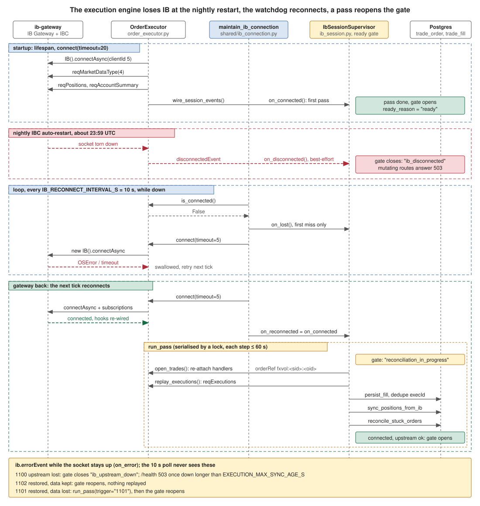
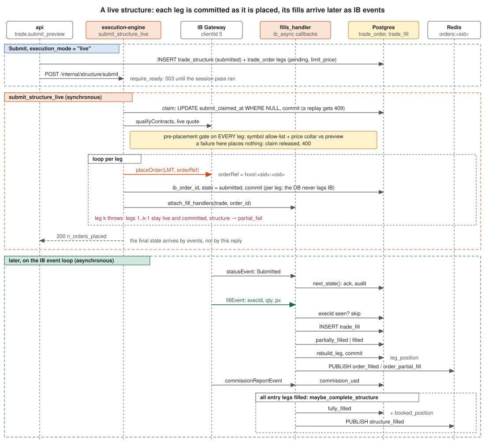

# IB integration

Every service that touches the market opens its own connection to the IB Gateway
via `ib_async`. The connection wrapper with backoff is
[`src/shared/ib_connection.py`](../../src/shared/ib_connection.py); the execution
engine's connection is
[`engines/execution/order_executor.py`](../../src/engines/execution/order_executor.py).

## The gateway

The stack runs `gnzsnz/ib-gateway` as the `ib-gateway` container (IB Gateway +
IBC). Engines reach it on the internal port `4002` over the `fxvol-external`
network. Outbound IB traffic is isolated on that network.

## One client ID per service

`ib_async` requires a distinct `clientId` per socket. Each engine binds its own
via `IB_CLIENT_ID` (`docker-compose.yml`):

| Service | clientId |
|---|---|
| `market-data` | 1 |
| `vol-engine` | 2 |
| `risk-engine` | 3 |
| `execution-engine` | 5 |

The api's own `OrderExecutor` (used by `api.routers.orders`) uses clientId 4. A
cycle engine (market-data/vol/risk) re-checks `ib.isConnected()` at the top of its
loop and reconnects inline; the request-driven execution engine instead runs a
`maintain_ib_connection` watchdog that polls `is_connected()` every 10s and calls
the idempotent `connect()` while down. Polling is deliberate — a torn-socket
`disconnectedEvent` is best-effort, the poll is the guarantee.

## Backoff and observability

`connect_ib_with_backoff(ib, host, port, client_id, ...)` retries with an
exponential backoff (capped at 60s, `shared.backoff`), yielding via
`asyncio.sleep` so the event loop keeps running. In prod it retries forever, since
the Gateway comes back from its nightly ~23:59 restart. Each attempt mirrors
session state into the Prometheus gauge `ib_session_connected{client_id}` for the
Grafana "IB session uptime" panel.

## Session resilience (execution engine)

The execution engine keeps orders in flight across the Gateway's nightly
restart, a torn socket and an IBKR upstream outage. Module:
`engines/execution/ib_session.py` (#321).

The diagram follows one night: the startup connect, the Gateway restart, the
10 s watchdog retries, then the reconnect and the pass that reopens the gate.

| Signal | How it is seen | What happens |
|---|---|---|
| socket down | `maintain_ib_connection` poll, `disconnectedEvent` | gate closes (`ib_disconnected`); watchdog reconnects and runs the pass |
| 1100 upstream lost | `ib.errorEvent` (socket stays up) | gate closes (`ib_upstream_down`); `/health` 503 once the outage exceeds `EXECUTION_MAX_SYNC_AGE_S` |
| 1102 restored, data kept | `ib.errorEvent` | gate reopens, nothing to replay |
| 1101 restored, data lost | `ib.errorEvent` | full pass, then the gate reopens |

**The pass** (`IbSessionSupervisor.run_pass`), serialised and run after every
successful connect: handlers re-attached on every open IB order whose
`orderRef` maps to a DB row still in flight (`fxvol:<structure>:<order>` for
options, `fxvol:spot:<id>` for cash), `reqExecutions` replayed through the
idempotent fill path (options dedupe on `execId`, spot re-folds the complete
fill list and never shrinks a booked quantity), one position sync, one
stuck-order reconcile. Each step has a `EXECUTION_SESSION_PASS_TIMEOUT_S`
budget; a failed step is reported in `/internal/session`, not a permanent
lock-out.

**The gate.** `/internal/orders`, `/positions/.../close`,
`/positions/close-by-symbol`, `/structure/submit`, `/structure/rollback` and
`/hedge` answer `503 {"code": "reconciliation_in_progress", "reason": ...}`
until the pass has completed on the current connection. Reads stay open.
`/health` carries `ready`, `ready_reason`, `ib_upstream_ok`,
`upstream_down_s`; `/internal/session` the full snapshot (last pass summary,
event counts). Metric: `ib_session_events_total{engine,kind}` with
`upstream_lost`, `restored_data_lost`, `restored_data_kept`, `socket_closed`,
`order_rejected`, `farm_status`, `connected`, `disconnected`.

## Order to fill

A live structure submit runs synchronously up to the last `placeOrder`; every
status and fill after that arrives as an `ib_async` event on the handlers
`attach_fill_handlers` wired, through the same idempotent `persist_fill` path the
reconnect pass replays (code: `engines/execution/live_submit.py`,
`engines/execution/fills_handler.py`).

## Market-data types

IB won't stream live quotes without a real-time subscription, so services request
a delayed type via `reqMarketDataType`:

- **market-data** and **vol-engine chain fetcher** request type **3** (delayed).
- **execution-engine** requests type **4** (delayed-frozen: delayed during hours,
  frozen after) on connect, so option tickers still populate a bid/ask and the
  marketable limit prices at the touch (see
  [order-lifecycle.md](order-lifecycle.md)).

On connect the execution engine also subscribes to positions
(`reqPositionsAsync`) and the account-summary ledger (`reqAccountSummaryAsync`) so
`ib.positions()` and per-currency cash populate after a reconnect.

## Single session per userid

IB allows one live session per userid. A web login on the client portal kicks the
container's IBC session, and the paper account is shared: prod runs the engines +
gateway 24/5 and owns the session. Stop the prod `ib-gateway` before any portal
access or a local IB run, or the running engines lose their connection.

## Paper vs live — READ_ONLY_API

Orders route to the IB **paper** account (the order builder stamps every ticket
`PAPER ACCOUNT`). The gateway's `READ_ONLY_API` setting is mirrored into the
engine as `IB_READ_ONLY` (`docker-compose.yml`, both default `no`). The
`OrderExecutor(readonly=...)` flag must match the gateway: when the gateway is
read-only, `ib_async`'s default handshake calls `reqAutoOpenOrders`, IB rejects
it ("Error 321 ... Read-Only mode"), and the connect never completes — passing
`readonly` through skips that call so the engine degrades to reads instead of
failing to connect.

## Secrets

IB credentials (`IB_USERID`, `IB_PASSWORD`, `VNC_PASSWORD`) live in AWS SSM
Parameter Store under `/fxvol/prod/*`, loaded into RAM at launch — never on disk,
never echoed. See [ops/secrets.md](../ops/secrets.md).
