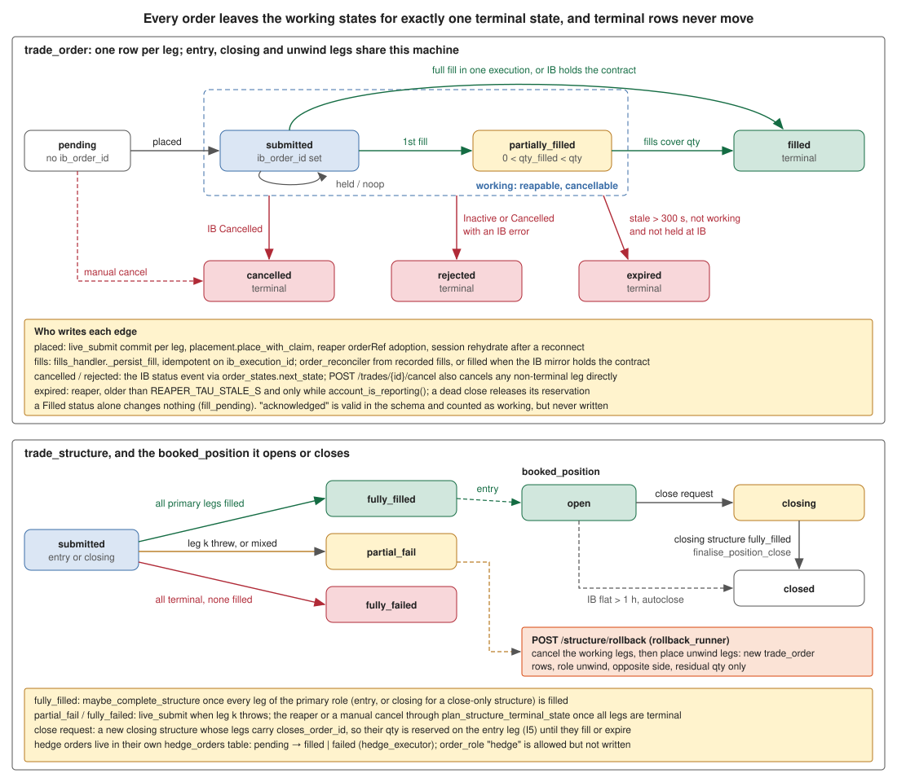

# Order lifecycle

This traces one structure from Submit, through IB placement and fills, to a
booked position. The live path is
[`engines/execution/live_submit.py`](../../src/engines/execution/live_submit.py)
and the fill callbacks in
[`fills_handler.py`](../../src/engines/execution/fills_handler.py).



## States

An order row (`trade_order`, one leg) is in one of seven states:

| State | Meaning |
|---|---|
| `pending` | written by the api, not yet at the broker |
| `submitted` | at the broker, nothing filled |
| `partially_filled` | at the broker, part filled |
| `filled` | every contract filled (ended) |
| `cancelled` | ended unfilled or partly filled, **because the desk asked** (`cancel_requested_at` is set) |
| `rejected` | ended because the broker refused it, with the broker's reason |
| `expired` | ended by the broker on its own (the end of the day for a DAY order), or never placed |

A trade (`trade_structure`) is `submitted` while its defining orders work,
then `fully_filled`, `fully_failed` or `partial_fail` (a real mix), and
`closed` once nothing of it is held.

IB's status is read by `core/execution/order_states.py`:

| IB status | What the row does |
|---|---|
| `PendingSubmit` / `PreSubmitted` / `Submitted` / `ApiPending` | `pending` becomes `submitted`; a row already further stays |
| `Filled` | nothing by itself: the executions end the row, never the status word |
| `Cancelled` / `ApiCancelled`, with an IB error | `rejected`, with the error text |
| `Cancelled` / `ApiCancelled`, no error | `cancelled` if the desk asked, `expired` otherwise |
| `Inactive`, with an IB error | `rejected` |
| `Inactive`, no error | **held**: the order is working (outside hours, a price cap); an `order_held` event says why |
| notice 10349 (time in force set to DAY) | ignored: the order is live |

## One writer

`persistence/order_state.py` is the only module that writes an order's state
(#489). Four functions, each taking the database row lock first, so the api
and the engine, two processes, exclude each other:

| Function | Edge |
|---|---|
| `mark_submitted` | `pending` to `submitted`, never backwards; records the broker's ids |
| `apply_fill_state` | what the recorded fills say; a filled row stays filled, an ended row stays ended on a late partial fill |
| `end_order` | `cancelled` / `rejected` / `expired`; releases the reservation of the leg a close held and finalises the trade, in the same transaction |
| `revive_order` | an ended row the broker still lists as open goes back to `submitted` |

A test fails on any assignment to `.state` in `src` that is not on its list
of other row kinds (a trade, a preview, a booked position, a spot order).

## Who follows an order to its end

| What can go wrong | Who owns it | Within |
|---|---|---|
| a row that never left for the broker (engine unreachable, timeout) | reaper: ends it `expired`, frees the leg | 5 min |
| an order sent and not recorded (the engine stopped between the send and the commit) | reaper: adopts it by its reference, never places it twice | 1 min |
| a fill the handlers missed (restart, reconnect) | reconciler: books it from IB's executions | 1 min |
| a trade whose entries all filled, left `submitted` | reconciler: completes it | 1 min |
| a multi-leg order whose later leg cannot be placed | live submit: cancels the legs still working, raises a critical event | at once |

Two things the engine does **not** do, on the owner rule "the app is not the
trader" (#490):

- **No late placement.** A worker that places an order minutes after the
  click sends a price the trader no longer watches. A row that did not leave
  is ended; the trader sends it again.
- **No automatic unwind.** A leg that filled before its package failed is a
  position. The engine does not sell what the trader bought: the position
  line shows `legs open / total`, the event is critical, the trader decides.

## One door to the broker

`engines/execution/door.py` holds the only call to `ib.placeOrder` (#491).
Every order, from a route, from the hedge sent after a fill or from its
retry loop, passes the kill switch and the ready gate there. A test fails
when another file calls `placeOrder`.

## Proven by scenarios

`tests/unit/engines/execution/test_order_lifecycle_sim.py` drives the real
submit, handlers, reaper and reconciler against a simulated broker
(`tests/fixtures/sim_broker.py`): partial fills, a refused second leg, a
fill during a cancel, an order sent and not recorded, an order IB holds, a
rejected close, a restart after the last fill, the end of the day, a
dropped connection. Each ends on one statement: the book equals the broker.

## Submit → IB

`submit_structure_live` runs in two phases so a failure never leaves half a
structure in an unknown state:

1. **Phase 1 (no side effects)** — validate + `qualifyContractsAsync` **every**
   leg before placing any. Qualification failure (the dominant real failure) is a
   zero-orders-placed abort; the claim is released so a retry is possible.
   A `FUT` on `CME` retries once with the legacy `GLOBEX` alias.
2. **Phase 2 (place + commit per leg)** — `placeOrder`, stamp `ib_order_id` /
   `ib_perm_id`, attach the fill handlers, set state `submitted`, then `commit`
   per leg so the DB never lags IB. A failure at leg *k* cancels the legs still
   working (IB's confirmation ends each row); the structure goes `partial_fail`.

An optional **combo (BAG)** path places combo-eligible option legs as one IB order
so they fill all-or-nothing (no naked half-fill), gated by `EXECUTION_USE_COMBO`.

## Idempotency

Three layers keep a replay from double-placing:

- **Submit claim (EXEC-1)** — an atomic `UPDATE ... WHERE submit_claimed_at IS
  NULL`, committed *before* anything touches IB. A replay loses the race and raises
  `LiveSubmitAlreadyClaimed` (HTTP 409). Only legs with `state='pending'` and
  `ib_order_id IS NULL` are eligible.
- **`orderRef`** — every IB order carries `fxvol:{structure_id}:{order_id}`
  (`order_ref()`). IB persists it across restarts, so an orphan stays discoverable
  and the reaper adopts it back onto its DB row.

- **`Idempotency-Key` on the api (#497)** — the browser sends one key per
  order request (close, trade close, spot, manual ticket, cancel, submit).
  The api runs a key once and replays its stored answer on a repeat
  (`api/middleware/idempotency.py`); a repeat of a request that never
  answered gets 409, because its outcome is not known. Two clicks are two
  keys: that stays the trader's decision.

Fills are idempotent on `ib_execution_id`
([`core/execution/fills.py`](../../src/core/execution/fills.py)):

```python
apply_fill_idempotent(seen_execution_ids, new_id) -> bool   # False = already persisted
```

The same execution id can be re-delivered on reconnect; the O(1) test drops it.

## Partial fills

On each `execDetailsEvent`, `fills_handler` persists the new `StructureFill`, then
recomputes the order aggregates from the **full** fill stream via
`update_order_aggregates`:

```
qty_filled = Σ fill.qty
avg_fill_price = Σ(qty·price) / Σ qty          # vwap
slippage_per_contract = signed vs preview_price, side-aware
fully_filled = qty_filled ≥ target_qty
```

`fully_filled` → state `filled`; otherwise `partially_filled`. Each fill rebuilds
the leg projection (`rebuild_leg`), and a closing fill releases the entry leg's
reservation. When all legs fill, `maybe_complete_structure` promotes the structure
to `fully_filled` and books the position (`state="open"`).

When the netted IB mirror can't confirm a fill (two trades holding opposite sides
net to zero at IB), `state_from_recorded_fills` repairs a stuck order from its
**own** recorded fills — book-only, it never fabricates a fill from the mirror.

## Marketable-limit pricing

The stored preview premium is theoretical and mis-prices real options (esp. OTM),
so a limit at it never crosses. `_marketable_limit` re-prices each leg off IB's
**live quote** at submit time; the pure core is `marketable_from_quote`:

```python
# BUY → ask, SELL → bid, snapped to the 0.0001 CME tick
BUY :  ceil(ref / tick) * tick        ref = ask or mkt
SELL:  floor(ref / tick) * tick       ref = bid or mkt
```

The theoretical `fallback` is used *only* when the relevant quote side is absent —
and a fallback BUY sits below the ask / SELL above the bid, so it does not cross:
that non-marketable rest is exactly why a leg with no live quote hangs `submitted`.
`_live_quote` warms a cold market-data line with a few retries first (the common
case for the 2nd+ leg of a strangle/spread) so it prices at the touch and fills.
