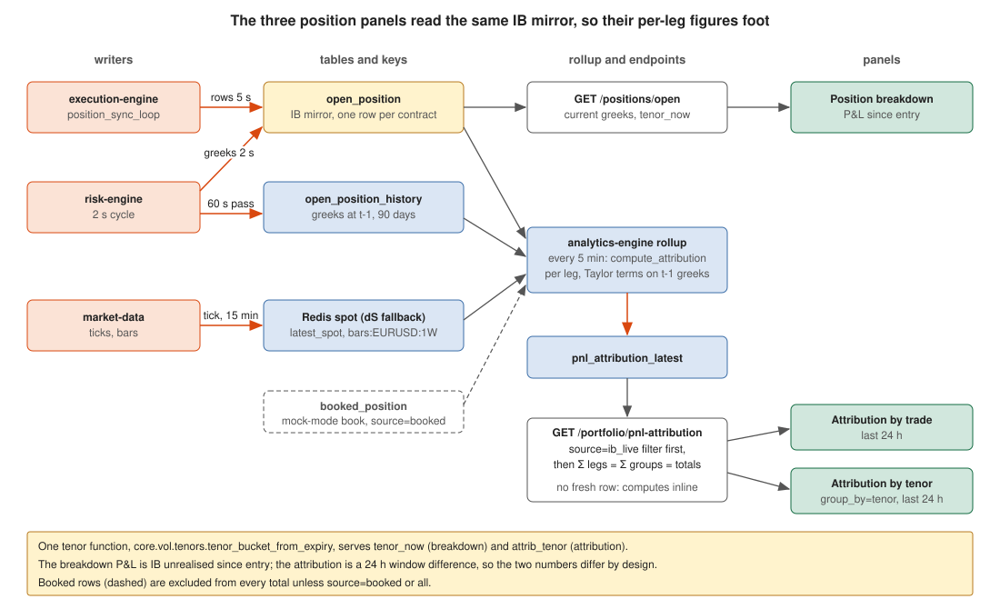

# Position figures: which table each panel reads, and why they foot

Three panels show per-position numbers that a trader compares by eye:
Risk › **Position breakdown**, Portfolio › **P&L attribution by tenor**, and
Portfolio › **P&L attribution by trade**. This note is the cross-table
verification the audit asked for (#377): per figure, the authoritative source,
how each panel derives from it, and the invariants that are tested. Verified
against the live book on 2026-11-06 (8 open IB legs, 3 trades, 1 future).

## The sources

| Table | Written by | Cadence | Holds |
|---|---|---|---|
| `open_position` | execution `position_sync_loop` (rows), risk engine (greeks, mark, pnl, iv) | rows every `SYNC_INTERVAL_S` (5 s in compose), greeks every 2 s | the IB mirror: one row per live contract, **current** state |
| `open_position_history` | risk engine | a 60 s pass, one row per position only when it moved or its heartbeat is due (#373) | the time series of `open_position` (same columns + `timestamp`) |
| `booked_position` + `booked_position_metric_history` | position monitor | per monitor cycle | the legacy mock-mode book; on prod these rows are artefacts without a structure |
| `leg_position` (via `/positions/book`) | position projector | on every fill | what we hold per leg, folded from fills; not a greeks source |
| Redis `latest_spot:EURUSD`, `bars:EURUSD:1W` | market data | tick / 15 min | spot now and the hourly spot history |

## The panels

| Panel | Endpoint | Rows | Greeks | P&L | Tenor |
|---|---|---|---|---|---|
| Position breakdown | `GET /positions/open` | `open_position`, one per contract, grouped by `trade_id` in the UI | current `delta_usd gamma_usd vega_usd theta_usd vanna_usd volga_usd` | `current_pnl_usd`: IB unrealised, **since entry** | `tenor_now` |
| Attribution by trade | `GET /portfolio/pnl-attribution` | same rows, `source=ib_live` | t-1 greeks from `open_position_history` (fallback: current) | `actual = pnl_now − pnl_then` over the **last 24 h**, decomposed δ·dS + ½Γ·dS² + V·dσ + Θ·dt + residual | `attrib_tenor` |
| Attribution by tenor | `GET /portfolio/pnl-attribution?group_by=tenor` | the same per-leg rows summed per bucket | same | same | `attrib_tenor` |

## Units, per figure

| Figure | Stored as | Breakdown shows | Attribution uses |
|---|---|---|---|
| delta | `delta_usd` = qty × Δ × multiplier, $ per 1.0 of spot | $ (auto-scaled) | δ_t-1 × dS, dS in spot units |
| gamma | `gamma_usd` = $ per pip (dΔ$ per 0.0001) | $k | ½ × (gamma_usd / 0.0001) × dS² |
| vega | `vega_usd` = $ per vol point | $ | V_t-1 × dσ, **dσ in vol points** (`iv` is stored as a fraction: ×100) |
| theta | `theta_usd` = $ per day | $ | Θ_t-1 × days elapsed |
| vanna, volga | $ per vol point, $ per vol point² | $k (÷1000 in the adapter) | not decomposed (land in the residual) |
| iv | fraction (0.0605) | % | fraction ×100 → points |
| P&L | `current_pnl_usd` since entry | $k | window difference, 24 h |

## What disagreed on 2026-11-06, and what changed

1. **Vega term 100× too small.** The IB branch fed `iv_now − iv_then` as a
   fraction to a per-vol-point vega. Fixed: fractions are converted to points
   before the decomposition. Booked rows already used `iv_avg_legs_pct`.
2. **Delta and gamma terms blank for every option.** dS came only from an open
   6E future's mark now and at t-1; the one future had been opened inside the
   window, so `forward_then` was None and both terms were None for the whole
   book. Fixed: when either side is missing, dS falls back to the market-data
   spot cache (`latest_spot` now, the hourly 1W bars at the window start);
   the response says which (`forward_source`: `future_mark`, `spot_cache`,
   `none`).
3. **Two tenors for one leg.** The breakdown showed the entry label
   (`open_position.tenor`, never rolls: "1W", "3M" for a future at 4.3M),
   the matrix a DTE bucket. Fixed: one function,
   `core.vol.tenors.tenor_bucket_from_expiry`, served as `tenor_now` by
   `/positions/open` and used by the attribution; the UI shows `tenor_now`.
4. **Totals that could differ.** The by-trade panel filtered IB legs client
   side, the by-tenor matrix summed IB + booked rows server side. Fixed:
   `source=ib_live|booked|all` (default `ib_live`) applied before totals and
   groups, so `Σ per-leg = Σ groups = totals` on one set (tested).
5. **Different windows read as the same number.** Breakdown P&L is since
   entry, attribution is the last 24 h. Not a bug; the panel titles now carry
   "· 24h" and the payload carries `window_start`.

## Invariants (tests)

- `Σ per_position[k] == Σ groups[k] == totals[k]` for every term, on the
  filtered set (`test_portfolio_attribution_sources.py`).
- `actual == δ + ½Γ + V + Θ + residual` per leg whenever every term is
  measurable (`test_portfolio_pnl_attribution.py`).
- A term nobody could measure stays `None`, never `0`
  (`test_portfolio_attribution_groups.py`).
- One tenor bucket function, clamped to the 1M..6M ladder
  (`test_portfolio_attribution_sources.py`).

## What is still different by design

- `/positions/book` is the fills ledger (per entry leg, signed `open_qty`,
  closing legs as negative rows); it is the authority for *what we hold*, not
  a greeks or P&L source, and it is reconciled against `open_position` by
  `/positions/breaks`.
- Booked positions (`source=booked`) are the mock-mode book. On prod they
  are excluded from every total by default; #330 covers their retention.
- The attribution rollup is materialised (#368): the analytics engine writes
  `pnl_attribution_latest` every 5 min from the sources named here, and the
  endpoint computes inline from the same sources only when no fresh row exists.
