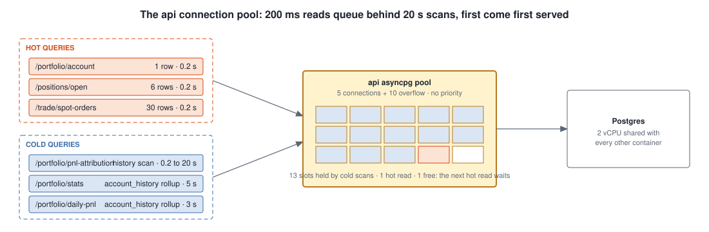
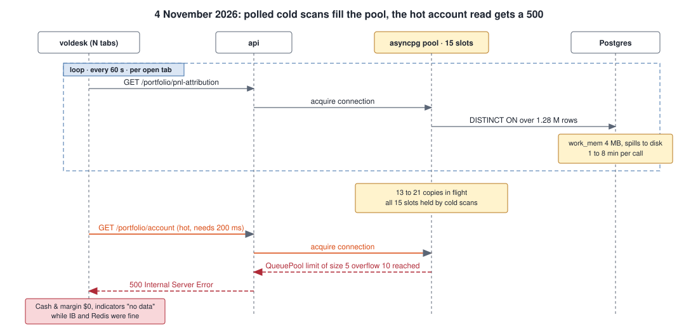
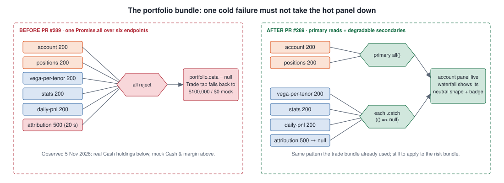
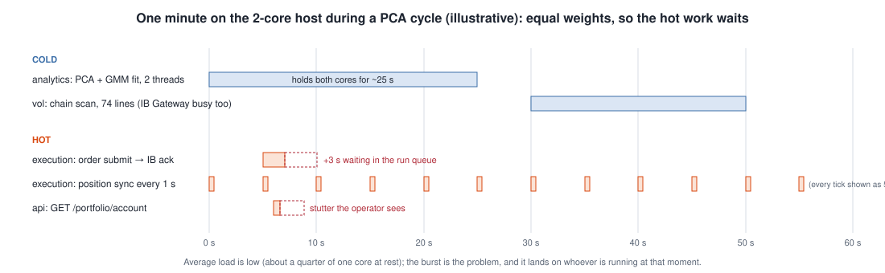
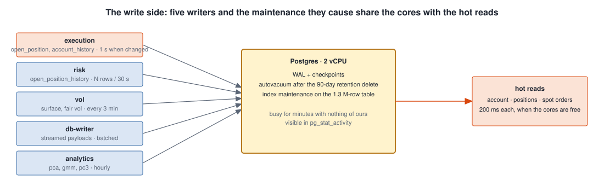
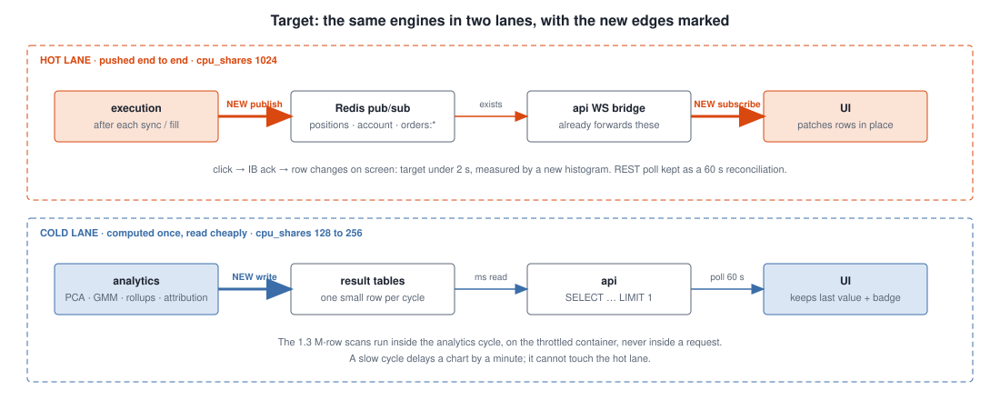

# Problem register

Each problem has one mechanism, one diagram where a diagram shows the
mechanism better than prose, and the evidence as it stands on 2026-11-05
(HEAD `c741160f`). Status moves to `closed` when the task that owns it ships;
the owning task is in [02-tasks.md](02-tasks.md).

| # | Problem | Path touched | Severity | Owning task | Status |
|---|---|---|---|---|---|
| P1 | One Postgres pool, first come first served | hot read vs cold read | high | T4, T9 | open |
| P2 | One UI bundle per domain fails as a whole | hot panel vs cold request | high | T5 (partly done, PR #289) | partial |
| P3 | Equal CPU priority for every container | hot compute vs cold compute | high | T1 | open |
| P4 | Postgres write side shared with hot reads | hot read vs cold write | medium | T9 | open |
| P5 | Hot state is polled although push channels exist | hot update latency | high | T2, T3 | open |
| P6 | Cold results recomputed on every request | hot read vs cold compute | high | T4 | open |
| P7 | Freshness is stamped once and never ages; mock spot fallback | perceived truth | high | T5 | open |
| P8 | No latency measurement | all | medium | T6 | open |
| P9 | IB Gateway load from option-chain subscriptions | hot ticks vs cold chain | medium | T8 | open |
| P10 | Analytics computed twice (vol-engine and analytics-engine) | cold compute, doubled | medium | T1 | open |

---

## P1 — One Postgres pool, first come first served

**Symptom.** Account and position reads that take 200 ms return 500, or
wait for seconds, while the database is otherwise healthy.

**Mechanism.** The api holds one asyncpg pool (5 connections plus 10
overflow). Every REST endpoint acquires from it, whether it reads six rows or
scans 1.3 million. A cold query holding a connection for 20 s holds it
against a hot read that needs it for 200 ms.

**Incidents.**
- 2026-11-04: the attribution endpoint ran a `DISTINCT ON` over the whole
  history table; polled every 60 s per tab, 13 to 21 copies piled up and held
  every slot; `/portfolio/account` got `QueuePool limit reached` and the desk
  showed $0 while IB and Redis were fine. Fixed by PR #285 (LATERAL probe,
  index, 20 s statement timeout).
- 2026-11-05: the same endpoint hit the new 20 s timeout through a second
  query shape (a forward lookup with no matching 6E future). The timeout did
  its job; the damage came through P2. Fixed by PR #289.

**Evidence today.** Five `DISTINCT ON (date_trunc('day', timestamp))` scans
remain in `src/api/routers/portfolio_panel.py` (lines 188, 1915, 2166, 2214,
2288), 3 to 20 s each, still polled by the Portfolio tab (issue #286).

**Impact.** Hot reads share the fate of the slowest cold query of the moment.

---

## P2 — One UI bundle per domain fails as a whole

**Symptom.** A hot panel goes blank, or worse shows a mock value, because an
unrelated cold request failed.

**Mechanism.** The provider fetched each domain as one `Promise.all`. One
rejection rejected the bundle; the Trade tab then fell back to the trade
slice's account, which is the trade-book bootstrap mock ($100,000 net
liquidation, $0 cash).

**Evidence today.** The portfolio bundle degrades per endpoint since PR #289.
The trade bundle already did. The risk bundle (`/portfolio/var` plus
`/portfolio/risk-per-tenor`) is still one `Promise.all`
(`frontend/src/voldesk/data/provider.tsx`, `liveRisk`).

**Impact.** The operator loses trust in the numbers that matter most at the
exact moment a cold request is slow.

---

## P3 — Equal CPU priority for every container

**Symptom.** A stutter in the order ticket or the account panel that lasts a
few seconds and recurs every hour or every three minutes.

**Mechanism.** Two cores, thirteen containers (twenty with observability).
Docker gives every container the same CPU weight. When the analytics engine
fits PCA and GMM it takes both cores for tens of seconds; when the vol engine
scans the option chain the IB Gateway's JVM is busy too. The execution
engine's order submit and the api's account read wait in the run queue behind
them. The only hard cap today is `cpus: 0.5` on the analytics engine.

**Evidence today.** `docker-compose.yml` sets no `cpu_shares` anywhere. At
rest the stack uses about a quarter of one core (averaged `docker stats`,
2026-11-05); the problem is the burst, not the average.

**Impact.** Latency spikes on the hot path at a cadence set by the cold path.

---

## P4 — Postgres write side shared with hot reads

**Symptom.** Postgres busy for minutes with nothing of ours in
`pg_stat_activity`; hot reads slow during that window.

**Mechanism.** Five writers (execution, risk history every 30 s, vol surfaces,
db-writer batches, analytics) plus the maintenance they cause (WAL,
checkpoints, autovacuum after the 90-day retention delete) run on the same two
cores as the hot reads.

**Evidence today.** `open_position_history` holds 1.3 million rows at one row
per open position per 30 s; the retention delete runs on risk-engine start
(`src/engines/risk/engine.py`, `_prune_history`), followed by autovacuum.
Postgres read 89 % CPU in one sample on 2026-11-05 with no active query of
ours.

**Impact.** Not an incident yet; the same shape as P1 on the write side.

---

## P5 — Hot state is polled although push channels exist

**Symptom.** A fill at IB appears in the Orders blotter up to 30 s later; a
position change up to 15 s later; the account snapshot up to 60 s later.

**Mechanism.** The execution engine writes positions and account snapshots to
Postgres; the UI reads them back on timers. Meanwhile the api already serves
`/ws/positions` and `/ws/orders/{structure_id}`, the Redis bridge already
forwards the `positions`, `account` and `orders:*` channels, and the bus has
`publish_position_update` and `publish_account`. Nothing calls those two
helpers, and the desk subscribes only to ticks, vol and risk.

**Evidence today.** `src/bus/publisher.py` (`publish_position_update`,
`publish_account`) have no caller in `src/engines`;
`frontend/src/hooks/streams.ts` exposes `useTicks`, `useVolStream`,
`useRiskStream` only; `TRADE_POLL_MS = 15_000`, orders 30 s, portfolio 60 s in
`frontend/src/voldesk/data/provider.tsx`.

**Impact.** The single largest contributor to the desk feeling slow, and the
cheapest to fix: two edges close a loop that is otherwise built.

---

## P6 — Cold results recomputed on every request

**Symptom.** Portfolio statistics and attribution take 3 to 20 s per call and
sometimes time out.

**Mechanism.** Daily rollups and attribution are computed from the raw history
tables inside the HTTP request, once per poll per tab, instead of once per
cycle by the engine that owns the data.

**Evidence today.** `/portfolio/stats` 5.3 s, `/portfolio/daily-pnl` 3.4 s,
`/portfolio/pnl-attribution` 0.2 to 20 s (measured 2026-11-05); issue #286.

**Impact.** P1's pressure on the pool; the Portfolio tab's slowest panels.

---

## P7 — Freshness is stamped once and never ages; mock spot fallback

**Symptom.** A panel shows a green freshness badge on data that is minutes old;
the spot shown in five places is a hard-coded mock when the tick stream is
down.

**Mechanism.** `useFetch` computes the age at fetch time
(`frontend/src/hooks/useFetch.ts:42`) and nothing re-evaluates it; the surface
adapter ignores the server timestamp; `DATA.SPOT` is the silent fallback in
`DashboardView.tsx:149`, `PortfolioView.tsx:1062`, `TradeView.tsx:971`,
`OrderBuilder.tsx:352,725`. The vol read paths carry a `timestamp` but no
stale or source flag (`api/orchestration/vol_service.py:51-84`).

**Evidence today.** Audit 09 items 1, 2, 4 and audit 05 item 10 (verified
2026-11-05; tickets #347, #328).

**Impact.** "Fluid" is also "truthful": a fast panel showing stale data as
live is worse than a slow one.

---

## P8 — No latency measurement

**Symptom.** Nobody can say whether an order feels slow because of IB, the
engine, the api, or the browser.

**Mechanism.** No histogram exists for click to IB acknowledgement or for fill
to screen; `/health` returns a constant and the deploy smoke check cannot tell
new code is live.

**Evidence today.** `shared/observability.py` exposes engine cycle metrics
only; no end-to-end timer; Prometheus and Grafana are back on prod since
2026-11-05 (PR #294) with no dashboard panel for these.

**Impact.** Every other task in this programme is tuned blind without it.

---

## P9 — IB Gateway load from option-chain subscriptions

**Symptom.** The IB Gateway's JVM at 40 % of a core every three minutes while
the vol engine scans the chain; spot ticks and order acknowledgements share
that process.

**Mechanism.** 74 live market-data lines (18 strikes per side per tenor) are
opened every cycle, with concurrency 1 (`VOL_MAX_CONCURRENT`,
`src/engines/vol/chain_fetcher.py`). The Gateway serialises everything through
one session.

**Evidence today.** Measured 43 % during a scan and 1.4 % between scans
(2026-11-05 `docker stats`, averaged).

**Impact.** Bounded and periodic, but it coincides with P3's burst.

---

## P10 — Analytics computed twice

**Symptom.** Two PCA and GMM fits per hour on a two-core box.

**Mechanism.** The analytics engine was extracted so the heavy batch could be
capped on its own, but the cutover flag `VOL_INLINE_ANALYTICS` still defaults
on (`src/engines/vol/engine.py:63`, `docker-compose.yml:217`), so the vol
engine runs the same batch too.

**Evidence today.** Audit 06 item 7 (verified 2026-11-05; ticket #334).

**Impact.** Doubles P3's worst burst for no result.
