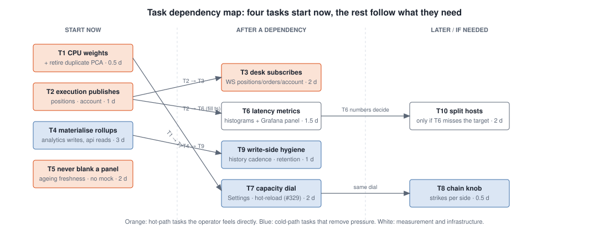

# Task plan

Ten tasks, each closing one or more problems from
[01-problems.md](01-problems.md). One GitHub issue per task (label
`hot-cold-path`), grouped under one epic. Estimates are engineering days for
one person including tests and the doc update.

| # | Task | Closes | Depends on | Estimate | PRs |
|---|---|---|---|---|---|
| T1 | CPU weights per container; retire the duplicate analytics run | P3, P10 | none | 0.5 d | 1 |
| T2 | Execution engine publishes position and account deltas | P5 | none | 1 d | 1 |
| T3 | Desk subscribes to positions, orders and account over WebSocket | P5 | T2 | 2 d | 1 |
| T4 | Materialise rollups and attribution in the analytics engine | P1, P6 | none | 3 d | 2 |
| T5 | Never blank a panel: per-endpoint degrade everywhere, ageing freshness, server as-of, no mock spot | P2, P7 | none | 2 d | 1 |
| T6 | Latency metrics and the fluidity panel | P8 | T2 (for fill timestamps) | 1.5 d | 1 |
| T7 | Capacity dial in Settings for the analytics engine | P3 (fine tuning) | T1, config hot-reload (#329) | 2 d | 1 |
| T8 | Chain-subscription knob for the vol engine | P9 | T7 (same dial) | 0.5 d | 1 |
| T9 | Write-side hygiene: history write cadence, retention off-peak, autovacuum settings | P4, P1 | T4 | 1 d | 1 |
| T10 | Split hosts: trading core / analytics and observability | P3, P4 (physically) | T6 numbers | 2 d | infra |

Shipping order: T1 and T5 first (hours, no dependencies, visible at once),
then T2 and T3 together (the change the operator feels most), T4 and T9, T6,
then T7 and T8, and T10 only if T6 still shows the target missed.

---

## T1 — CPU weights per container; retire the duplicate analytics run

**Scope.** `docker-compose.yml`: `cpu_shares` 1024 on execution, api,
market-data, nginx; 512 on risk; 256 on vol, db-writer, postgres, redis; 128
on analytics and every obs service. Keep `cpus: 0.5` on analytics. Set
`VOL_INLINE_ANALYTICS` default to off and remove the inline path once prod has
run one day on the analytics engine alone (audit ticket #334).

**Acceptance.**
- Under a synthetic load (one container spinning both cores), the api's
  `/portfolio/account` p95 stays under 500 ms; without weights it does not.
- One PCA snapshot per hour in `pca_surface_snapshot`, not two.
- `docs/architecture/hot-cold-paths.md` section 3 updated with the weights.

**Notes.** Shares bite only under contention; an idle box still gives
analytics both cores. This is the kernel version of the manual brake.

## T2 — Execution engine publishes position and account deltas

**Scope.** After each position sync that changed a row, call
`publish_position_update` with the changed positions (full row, same shape as
`/positions/open`); after each account snapshot, `publish_account`. Order
events already publish on `orders:<structure_id>`. Spot orders publish on a
new `spot_orders` channel (same row shape as `/trade/spot-orders`).

**Acceptance.**
- A fill on paper produces a `positions` message within 2 s of the IB
  execution event, measured by T6's timer once it exists, by log timestamps
  until then.
- Payload fixtures committed under `tests/fixtures/channels/` and asserted by
  a unit test for each publisher.
- `docs/architecture/data-flow.md` channel table updated.

## T3 — Desk subscribes to positions, orders and account over WebSocket

**Scope.** `frontend/src/hooks/streams.ts`: `usePositionsStream`,
`useOrdersStream(structureIds)`, `useAccountStream`, `useSpotOrdersStream`.
The provider patches rows in place from messages; the REST polls for trade,
orders and portfolio account drop to 60 s reconciliation. New api route
`/ws/account` and `/ws/spot_orders` served through the existing bridge.
Connection state shown as a chip in the Trade panel header.

**Acceptance.**
- With the WebSocket connected, a position change reaches the Open positions
  table in under 2 s end to end (T6 metric); with it disconnected the chip
  turns red and the 60 s poll keeps the panels alive.
- Vitest: a message patches the matching row and nothing else; a disconnect
  does not blank a panel.
- No full re-render per tick: `useFetch` result memoised (audit ticket #348).

## T4 — Materialise rollups and attribution in the analytics engine

**Scope.** New tables `portfolio_daily` (one row per UTC day: net liq close,
realised, mtm) and `pnl_attribution_latest` (one row per lookback window),
written by the analytics engine once per cycle (daily table at 00:05 UTC and
on demand, attribution every 5 min). `/portfolio/stats`,
`/portfolio/daily-pnl`, `/portfolio/header`, `/portfolio/var` (the rollup
part), `/portfolio/greek-limits` and `/portfolio/pnl-attribution` read one
row. Closes #286.

**Acceptance.**
- Each listed endpoint answers in under 100 ms on prod with the 1.3 M-row
  history.
- No query against `account_history` or `open_position_history` remains in
  the request path of those endpoints (grep gate in tests).
- Freshness carried in the payload (`computed_at`) and shown by the badge.

## T5 — Never blank a panel

**Scope.** Risk bundle degrades per endpoint like trade and portfolio.
`useFetch` keeps the last good value on every error. Freshness re-evaluated on
a 1 s clock from the server `as_of` (vol surface, account, positions carry
it; the api adds `as_of` and `source` to the vol read paths, audit ticket
#328). Remove the `DATA.SPOT` fallback: render a dash and the stale chip. Label
the markets-closed grid with the date of the last complete grid. Audit ticket
#347 covers the same ground; this task is its hot/cold half.

**Acceptance.**
- Kill the api for 30 s in the local stack: every panel keeps its values, every
  badge turns stale within 5 s, nothing shows $0 or a mock.
- Vitest for the ageing clock and the risk bundle degrade.

## T6 — Latency metrics and the fluidity panel

**Scope.** Two Prometheus histograms in the execution engine:
`order_submit_latency_seconds` (api request received to IB `Submitted` status)
and `fill_to_publish_seconds` (IB execution time to the `positions` publish).
One browser beacon posting `publish_to_screen_ms` (message received to row
rendered) to a cheap api endpoint, sampled 1 in 10. A Grafana panel "Desk
fluidity" with the two server histograms, the browser sample, and a 2 s target
line. `/health` gains `version` and `commit` (audit ticket #353).

**Acceptance.**
- The panel shows live data on prod; the smoke check asserts the deployed
  commit from `/health`.
- An alert rule fires when p95 of either histogram exceeds 2 s for 5 min
  (feeds audit ticket #342).

## T7 — Capacity dial in Settings for the analytics engine

**Scope.** A `CapacityConfig` versioned like `VolConfig`, hot-reloaded over
`config:changed` (requires the hot-reload fixes in audit ticket #329): cadence
(minutes), training window (days), thread cap (BLAS and scikit-learn thread
pool via `threadpoolctl`). Three presets (Eco, Balanced, Full) and a per-field
override table in the Settings tab. The analytics engine reads it at the start
of each cycle.

**Acceptance.**
- Moving the dial from Full to Eco changes the next cycle's thread count and
  cadence without a restart; the Hardware graph shows the flatter burst.
- Config rows are append-only with author and timestamp.

## T8 — Chain-subscription knob for the vol engine

**Scope.** Expose strikes per side and max concurrency in the same
`CapacityConfig`; the vol engine reads them per cycle. Document the trade-off
(wing coverage versus gateway load) in `docs/vol-modeling/`.

**Acceptance.**
- 12 strikes per side cuts the Gateway's scan-time CPU by about a third on the
  Hardware graph with no change to the ATM and 25-delta pillars.

## T9 — Write-side hygiene

**Scope.** Risk history: write every 60 s instead of 30 s and only for
positions whose greeks moved beyond a threshold. Retention delete moved to a
scheduled off-peak job (02:30 UTC, after the IB restart) in batches of 50 k
rows. Postgres: `autovacuum_vacuum_scale_factor` and `work_mem` set per table
for the two history tables; `shared_buffers` and `effective_cache_size` sized
for the 3.8 GB host. Documented in `docs/architecture/database.md`.

**Acceptance.**
- History row growth halves; the retention job completes in under 5 min with
  no hot-read p95 regression during it (T6 panel).

## T10 — Split hosts

**Scope.** Only if T6 still shows the 2 s target missed after T1 to T5. Second
small instance for analytics, db-writer's analytics tables and observability;
Redis and Postgres stay with the trading core; the analytics engine reads over
the private network. Same monthly cost as one size up, isolation becomes
physical.

**Acceptance.**
- Trading core instance shows no analytics or observability container; T6
  panel meets the target during PCA cycles.
