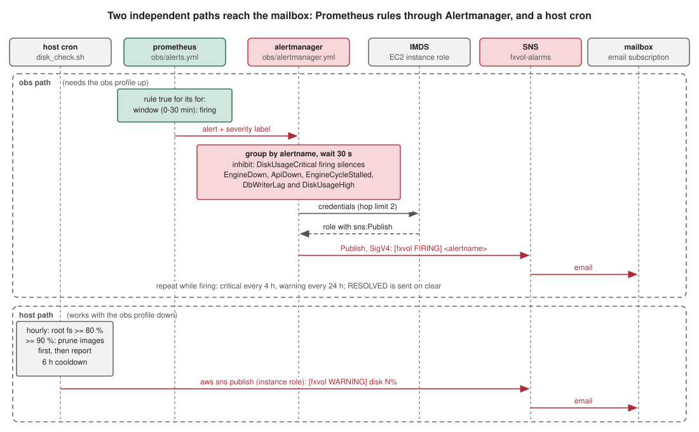

# Alerting

What pages you, from where, and what to do. Until #342 nothing did: the SNS
topic `fxvol-alarms` had a confirmed email subscription and zero publishers.

## Two independent paths

Both end at the same SNS topic; only the first depends on the obs profile:

| Path | Runs where | Covers | Needs |
|---|---|---|---|
| Prometheus rules → Alertmanager → SNS | the `obs` profile on the host (`obs/alerts.yml`, `obs/alertmanager.yml`) | engines down or stalled, api down, IB session down, crash loops, db-writer lag, disk, memory caps, backup age | the obs profile up; instance role with `sns:Publish`; IMDS reachable from the container |
| Host cron → SNS | `/etc/cron.hourly/fxvol-disk-check` (`infrastructure/ec2/disk_check.sh`) | root disk ≥ 80 % (prunes images itself ≥ 90 %) | instance role with `sns:Publish`; works with the obs profile down |

The IB watchdog (`infrastructure/ec2/ib_watchdog.sh`, every 2 min) is the
third leg: it restarts the gateway and the four IB-bound engines
(market-data, vol-engine, risk, execution) when one is `unhealthy`, with a
15 min cooldown. It heals rather than alerts; its log is rotated by
`/etc/logrotate.d/fxvol` and a restart it issued shows up as an
`EngineDown` / `IBSessionDown` resolve.

## The rules (`obs/alerts.yml`)

| Alert | Fires when | Severity | First move |
|---|---|---|---|
| `EngineDown` | an engine's `/metrics` unscraped 2 min | critical | `docker ps`, `docker logs <name> --tail 100` |
| `ApiDown` | api `/metrics` unscraped 2 min | critical | `docker logs fxvol-api`, `curl -s localhost:8000/api/v1/health/ready` from the host |
| `EngineCycleStalled` | no completed cycle for 2 min (market-data, risk, execution) or 10 min (vol, analytics, db-writer), 3 min grace | critical | alive but stuck: usually IB. `tail /var/log/fxvol-ib-watchdog.log` |
| `IBSessionDown` | any engine's IB session disconnected 3 min | critical | 2 min = the nightly IBC restart; longer: competing login, 2FA, gateway version drift (`docs/execution/ib-integration.md`) |
| `ContainerCrashLoop` | 3+ restarts in 15 min | critical | `docker inspect --format '{{.State.OOMKilled}}' <name>`; raise the cap or read the boot error |
| `DbWriterLag` | db-writer no cycle for 3 min | warning | frames are being lost; check Redis and the writer log |
| `DiskUsageHigh` / `DiskUsageCritical` | root fs > 80 % 10 min / > 90 % 5 min | warning / critical | `docker image prune -af`, `journalctl --disk-usage` |
| `BackupStale` | backup stamp older than 26 h for 30 min | critical | `tail /var/log/fxvol-postgres-backup.log`; `RESTORE.md` §5 |
| `BackupSignalMissing` | no backup-age metric at all | warning | api not scraped or `BACKUP_STATE_FILE` unset |
| `MemoryNearLimit` | a container above 90 % of its cap 10 min | warning | an OOM kill follows |
| `OrderSubmitSlow` / `FillToPublishSlow` | p95 of click-to-IB-Submitted or fill-to-publish above 2 s for 5 min | warning | Grafana "Desk fluidity": which hop grew (#370) |
| `DbWriterDroppingFrames` | writer queue full, frames dropped in the last 10 min | critical | Postgres behind; `db_writer_queue_depth`, writer log (#324) |
| `DbWriterDeadLetters` | rows parked in `db_writer_dead_letter` in the last hour | warning | read the row's `error`, fix the producer, replay by hand (#324) |
| `HistoryPruneFailing` | a retention prune failed for a table in the last 2 days | warning | `grep history_prune_failed` in the engine log; the table grows until fixed (#330) |

Routing (`obs/alertmanager.yml`): one group per alert name, 30 s initial
wait, critical repeats every 4 h, warning every 24 h, resolved messages
sent. A critical disk inhibits the engine alerts it would cause.

## One-time host setup (user action)

1. **IAM**: attach `sns:Publish` on `arn:aws:sns:eu-west-1:552269855056:fxvol-alarms`
   to the instance role (`infrastructure/aws/host-additions.json` has the
   statement). Without it the disk cron logs `sns publish failed` and
   Alertmanager logs an AccessDenied; nothing else breaks.
2. **IMDS from containers**: Alertmanager signs with the instance role through
   the metadata service. If the instance uses IMDSv2 with a hop limit of 1,
   containers on a bridge network cannot reach it; set it to 2:
   `aws ec2 modify-instance-metadata-options --instance-id <id> --http-put-response-hop-limit 2 --http-tokens required`.
3. Deploy (the payload ships `obs/alerts.yml`, `obs/alertmanager.yml`,
   `disk_check.sh`; `remote-deploy.sh` installs the cron, the logrotate and
   the journald cap on every deploy).
4. Test end to end from the host: `aws sns publish --topic-arn <topic> --subject "fxvol test" --message "ping"`
   should land in the mailbox; then stop an engine for 3 min
   (`docker stop fxvol-risk`) and expect `EngineDown` to fire and resolve.

## Logs and disk hygiene (08#14 / 08#15)

- `/etc/logrotate.d/fxvol`: `/var/log/fxvol-*.log` weekly, 4 rotations,
  compressed (watchdog, backup, disk check).
- `/etc/systemd/journald.conf.d/fxvol.conf`: `SystemMaxUse=200M`,
  `MaxRetentionSec=14day`.
- Docker container logs were already capped (`daemon.json`: json-file,
  10 MB × 3 per container).

## Local

The obs profile locally has no AWS role: the rules evaluate, Alertmanager
shows them at `http://localhost:9093`, and the SNS send fails harmlessly.
Prometheus `http://localhost:9090/alerts` lists rule state.
