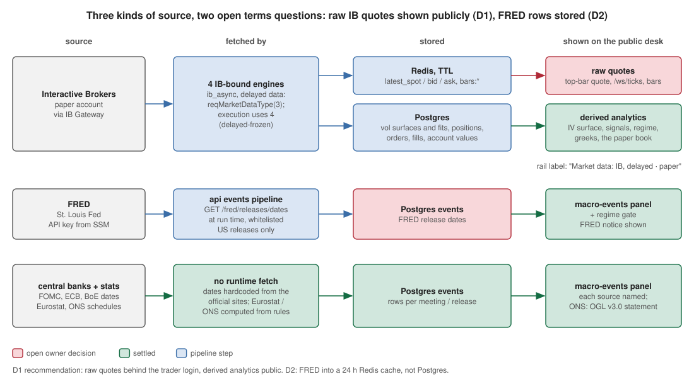

# Data sources and terms

What the system takes from whom, what it keeps, what each provider's terms ask
for, and the decisions on record (#307, audit 10#13, release gate §8). The
attribution strings below are the ones the desk and the README show
(`frontend/src/voldesk/components/DataAttribution.tsx`).

## Sources

| Source | How | What is stored | Attribution shown |
|---|---|---|---|
| Interactive Brokers (paper account) | `ib_async` to IB Gateway, **delayed** market data (`reqMarketDataType(3)`, execution `4`) | ticks (Redis, TTL), vol surfaces and fits, positions, orders, fills, account values (Postgres) | rail: "Market data: IB, delayed · paper"; README |
| FRED (Federal Reserve Bank of St. Louis) | `GET /fred/releases/dates` with an API key | nothing in Postgres: release **dates** of whitelisted US releases in a Redis key, 24 h | the FRED notice under Macro events and in the README |
| Federal Reserve (FOMC) | meeting dates, hardcoded from federalreserve.gov | rows in `events` | "Federal Reserve" under Macro events |
| ECB | monetary-policy meeting dates, hardcoded from ecb.europa.eu | rows in `events` | "ECB" |
| Bank of England | MPC dates, hardcoded from bankofengland.co.uk | rows in `events` | "Bank of England" |
| Eurostat | HICP / GDP release schedule computed from Eurostat's published rules | rows in `events` | "Eurostat" |
| ONS | CPI / GDP release schedule computed from the ONS calendar rules | rows in `events` | the Open Government Licence v3.0 statement |

None of the calendar sources is scraped; only FRED is called at run time.

## Decisions

### D3, attribution: decided 2026-11-10

Every source is named where its data appears: the macro-events panel carries
the calendar sources, the FRED notice ("This product uses the FRED® API but is
not endorsed or certified by the Federal Reserve Bank of St. Louis.") and the
OGL v3.0 statement for ONS; the rail says the market data is IB, delayed, on a
paper account; the README has the same list. Done in #307.

### D1, IB-derived data on the public desk: **open, owner decision**

The public read-only desk and the WebSocket streams show IB-derived data to
anyone: the EUR/USD mid / bid / ask (delayed), the option-chain-derived IV
surface, and positions / P&L of the paper account. IB's market-data
agreements restrict redistribution by a non-professional subscriber, delayed
data included (release gate §8.1).

Recommendation: **keep raw quotes behind the trader login, keep derived
analytics public.** Concretely: `/ws/ticks`, the bars endpoint and the top-bar
quote become trader-only; the IV surface (a model output), signals, regime,
greeks and the paper book stay public with the "delayed · paper" label. It is
the cheapest stance that removes the raw-quote redistribution, keeps the
public demo meaningful, and is one auth dependency on three routes plus the
socket. Alternatives: take the whole deployment private (no public demo), or
obtain a redistribution entitlement from IB (cost, paperwork).

### D2, FRED storage: decided 2026-11-14

The FRED terms prohibit storing FRED content in a database; the events
pipeline persisted FRED release dates in `event_calendar`.

Decision: **FRED rows are not database content.** The scheduler puts them in
one Redis key (`events:fred`, `bus/fred_cache.py`) that expires after 24
hours and refreshes it every 12. The api (macro-events panel, regime
endpoints) and the vol engine (regime gate) merge that list with the
database rows through `core/calendar_merge.py`, so they see one calendar.
Migration 074 deletes the FRED rows already stored; prod held none (no FRED
key is configured there). Nothing FRED-sourced lands in Postgres or in the
backups any more.

What it costs: when FRED cannot be reached for 24 hours the US releases
(CPI, NFP, GDP, PCE) drop out of the calendar until the next successful
fetch, and the regime gate does not see them. The FOMC, ECB, BoE, Eurostat
and ONS calendars are hardcoded or computed and are unaffected.

## How to change a source

Add the row to the table above in the same PR as the code, with the
attribution its terms ask for, and add the string to `DataAttribution.tsx`.
