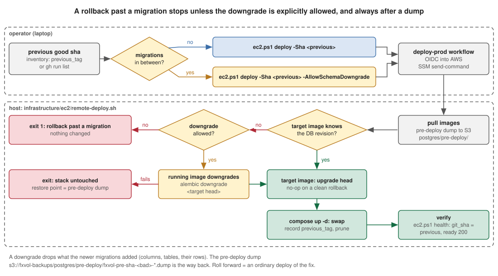
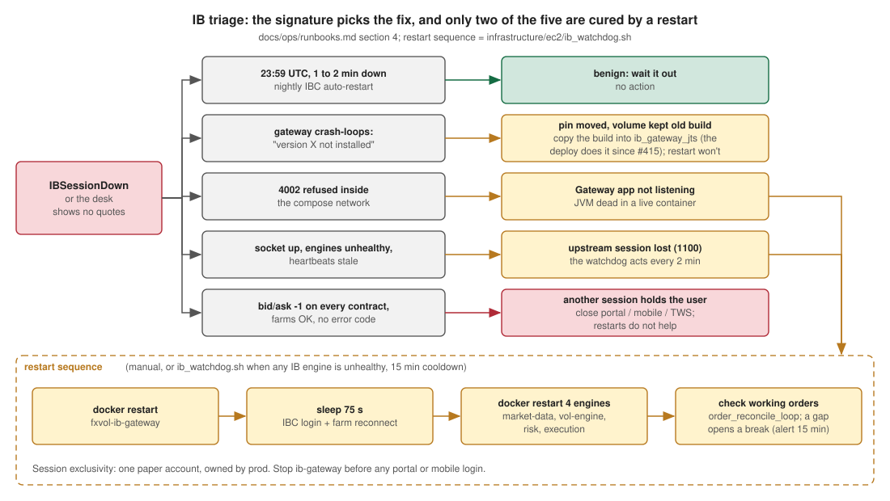

# Ops runbooks

Reboot, rollback, restore and IB-session recovery for the prod host
(`valeriandarmente.dev`, one EC2 instance, `COMPOSE_PROFILES=engines,ib,obs`).
Promoted from the audit-08 draft (`docs/audits/reports/08-runbook-draft.md`)
and rewritten against the scripts as they are now (#346).

> **Secrets rule.** No command here prints a secret. Never `docker inspect` a
> fxvol container's `Config.Env`, never `cat /opt/fxvol/.env`, never
> `aws ssm get-parameter` without a `--query` that excludes `Parameter.Value`
> ([`secrets.md`](secrets.md)).

Every procedure ends with a **Walked** line: the date it was last run end to
end and what it measured. A procedure without a date is written from the
scripts and has not been exercised yet.

| Procedure | Walked |
|---|---|
| [Orientation](#0-orientation) | not yet |
| [Reboot](#1-reboot) | not yet |
| [Rollback](#2-rollback) | not yet |
| [Restore](#3-restore-from-backup) | not yet (`restore_drill.sh` exists, the log in `RESTORE.md` is empty) |
| [IB session recovery](#4-ib-session-recovery) | partly: the gateway volume-drift recovery (2026-07-31) and the competing-session diagnosis (2026-10-10) were done live |

## 0. Orientation

Run first, every time. Trust the box over the docs.

```powershell
.\scripts\aws\ec2.ps1 health        # public: /health git_sha + /health/ready
.\scripts\aws\ec2.ps1 stack         # containers, RAM/CPU, host memory, engine heartbeats
.\scripts\aws\ec2.ps1 inventory     # crons + units present, backup stamp, rollback tag pair,
                                    # pending reboot, newest backups, watchdog state
```

`inventory` prints `MISSING` for any ops file the host lacks. The deploy
re-installs the backup, prune and disk crons on every run; the IB watchdog
cron, the systemd unit and the unattended-upgrades config come from
`infrastructure/ec2/setup.sh`, which is idempotent:

```bash
sudo bash /opt/fxvol/infrastructure/ec2/setup.sh
```

Alerts reach the SNS topic `fxvol-alarms` by email (Alertmanager rules in
`obs/alerts.yml`, the host disk guard, the backup-age metric). Each alert's
description names the command to run; [`alerting.md`](alerting.md) lists them.

**Walked:** not yet.

## 1. Reboot

Take it in the weekend window (Saturday, FX closed) unless the host is down.
`inventory` shows `REBOOT PENDING` when unattended-upgrades installed a kernel.

At boot two paths start the stack at once: dockerd restarts every
`restart: unless-stopped` container (no `depends_on` ordering), and
`fxvol-compose.service` runs `docker compose up -d --remove-orphans`, which
honours the health conditions and converges. Expect nginx to restart a few
times until `api` and `frontend` resolve.

```powershell
.\scripts\aws\ec2.ps1 connect
```
```bash
cd /opt/fxvol
sudo /etc/cron.daily/fxvol-postgres-backup                 # fresh restore point
sudo docker compose stop db-writer execution-engine        # drain the writer, leave IB cleanly
sleep 15
sudo systemctl stop fxvol-compose.service
sudo reboot
```

Acceptance, after about two minutes:

```bash
systemctl status fxvol-compose.service --no-pager         # active (exited)
cd /opt/fxvol && sudo docker compose ps --format '{{.Name}} {{.Status}}' | grep -v healthy   # expect empty
```
```powershell
.\scripts\aws\ec2.ps1 health
.\scripts\aws\ec2.ps1 inventory     # "no reboot pending"
```

If nginx stays down: `sudo docker compose up -d --force-recreate nginx`
(it resolves the upstreams once at config load).

**Record:** time from `reboot` to all healthy, nginx restarts, any manual step.
**Walked:** not yet.

## 2. Rollback

The pipeline side is in [`deployment.md`](deployment.md#rollback): the
previous release's images stay on the host, and a rollback past a migration
stops unless explicitly allowed.



1. Find the previous good sha: `inventory` prints `previous_tag=sha-<sha>`, or
   `gh run list --workflow deploy.yml --limit 5`.
2. Did the bad release add migrations? Compare the heads:
   ```bash
   git diff --stat <previous>..<bad> -- src/persistence/migrations/versions
   ```
3. Roll back:
   ```powershell
   .\scripts\aws\ec2.ps1 deploy -Sha <previous-sha>                          # no migration in between
   .\scripts\aws\ec2.ps1 deploy -Sha <previous-sha> -AllowSchemaDowngrade    # past a migration
   ```
   Without the switch, a deploy whose database is ahead of the target image
   fails with "this is a rollback past a migration" and changes nothing.
   With it, the running image runs `alembic downgrade <target head>` after the
   pre-deploy dump. A downgrade drops what the newer migrations added (columns,
   tables, rows in them); the dump `s3://fxvol-backups/postgres/pre-deploy/fxvol-pre-sha-<bad>-*.dump`
   is the way back.
4. Verify:
   ```powershell
   .\scripts\aws\ec2.ps1 health      # git_sha = the previous sha, ready = 200
   ```
   ```bash
   cd /opt/fxvol && sudo docker compose ps --format '{{.Name}}\t{{.Image}}' | grep fx-options   # all sha-<previous>
   ```
5. Roll forward again once fixed: an ordinary deploy of the fix runs
   `upgrade head` and re-applies the dropped migrations (their data is gone
   unless restored from the dump).

If the deploy job fails on its 5-minute poll while the host keeps going
(heavy pulls), check `health` and the container images before re-running.

**Drill (exit criterion of iteration 14):** on a weekend, roll back one
release that has no migration, verify, roll forward. Then, on a release that
has one, run the gated path once against the same pair.
**Walked:** not yet.

## 3. Restore from backup

Authoritative procedure: [`infrastructure/ec2/RESTORE.md`](../../infrastructure/ec2/RESTORE.md).
Dumps: nightly `s3://fxvol-backups/postgres/fxvol-<ts>.dump`, pre-deploy
`postgres/pre-deploy/fxvol-pre-sha-<sha>-<ts>.dump`. Freshness: `/health/extended`
`components.backup`, metric `fxvol_postgres_backup_age_seconds`, alerts
`BackupStale` / `BackupSignalMissing`.

### 3.1 Test restore (never touches the live database)

Monthly, and before relying on a dump:

```bash
sudo sh /opt/fxvol/infrastructure/ec2/restore_drill.sh
```

It restores the newest dump into a scratch container, prints table count,
alembic head and row counts, then removes everything. Paste its last line into
the log table at the bottom of `RESTORE.md`; the restore duration it prints is
the RTO of 3.2.

### 3.2 Real restore over the live database

Destructive (`pg_restore --clean`). Follow `RESTORE.md` section 4: snapshot the
current state, stop every writer, restore, `alembic upgrade head` with the
running image if the dump is older than the code, start, verify with
`/health/extended`.

What a restore does not bring back: anything the db-writer had not written
(Redis pub/sub has no backlog), the `ib_gateway_jts` volume (Gateway install +
API Trusted IPs), `/etc/letsencrypt`, and the obs volumes. See
[`redis-durability.md`](redis-durability.md).

**Walked:** not yet.

## 4. IB session recovery

### 4.1 Normal events

- The gateway's IBC auto-restart at 23:59 UTC (01:59 Paris) costs a 1 to 2
  minute CPU spike and a brief disconnect. Benign.
- Weekend and holidays: no quotes, engines idle, the desk shows the
  closed-market banner. Not an incident.

### 4.2 Triage



```bash
cd /opt/fxvol
sudo docker compose ps ib-gateway market-data vol-engine risk-engine execution-engine
sudo docker compose exec -T execution-engine curl -fsS http://127.0.0.1:8001/health   # ib_connected
```

| Signature | Cause | Fix |
|---|---|---|
| gateway crash-loops, "version X not installed: can't find jars folder" | image pin bumped, the `ib_gateway_jts` volume still holds the old build | surgical copy of the new build into the volume: `infrastructure/ib-gateway/README.md`; a restart does not fix it |
| connect to 4002 refused inside the network | the Gateway app is not listening (JVM dead in a live container) | 4.3 |
| socket up, engines unhealthy, heartbeats stale | upstream IBKR session lost (error 1100) | 4.3; the watchdog does this every 2 min with a 15 min cooldown |
| bid/ask -1 on every contract, farms OK, no error code | another session holds the user (portal, mobile, TWS) | close the other session; restarts do not help |
| `alert IBSessionDown` | any of the above | triage |

### 4.3 Manual recovery

The same sequence as `infrastructure/ec2/ib_watchdog.sh`:

```bash
sudo docker restart fxvol-ib-gateway
sleep 75                                     # IBC login + farm reconnect
sudo docker restart fxvol-market-data fxvol-vol-engine fxvol-risk fxvol-execution
```

Then check working orders on the desk (Trade view, blotter): an order that was
working across the outage is reconciled by the execution engine at reconnect
(`order_reconcile_loop`), a book-vs-broker gap opens a break
(`ReconciliationBreakOpen` after 15 min).

`inventory` shows the watchdog's last recovery time; its log is
`/var/log/fxvol-ib-watchdog.log` (rotated weekly).

### 4.4 Trusted IPs after a volume or host rebuild

An empty `ib_gateway_jts` volume loses the API settings. Re-enter them over VNC
(`127.0.0.1:5900`, tunnel only): uncheck "Allow connections from localhost
only", add the engine addresses one per line (`127.0.0.1`, `172.20.0.10`
market-data, `.11` vol-engine, `.12` risk-engine, `.14` execution), Save Settings.

### 4.5 Session exclusivity

One paper account, one session, owned by prod. Stop `ib-gateway` before any
portal or mobile login, and never run a local stack with the `ib` profile
while prod holds the session.

**Walked:** partly (see the table at the top).
