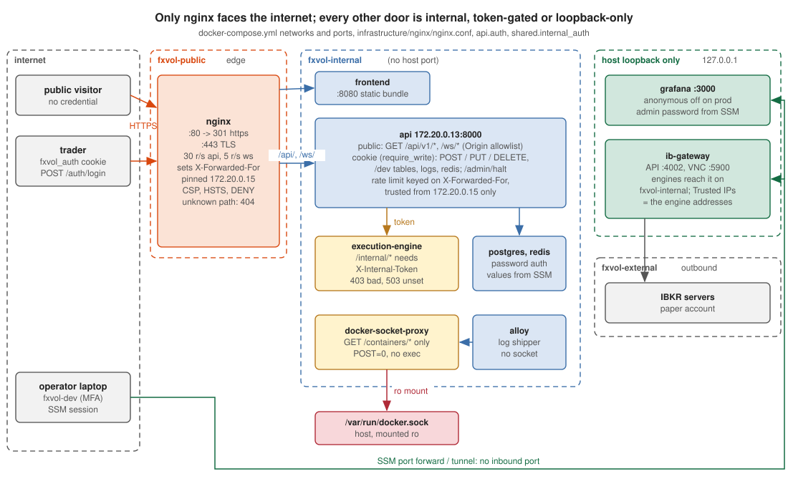

# Security boundary

What is public, what needs the trader cookie, what only the api may call, and
why. Audit 01 (`docs/audits/01-security.md`) drove this page; the decisions
below are the ones it asked to be written down (#300, #299, #296, #298, #301,
#302).

## Three audiences

| Audience | How it is recognised | What it may do |
|---|---|---|
| Public visitor | nothing | read the desk: every `GET` under `/api/v1` except the trader-only `/dev` reads, the WebSocket streams, the OpenAPI spec at `/api/openapi.json` (Swagger / ReDoc only outside prod: the prod CSP would blank them, #352) |
| The trader | the `fxvol_auth` cookie from `POST /api/v1/auth/login` (`api.auth.require_write`) | every `POST` / `PUT` / `DELETE`, the `/dev` reads that touch tables, logs or Redis, `/admin/halt` |
| The api itself | `X-Internal-Token` (`shared.internal_auth`) | the execution engine's `/internal/*` routes |

The site is a public portfolio piece: the read side is meant to be seen. What
it must never do is let a visitor move the book or read a secret.

## The execution engine's `/internal/*` routes

Every one of them places, cancels or reconciles orders. They answer only on
the compose network, and since #300 only to a caller presenting the shared
token in `X-Internal-Token`:

* 403 `internal_token_invalid` on a missing or wrong token;
* 503 `internal_token_unconfigured` when the engine itself has no token (it
  never falls open);
* `/health` stays open for the container healthcheck.

The token is `EXECUTION_INTERNAL_TOKEN` on both containers. Prod takes it
from `/fxvol/prod/EXECUTION_INTERNAL_TOKEN` when that parameter exists, else
`remote-deploy.sh` generates one into `/etc/fxvol/internal_token` (root,
0600, outside every bind mount) and reuses it on every deploy. Dev shares the
compose default.

## Public `GET` routes that are deliberate

| Route | Why it stays public |
|---|---|
| `/api/v1/dev/stack`, `/dev/engines`, `/dev/cycle-progress`, `/dev/hardware`, `/dev/containers/metrics` | the System view is the showcase: container health, engine heartbeats, host load. No env, no socket, no secret: the api has no Docker socket and reads Redis heartbeats and `/proc` only. |
| `/api/v1/dev/migrations`, `/dev/migrations/{rev}`, `/dev/db-schema` | the repository is public; the migration source and the ORM schema are already on GitHub. |
| `/api/v1/admin/config`, `/admin/config/schema`, `/admin/config/history`, `/admin/settings/{domain}`, `/admin/halt` (GET) | the vol-engine and risk settings are the strategy, shown on purpose; the halt flag is a status. Changing any of them is a write and needs the cookie. |
| `/api/docs`, `/api/redoc`, `/api/openapi.json` | the typed contract is part of the showcase and already in the repo (`frontend/src/api/schema.d.ts`). |

Trader-only `/dev` reads (`require_write`): `/dev/tables*`, `/dev/logs/*`,
`/dev/redis/*`. They can show row contents, log lines and cache values.

## Login

One operator, one credential: the username is compared in constant time and
the password through pbkdf2 against the hash in settings; both checks always
run so neither branch leaks by timing. The body is bounded (username 64,
password 256 chars). In prod the boot guard refuses a default `AUTH_SECRET`,
an empty `AUTH_PASSWORD_HASH`, a missing `DATABASE_URL` and a non-secure
cookie, and logs when `AUTH_SALT` is still the repo default (rotate it with
the password at the next rotation: a new salt needs a new hash).

## Write bodies

Every write route takes a typed model with bounds (`api/schemas/orders.py`,
`SubmitBody`, `PreviewRequest`, `LoginBody`): quantities capped at 1000
contracts or 5 M of spot notional, strikes and prices positive and bounded,
free text length-limited. A bad body is a 422 at the edge and never reaches
the execution engine.

## Rate limiting and login lockout

nginx limits anonymous traffic per client address (`limit_req_zone`) and
forwards `X-Forwarded-For: $remote_addr`, overwriting whatever the client
sent. The api trusts that header only from nginx's pinned address
(`FORWARDED_ALLOW_IPS=172.20.0.15`), so its own per-IP limiter
(slowapi, 600/min, 5/min on `/login`) keys on the real client and a
compose-internal peer cannot choose its key (#296, audit 01#4).

`/login` also locks a username after `AUTH_LOCKOUT_THRESHOLD` failures
(default 5) for `AUTH_LOCKOUT_SECONDS` (default 900), whatever the source
address: 429 with `Retry-After`. The counter lives in the api process (one
uvicorn worker); a restart clears it.

## WebSocket streams

Every `/ws/*` upgrade is checked against an Origin allowlist
(`CORS_ORIGINS` + `WS_ALLOWED_ORIGINS`, by default `http://localhost` and
`https://valeriandarmente.dev`): a page on another site cannot open the
streams in a visitor's browser. A request without `Origin` is not a
browser and is allowed; the streams are public reads (#299, audit 01#2).

`/ws/orders/{structure_id}` stays public, by decision: the order and fill
events it carries are the same rows the public `GET /api/v1/trade/submitted`
and `GET /api/v1/orders` already serve, and the blotter is part of the
showcase. Gating the socket alone would hide nothing. Revisit together with
the REST reads if the blotter ever becomes trader-only.

Empty channel keys are dropped on the last disconnect, so a registry of
thousands of one-off paths (`/ws/orders/<id>`) does not grow forever.

## nginx headers (#301)

`server_tokens off` and `client_max_body_size 1m` at http level; CSP
`connect-src` names the site's own `wss://` hosts instead of any `wss:`;
`Permissions-Policy` disables camera, microphone, geolocation, payment, USB
and FLoC; HSTS, nosniff, `X-Frame-Options: DENY`, `frame-ancestors 'none'`
and the referrer policy as before. `tests/unit/infrastructure/test_nginx_config_syntax.py`
asserts each of these, and CI runs `nginx -t` on every conf.

## Containers (#298)

* `api` and `execution-engine` run as the unprivileged `fxvol` user (uid
  10001); the images install as root and drop privileges before `CMD`.
* The prod profile allowlist is `engines,ib,obs`. The `obs` set runs with
  cAdvisor unprivileged (read-only `/`, `/sys`, `/var/lib/docker` mounts),
  alloy without a Docker socket (container discovery and log reads go
  through `docker-socket-proxy`, which allows `GET /containers/*` only and
  mounts the socket read-only), Grafana bound to `127.0.0.1:3000` with
  anonymous access off and the admin password from
  `/fxvol/prod/GRAFANA_ADMIN_PASSWORD`. The deploy refuses to start `obs`
  without that parameter, and refuses any deploy without
  `/fxvol/prod/REDIS_PASSWORD` (no dev password on prod).
* `metrics` (prometheus + cadvisor) remains the minimal subset for a host
  that only wants the Hardware tab.

## IAM and workflows (#302)

* The deploy role (`infrastructure/aws/deploy-perms.json`) may put one S3
  prefix, send `AWS-RunShellScript` to one instance, and read command
  results. `ssm:GetCommandInvocation` / `ListCommand*` accept no resource
  ARN (the API has no resource-level permissions), so they stay on `*`
  with an `aws:RequestedRegion = eu-west-1` condition.
* `fxvol-dev` has MFA (`infrastructure/aws/STATE.md`); its access key is the
  laptop's only standing credential and reads `/fxvol/prod/*`.
* Every action in `.github/workflows` is pinned to a commit sha with the
  version as a comment; Dependabot (`.github/dependabot.yml`) bumps the
  pins weekly. `deploy_sha` reaches the shell through `env`, validated as
  hex. Every workflow declares `permissions:`; CI is `contents: read`.
