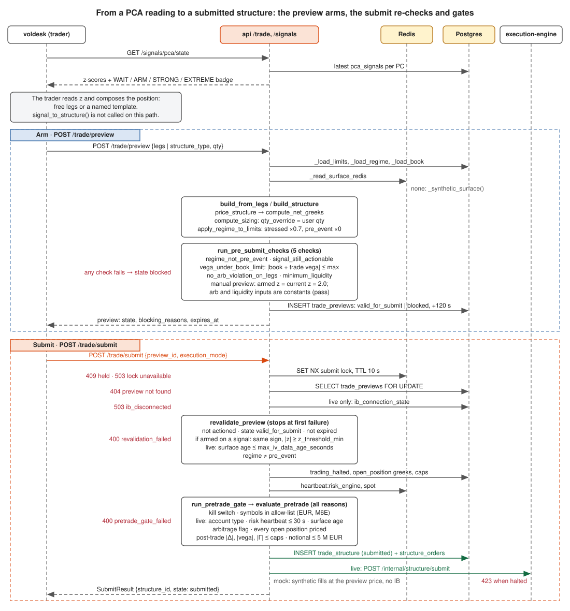

# From PC signal to structure

The vol surface is decomposed by PCA into three principal components; each PC's
z-score is a tradable signal, and each maps to exactly one canonical structure.
The map lives in `signal_to_structure()` in
[`src/core/structures.py`](../../src/core/structures.py);
the per-PC structure choice and thresholds are config, in
[`src/core/config/vol_params.py`](../../src/core/config/vol_params.py).

See [vol-modeling/pca-signals.md](../vol-modeling/pca-signals.md) for how the PCs
and z-scores are computed, and [structures.md](structures.md) for the structures.

## The mapping

| PC | `pc_label` | Surface meaning | Structure | View |
|---|---|---|---|---|
| PC1 | `level` | parallel shift of the whole surface | `StraddleATM` | vol level |
| PC2 | `term_slope` | near-vs-far term structure | `CalendarSpread(near="1M", far=tenor)` | term slope |
| PC3 | `skew` | 25Δ put−call asymmetry | `RiskReversal25d` | skew |
| PC3 | `smile` | wing-vs-body curvature | `Butterfly25d` | convexity |

```python
side: Side = "SELL" if direction == "EXPENSIVE" else "BUY"
if pc_label == "level":       return StraddleATM(tenor=tenor, side=side)
if pc_label == "term_slope":  return CalendarSpread(tenor_near="1M", tenor_far=tenor, side=side)
if pc_label == "smile":       return Butterfly25d(tenor=tenor, side=side)
if pc_label == "skew":        return RiskReversal25d(tenor=tenor,
                                  direction="LONG_CALL" if side == "BUY" else "LONG_PUT")
```

The map is a reference, not a pipeline step: `POST /trade/preview` does not
call `signal_to_structure()`. Signal-driven auto-structuring was removed; the
trader reads the z-scores and composes the position (free legs or a named
template), and the preview runs with `mode = "manual"`.

## Direction: cheap vs expensive

`direction` carries the sign of the trade. `"CHEAP"` (default) → `BUY` the
structure (long the factor); `"EXPENSIVE"` → `SELL`. For the risk reversal the
sign instead picks the leg orientation (`LONG_CALL` vs `LONG_PUT`); for the
calendar the sign of the PC2 z-score drives which tenor is near vs far.

## Thresholds — when a signal arms (`vol_params.py`)

`SignalConfig` gates a raw z-score into a UX badge before it can become a ticket:

| Field | Default | Meaning |
|---|---|---|
| `z_threshold_arm` | 1.5 | below this → WAIT, no trade |
| `z_threshold_strong` | 2.0 | conviction band |
| `z_threshold_extreme` | 3.0 | max conviction |
| `pca_rolling_months` | 3 | window for the z-score distribution |
| `variance_explained_min` | 0.85 | min variance the 3 PCs must explain |

The thresholds are validated strictly monotonic (`arm < strong < extreme`).

`TradeStructuresConfig` binds each PC origin to its structure kind
(`pc1_structure = "straddle_atm"`, `pc2_structure = "calendar_spread"`,
`pc3_skew_structure = "risk_reversal_25d"`, `pc3_convex_structure = "butterfly_25d"`)
and the `default_tenor_days` (90 = 3M) the map fills in.

## Regime gate and sizing

The GMM regime (`RegimeConfig`) modulates the raw signal before it sizes a trade
(see [vol-modeling/regime.md](../vol-modeling/regime.md)):

- `stressed_sizing_multiplier` (0.7) shrinks size in a stressed regime;
- `event_dampener_horizon_days` / `event_dampener_multiplier` damp signals in the
  run-up to a scheduled macro event.

`SizingConfig` describes the intended formula
`base_size × conviction × book_penalty × event`, capped at
`max_loss_pct_capital` (2% of capital), but no code reads it. The preview
sizes with `compute_sizing` in `core/trade_preview.py`
(`base × z_factor × book_penalty × event_dampener × regime_mult`), and in the
manual mode it always runs today the trader's `qty` overrides the result.
The regime acts on the limits instead: `apply_regime_to_limits` scales
`max_book_vega_usd` and `max_loss_per_trade_pct` by 0.7 in `stressed` and 0 in
`pre_event`.

## From a reading to a submitted trade

The arm step builds, prices and checks the preview; the submit step re-checks
it and runs the fail-closed pre-trade gate before any order reaches
[execution](../execution/oms.md).



Two of the five pre-submit checks never refuse today: `no_arb_violation_on_legs`
and `minimum_liquidity` get constant inputs (`has_arb_violation=False`,
`min_quoted_size=99`), and `signal_still_actionable` sees `armed_z = current_z
= 2.0` on a manual preview. The checks that can block an armed preview are
`regime_not_pre_event` and `vega_under_book_limit`; everything else is caught
at submit by `revalidate_preview` and `run_pretrade_gate`
(see [risk.md](risk.md)).
