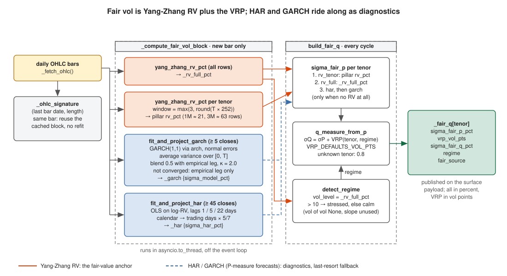

# Forecasting — realized vol, HAR, GARCH, and the variance risk premium

The desk never compares implied vol to realized vol directly — that mixes two
measures. Instead it estimates a **physical (P)** fair vol from price history,
then converts it to a **risk-neutral (Q)** fair vol by adding the variance risk
premium (VRP). This doc covers the four building blocks: the Yang-Zhang realized
estimator, the HAR-RV and GARCH forecasters, and the VRP that bridges P → Q.

All four are pure modules under `src/core/vol/`; the vol-engine
(`_compute_fair_vol_block`, `_attach_fair_vol`) fetches OHLC bars and calls them.

## Measure convention

The engine header states the rule explicitly:

- `rv_*` / `garch_*` / `har_*` → **P** (what has / will realize on average)
- `iv_*` / `sigma_fair_q_*` → **Q** (what options are priced to)
- Comparing P to Q directly is *economically incorrect* — always route through the
  VRP conversion first.

## 1. Yang-Zhang realized vol — the anchor

`yang_zhang_rv_pct(df_ohlc, window)`
([`core/vol/yang_zhang.py`](../../src/core/vol/yang_zhang.py)) is the
drift-independent, opening-jump-aware realized estimator. Over the trailing
`window` OHLC rows it combines overnight, open-close, and Rogers-Satchell terms:

```
σ²_YZ = σ²_overnight + k · σ²_open-close + (1 − k) · σ²_RS
k     = 0.34 / (1.34 + (n+1)/(n−1))
RV%   = sqrt(σ²_YZ · 252) · 100          # annualised, in vol points
```

It needs ≥ 3 rows (returns `None` otherwise). This is the **fair-value anchor**:
`fair_term` prefers Yang-Zhang RV over the forecasters because its OHLC-range
construction is less biased than a daily-`|return|` proxy.

The engine computes two flavours: full-sample `_rv_full_pct`, and a
**horizon-matched** RV per tenor over a window ≈ the tenor length in trading days
(`window = max(3, round(yfrac * 252))`, so 1M ≈ 21, 3M ≈ 63, 6M ≈ 126), stored as
`rv_pct` on each pillar.

## 2. HAR-RV — heterogeneous autoregression (Corsi 2009)

`fit_har_rv` / `project_horizon` ([`core/vol/har_rv.py`](../../src/core/vol/har_rv.py))
encode three time-scales of vol persistence — daily, weekly, monthly:

```
RV_{t+1} = β0 + β_d·RV_t + β_w·RV_t^(w) + β_m·RV_t^(m) + ε
RV_t^(w) = mean(RV over WEEKLY_LAG = 5 days)
RV_t^(m) = mean(RV over MONTHLY_LAG = 22 days)
```

Fit is plain OLS (`numpy.linalg.lstsq`) on **log-RV** — variance-stabilising and
keeps forecasts positive. It needs `MONTHLY_LAG + 20` clean closes. A horizon
forecast iterates the 1-step model in log-space and returns the mean daily σ over
the horizon (`fit_and_project_har` converts calendar days to trading days via
`5/7`). HAR-RV is a P-measure estimator — it carries no risk premium.

## 3. GARCH(1,1) — conditional-variance term structure

`fit_and_project_garch` ([`core/vol/garch.py`](../../src/core/vol/garch.py)) fits
a GARCH(1,1) with the `arch` library (`vol="Garch", p=1, q=1, mean="Constant",
dist="normal"`) on log-return percentages, then projects a mean-reverting term
structure. From the fitted `omega / alpha[1] / beta[1]`:

```
persistence = min(alpha + beta, 0.9999)
kappa       = −ln(persistence)
var_lr      = omega / (1 − persistence)          # long-run variance
var_T       = var_lr + (var_c − var_lr) · exp(−kappa·T)
```

It then **blends** the GARCH projection with an empirical mean-reversion leg
anchored on the full-sample RV (`blend=0.50`, `emp_kappa=2.0`):

```
vol_model = blend · vol_garch + (1 − blend) · vol_empirical
```

Returns `{tenor: {sigma_model_pct}}`, or an empty dict on insufficient data /
numerical divergence. GARCH is also P-measure.

## Input sanitising and non-convergence (#312)

* **Yang-Zhang**: rows with a non-finite or non-positive price, or a high below
  the low, are dropped; three valid rows are the floor; `k` uses the number of
  periods (`n - 1` for `n` rows), the textbook definition.
* **HAR**: the projection seeds from the last 22 finite, positive daily RVs
  (the old slice took the whole series and an unfiltered NaN poisoned the
  recursion); `fit_and_project_har` feeds the projection the same filtered
  closes the fit used.
* **GARCH**: only finite, positive closes; a constant series fits nothing;
  the optimiser's `convergence_flag` is honoured: on non-convergence the
  GARCH leg is dropped and the tenor carries the empirical mean-reversion leg
  alone, with `garch_converged: false` on every tenor. The term structure is
  the **average** variance over `[0, T]`,
  `var_lr + (var_c - var_lr)(1 - exp(-kT))/(kT)`, the quantity an option to
  `T` prices, not the instantaneous variance at `T`.

## 4. VRP — the P → Q bridge

`core.vol.vrp` ([`core/vol/vrp.py`](../../src/core/vol/vrp.py)) holds the variance
risk premium, tabulated per `(regime, tenor)` in `VRP_DEFAULTS_VOL_PTS` (positive
= the market pays a premium to sell vol, so IV ≳ RV):

| Regime | 1M | 3M | 6M |
|--------|----|----|----|
| calm | 0.6 | 0.8 | 1.1 |
| stressed | 1.5 | 1.8 | 2.1 |
| pre_event | 2.5 | 2.0 | 1.8 |

`q_measure_from_p` applies it: `σ_fair^Q = σ_fair^P + VRP(tenor, regime)`. The
tabulated defaults stand in until an empirical VRP (≥ 6 months of aligned IV/RV
history) is calibrated; an unknown tenor falls back to `0.8` with a warning.

## What feeds what

`fair_term.build_fair_q` ([`core/vol/fair_term.py`](../../src/core/vol/fair_term.py))
assembles the fair term structure per tenor:

1. `σ_fair^P` ← horizon-matched Yang-Zhang `rv_pct`, else full-sample `_rv_full_pct`,
   else HAR / GARCH as a last resort (`pick_sigma_fair_p`).
2. `regime` ← `detect_regime(vol_level_pct=_rv_full_pct, vol_of_vol_pct=None,
   term_slope_pct=slope)` (see [regime](regime.md)). The slope is passed but
   unused and the vol of vol is `None`, so here the regime is only ever `calm`
   or `stressed` (`_rv_full_pct > 10`); the `pre_event` VRP row is never
   selected by `build_fair_q`.
3. `σ_fair^Q = σ_fair^P + VRP(tenor, regime)`.



The OHLC block (both Yang-Zhang flavours, GARCH, HAR) is refitted only when a
new daily bar lands (`_ohlc_signature`), off the event loop; `build_fair_q`
runs every cycle on the cached block. The engine gates the fits on the number
of closes: GARCH from 5, HAR from 45.

Output per tenor: `{sigma_fair_p_pct, vrp_vol_pts, sigma_fair_q_pct, regime,
fair_source}`. HAR-RV and GARCH stay attached to the surface (`_har`, `_garch`)
as forward-looking **diagnostics** — their daily-`|return|` RV proxy biases the
level low versus Yang-Zhang, so they are deliberately not the fair anchor, only a
fallback when no RV at all is available.

## See also

- [Volatility surface](volatility-surface.md) — where `σ_fair^Q` becomes the fair smile
- [PCA signals](pca-signals.md) — rich/cheap read of IV vs fair value
- [Regime detection](regime.md) — selects the VRP bucket
