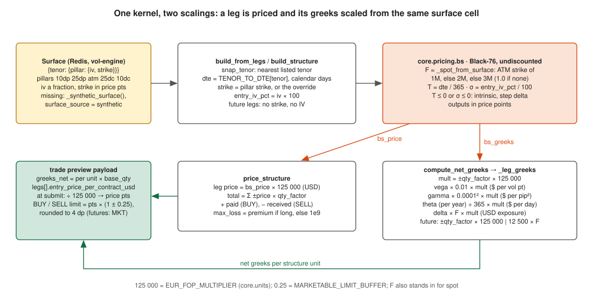

# Pricing kernel and conventions

One Black-Scholes kernel prices everything: `src/core/pricing/bs.py`. The trade
preview (`core/trade_preview.py`), the structures (`core/structures.py`), the
risk engine, the stress and ladder endpoints and the vectorised P&L curve
(`core/risk/greeks.py`) all call it or mirror it element for element (#331).
This page records the conventions and the one modelling decision the audit
asked to be written down (02#1 / QM-09).

## Inputs and outputs

| Symbol | Meaning | Unit |
|---|---|---|
| `F` | the forward: the CME EUR future's price (6E), or the ATM strike of the tenor on the published surface when no future mark exists | USD per EUR, price points |
| `K` | strike | price points |
| `T` | time to expiry | years, ACT/365 (`tenor_years("1M") = 30/365`, one map in `core/vol/tenors.py`) |
| `sigma` | implied volatility | fraction (`0.07`), never percent |
| `right` | `"C"` / `"P"` | the preview's `"call"` / `"put"` is mapped by its wrapper |

Outputs are plain Python floats in price points. Scaling to money is the
caller's job and is written in [units.md](units.md): `× qty × multiplier`
for premium, `/ 100` for vega per vol point, `/ 365` for the per-year theta
that `bs_greeks` returns (`bs_theta` alone is already per day).

In the trade preview, `F` is always `_spot_from_surface`: the ATM strike of
the 1M pillar, else 2M, else 3M (1.0 when the surface has none); the future
mark is not read on that path.

## The boundary

At `T <= 0` or `sigma <= 0` there is no diffusion left to price:

- price = intrinsic value (`max(F - K, 0)` for a call, `max(K - F, 0)` for a put);
- delta = the step (call 1 if `F > K` else 0; put −1 if `F < K` else 0);
- gamma, vega, theta, vanna, volga = 0.

Before #331 the kernel returned 0 for everything at the boundary, so a leg
on its expiry day priced at zero in the risk engine and the position pricer
while the preview priced it at intrinsic (QM-01, the two pricers disagreed).
`F <= 0` or `K <= 0` is not an option at all and prices 0 with zero greeks;
the vectorised pricer applies that per element so one bad forward in a
ladder zeroes that point instead of turning the whole curve into NaN (QM-14).

Put-call parity `C − P = F − K` holds through the boundary; the property
suite (`tests/unit/core/pricing/test_bs_properties.py`) checks it, the
no-arbitrage bounds, monotonicity in vol and time, delta bounds, and every
greek against a central finite difference of the price.

## Discounting: the decision

The kernel is **undiscounted Black-76 on the forward, with zero rates**. That
is exact for futures-style-margined options. CME EUR/USD FOPs (EUU) are
premium-paid-upfront, so the traded premium is approximately
`exp(−r_USD · T)` times the kernel's value: at 4 to 5 % USD rates the model
overprices a 3M option by about 1.1 to 1.3 % of premium and a 6M by 2.2 to
2.5 %, and an implied vol solved from a market premium carries the opposite
bias.

Decision (2026-11-07, #309): **keep the undiscounted convention** and do not
add `r_d` / `r_f` yet.

- Every consumer uses the same convention, so richness / cheapness, the
  surface z-scores, the attribution terms and the stress grids are
  internally consistent; a discount factor would scale both sides of every
  comparison.
- The bias is a known, slowly varying multiplier of the premium, far below
  the bid/ask and the IV uncertainty the desk works with on paper.
- Where the model meets IB's fills (`preview_price` vs `avg_fill_price`) the
  gap is reported, not hidden: the slippage column carries it.

What would reopen it: trading live size where the 1 to 2.5 % premium bias
is money, or quoting a market in premium terms. Then the kernel gains
`r_d`, `r_f` arguments (one discount factor on the price, forward unchanged)
and the rates come from a feed with a freshness contract like the surface.

## Related

- [units.md](units.md): the scaling of every greek and P&L term.
- [volatility-surface.md](volatility-surface.md): where `sigma` comes from.
- `docs/audits/reports/02-quant-models-findings.md`: QM-01, QM-09, QM-14.
