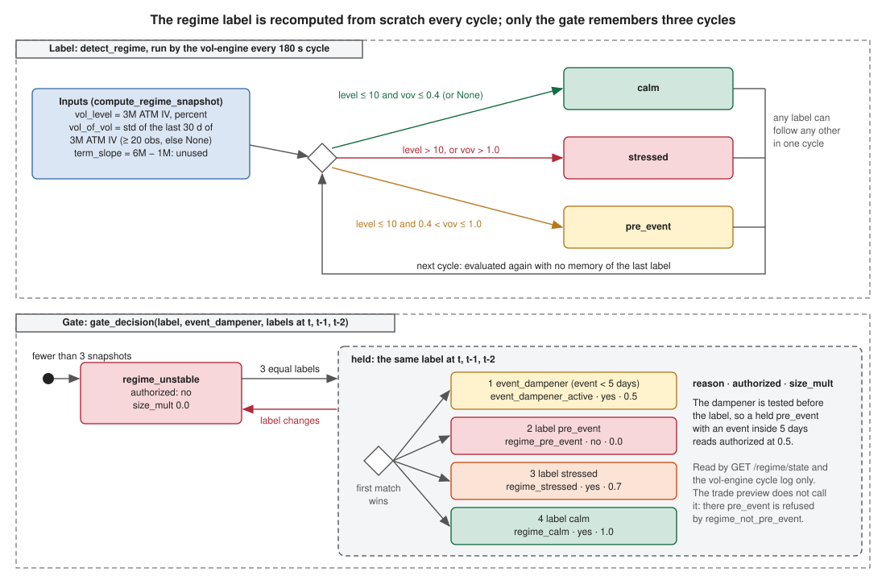

# Regime detection — GMM on [vol_of_vol, vol_level, term_slope]

Every signal the desk generates is gated by a market regime. Three regimes —
**calm**, **stressed**, **pre_event** — are inferred from three volatility
features, and the regime decides both *whether* a signal may trade and *how big*.
This doc covers the feature construction, the two classifiers (a threshold
heuristic in production and a shadow-mode GMM), and the gate that maps a regime to
a size multiplier.

Code: [`core/vol/gmm_regime.py`](../../src/core/vol/gmm_regime.py),
[`core/vol/regime_engine.py`](../../src/core/vol/regime_engine.py),
`detect_regime` in [`core/vol/vrp.py`](../../src/core/vol/vrp.py). The vol-engine
(`_compute_regime`, `_fit_and_infer_gmm`) supplies history and persists the
snapshot.

## 1. The three features

`compute_regime_snapshot` builds them from the surface + `feature_history`:

| Feature | Definition |
|---------|------------|
| `vol_level` | ATM IV at 3M (percent) |
| `vol_of_vol` | std of the last 30 days of 3M ATM IV from `feature_history` (needs ≥ 20 obs, else `None`) |
| `term_slope` | `iv_atm_6m − iv_atm_1m` (percent) |

Each feature is z-scored against a 90-day rolling history via
`compute_rolling_zscore`, which **refuses to score below `MIN_OBS_ZSCORE = 30`**
observations — with `N < 30` the sample σ̂ has > 50 % sampling variance and any
`|z| > 2` is trivially obtained, so the panel stays grey for the first ~90 minutes
of engine uptime rather than raising meaningless alerts.

## 2. Production classifier — the threshold heuristic

`detect_regime(vol_level_pct, vol_of_vol_pct, term_slope_pct)` is the **active**
classifier (`method = "threshold_heuristic"`):

```python
if vol_level_pct > 10.0:  return "stressed"   # sustained high IV
if vol_of_vol_pct > 1.0:  return "stressed"   # extreme jumpiness
if vol_of_vol_pct > 0.4:  return "pre_event"  # surface instability, no sustained level
return "calm"
```

`term_slope` is accepted but currently unused in classification (reserved for a
future term-structure regime). Any `None` feature is ignored; the default is
`calm`.

## 3. Shadow classifier — the 3-component GMM

`fit_gmm` / `infer_proba` fit a `sklearn.mixture.GaussianMixture` with
`n_components=3`, `covariance_type="full"`, `random_state=42`, and
`reg_covar=0.5` (a numerical-stability regulariser for the small-N,
tightly-clustered calm-only windows the desk trains on). It needs
`MIN_OBS_GMM = 50` observations.

Components are mapped to labels **deterministically** by sorting on mean
`vol_level` — lowest = calm, highest = stressed, middle = pre_event
(`_map_components_to_labels`) — so labels stay stable across re-fits.
`infer_proba` returns `(p_calm, p_stressed, p_pre_event)`.

The GMM runs in **shadow mode**: its probabilities are persisted to
`regime_snapshots.p_calm/p_stressed/p_pre_event` for offline backtest comparison,
but the live `_regime` payload keeps `probabilities: None` and the label is always
the threshold heuristic. Rationale: with a calm-only training window the GMM
components do not correspond to real regimes — the mapping is mathematically
defined but semantically empty until the data spans a traversed event. In the
engine the GMM fits on just 2 features (`vol_level`, `vol_of_vol`) because
`term_slope` is mostly NULL during bootstrap.

### Standardised features (#314)

The three features live on different scales (vol level in percent points,
vol-of-vol and term slope much smaller), and the old `reg_covar = 0.5` on raw
units swamped the two small ones. `fit_gmm` now standardises each column
(mean / std, a constant column keeps std 1) before the fit, with
`reg_covar = 1e-3` on the z-scores; the scale travels with the serialised
model so the vol engine standardises the live observation the same way. A
model published before this change carries no scale and is evaluated in raw
units until the next refit.

## 4. The gate — regime to size multiplier

`gate_decision(label, event_dampener, history_labels)` is the final authorization,
and it enforces **stability first**:

```python
recent = history_labels[:STABILITY_CYCLES]        # last 3 labels
if len(recent) < 3 or any(x != label for x in recent):
    return (False, "regime_unstable", 0.0)        # regime must hold 3 cycles
if event_dampener:  return (True,  "event_dampener_active", 0.5)
if label == "pre_event": return (False, "regime_pre_event", 0.0)
if label == "stressed":  return (True,  "regime_stressed",  0.7)
if label == "calm":      return (True,  "regime_calm",      1.0)
```

The rules are tested in that order, so the event dampener wins over the label:
a held `pre_event` label with an event inside 5 days returns
`(True, "event_dampener_active", 0.5)`. The decision table is:

| Condition | Authorized | size_mult |
|-----------|-----------|-----------|
| regime changed within last 3 cycles | no | 0.0 |
| event dampener active | yes | 0.5 |
| pre_event | no | 0.0 |
| stressed | yes | 0.7 |
| calm | yes | 1.0 |



The label itself has no memory: `detect_regime` runs on each vol-engine cycle
(180 s) and any label can follow any other. The three-cycle memory lives in
`gate_decision`, which reads the current label plus the two before it. Its
result is served by `GET /regime/state` and logged by the vol engine; the
trade preview does not call it (it refuses `pre_event` through its own
`regime_not_pre_event` check and scales its limits with
`apply_regime_to_limits`).

## 5. Event dampener

When a high-impact EU/US macro event (from the events pipeline) is closer than
`EVENT_DAMPENER_DAYS = 5`, `event_dampener` is set. It halves sizing (`0.5`) even
in a calm regime — the desk trims exposure into scheduled volatility rather than
blocking outright.

## How regime gates the desk

- **Sizing** — the gate `size_mult` is published for the desk; the trade
  preview does not apply it (see the gate section above).
- **Fair value** — `detect_regime` also selects the [VRP bucket](forecasting.md)
  in `build_fair_q`, so the regime shifts the fair smile itself (a stressed regime
  widens the expected IV−RV premium).
- **Persistence** — the 3-cycle stability rule means a single anomalous cycle
  never flips the published gate into or out of authorization (the label
  shown next to it can still change every cycle).

## See also

- [PCA signals](pca-signals.md) — signals the gate authorizes and sizes
- [Forecasting](forecasting.md) — the VRP table the regime indexes
- [Volatility surface](volatility-surface.md) — source of the ATM IV features
